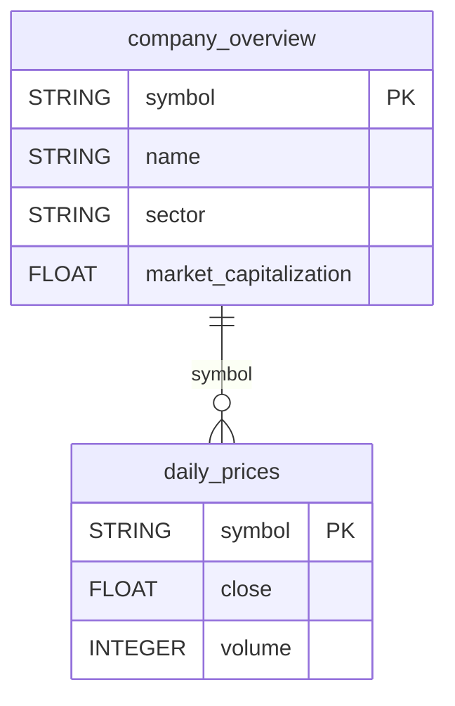

# Alpha Vantage


Sync Alpha Vantage stock market data (daily prices and company fundamentals) for the ticker symbols you choose into your warehouse.


***

## Prerequisites

* An Alpha Vantage **premium** API key: Daily Prices fetches the full price history, which Alpha Vantage reserves for premium keys.
* The list of stock ticker symbols to track.

***

## Authentication

The connector uses an **API key**. Paste your Alpha Vantage API key in the setup screen, together with the stock symbols to track.

***

## Setup Instructions



**Enter your API key and symbols**

Paste your **Alpha Vantage API Key** and enter the **Stock Symbols** to track, comma-separated (e.g. `IBM,AAPL,MSFT`).



**Choose your reports**

Select the reports to sync.



***

## Data Model

***

## Available Reports

### Daily Prices

Daily open, high, low, close and volume, one row per symbol per day.

#### Dimensions

| Column | Type | Description |
|---|---|---|
| `symbol` | STRING | Stock ticker symbol (e.g. IBM, AAPL) (primary key) |

#### Metrics

| Column | Type | Description |
|---|---|---|
| `open` | FLOAT | Daily opening price |
| `high` | FLOAT | Daily highest price |
| `low` | FLOAT | Daily lowest price |
| `close` | FLOAT | Daily closing price |
| `volume` | INTEGER | Daily trading volume (number of shares traded) |

### Company Overview

Company fundamentals, one row per symbol: sector, market cap, valuation ratios, dividends and analyst target price.

#### Dimensions

| Column | Type | Description |
|---|---|---|
| `symbol` | STRING | Stock ticker symbol (primary key) |
| `name` | STRING | Company name |
| `exchange` | STRING | Stock exchange (NYSE, NASDAQ, etc.) |
| `currency` | STRING | Trading currency (USD, EUR, etc.) |
| `country` | STRING | Country of incorporation |
| `sector` | STRING | Industry sector (TECHNOLOGY, FINANCE, etc.) |
| `industry` | STRING | Specific industry within the sector |

#### Metrics

| Column | Type | Description |
|---|---|---|
| `market_capitalization` | FLOAT | Total market capitalization in USD |
| `pe_ratio` | FLOAT | Trailing price-to-earnings ratio |
| `eps` | FLOAT | Earnings per share (TTM) |
| `dividend_yield` | FLOAT | Annual dividend yield (decimal, e.g. 0.03 = 3%) |
| `beta` | FLOAT | Market beta (volatility relative to market index) |
| `week_52_high` | FLOAT | 52-week highest price |
| `week_52_low` | FLOAT | 52-week lowest price |
| `moving_avg_50d` | FLOAT | 50-day moving average price |
| `moving_avg_200d` | FLOAT | 200-day moving average price |
| `analyst_target_price` | FLOAT | Consensus analyst 12-month target price |
| `shares_outstanding` | FLOAT | Number of shares outstanding |
| `revenue_ttm` | FLOAT | Total revenue (trailing twelve months) in USD |
| `profit_margin` | FLOAT | Net profit margin (decimal, e.g. 0.12 = 12%) |

***

## Scheduling

| Setting | Default | Options |
|---|---|---|
| **Frequency** | Daily | Daily, Weekly |
| **Sync time** | 4:00 AM | — |
| **Lookback window** | 3 days | 1, 3, 5 days |
| **Historical load** | Up to 20 years | 3 months, 12 months, 3 years or custom dates |

***

## Notes

* Each symbol consumes one API call per selected report per sync (up to two calls per symbol).
* Daily reports have no date column of their own: the reporting day is stored in the `_quanti_date` column added by QUANTI:.
