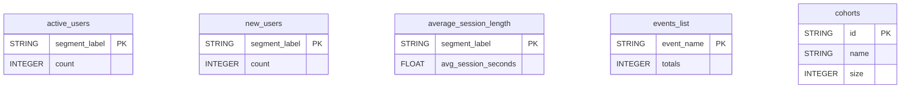

# Amplitude


Sync your Amplitude product analytics (active users, new users, session length, events and cohorts) into your warehouse.


***

## Prerequisites

* An Amplitude project.
* The project's **API Key** and **Secret Key**.

***

## Authentication

The connector uses your project's **API Key** and **Secret Key**. Find both in **Amplitude > Settings > Projects > [your project] > General** and paste them in the setup screen.

***

## Setup Instructions



**Enter your keys**

Paste your Amplitude **API Key** and **Secret Key**.



**Choose your reports**

Select the reports to sync.



***

## Data Model

***

## Available Reports

### Active Users

Daily number of active users, one row per segment per day.

#### Dimensions

| Column | Type | Description |
|---|---|---|
| `segment_label` | STRING | Segment label (defaults to 'All Users' when no grouping is applied) (primary key) |

#### Metrics

| Column | Type | Description |
|---|---|---|
| `count` | INTEGER | Number of active users |

### New Users

Daily number of new users, one row per segment per day.

#### Dimensions

| Column | Type | Description |
|---|---|---|
| `segment_label` | STRING | Segment label (defaults to 'All Users' when no grouping is applied) (primary key) |

#### Metrics

| Column | Type | Description |
|---|---|---|
| `count` | INTEGER | Number of new users |

### Average Session Length

Daily average session length in seconds, one row per segment per day.

#### Dimensions

| Column | Type | Description |
|---|---|---|
| `segment_label` | STRING | Segment label (defaults to 'All Users' when no grouping is applied) (primary key) |

#### Metrics

| Column | Type | Description |
|---|---|---|
| `avg_session_seconds` | FLOAT | Average session length in seconds |

### Events List

One row per tracked event, with its metadata and total count.

#### Dimensions

| Column | Type | Description |
|---|---|---|
| `event_name` | STRING | Event type name (e.g. 'AddedToCart') (primary key) |
| `hidden` | BOOLEAN | Whether the event is hidden from charts |
| `deleted` | BOOLEAN | Whether the event has been deleted |
| `non_active` | BOOLEAN | Whether the event is considered non-active |
| `flow_hidden` | BOOLEAN | Whether the event is hidden from the user flows chart |
| `display_name` | STRING | Display name override for the event |

#### Metrics

| Column | Type | Description |
|---|---|---|
| `totals` | INTEGER | Total number of times this event has been triggered |

### Cohorts

One row per behavioral cohort defined in Amplitude.

#### Dimensions

| Column | Type | Description |
|---|---|---|
| `id` | STRING | Unique identifier of the cohort (primary key) |
| `name` | STRING | Display name of the cohort |
| `cohort_type` | STRING | Type of the cohort (e.g. 'custom', 'predictive') |
| `created_at` | INTEGER | Unix timestamp (ms) when the cohort was created |
| `last_mod` | INTEGER | Unix timestamp (ms) when the cohort was last modified |
| `last_computed` | INTEGER | Unix timestamp (ms) when the cohort was last computed |

#### Metrics

| Column | Type | Description |
|---|---|---|
| `size` | INTEGER | Number of users in the cohort |

***

## Scheduling

| Setting | Default | Options |
|---|---|---|
| **Frequency** | Daily | Daily, Weekly |
| **Sync time** | 4:00 AM | — |
| **Lookback window** | 3 days | 1, 3, 7 days |
| **Historical load** | Up to 1 year | 3 months, 6 months, 12 months or custom dates |

***

## Notes

* In `cohorts`, `created_at`, `last_mod` and `last_computed` are Unix timestamps in milliseconds.
* Daily reports have no date column of their own: the reporting day is stored in the `_quanti_date` column added by QUANTI:.
