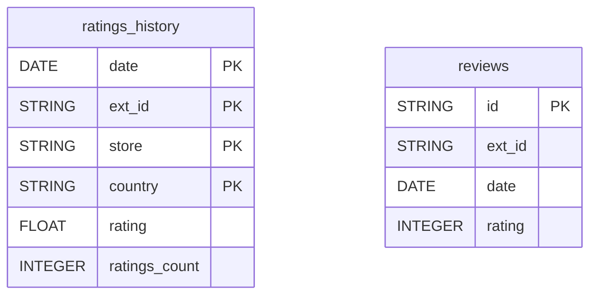

# AppFollow


Sync the app store reviews and daily rating history of your mobile app from AppFollow into your warehouse.


***

## Prerequisites

* An AppFollow account with the **Owner** or **Admin** role (only they can create API tokens).
* The external ID of your app: Apple App Store numeric ID or Google Play package name.

***

## Authentication

The connector uses an **API token**. Generate it on the **API Dashboard** (API management page) of your AppFollow account and paste it in the setup screen, together with your app's external ID.

***

## Setup Instructions



**Enter your token and app**

Paste your **AppFollow API Token** and enter the **App External ID** (e.g. `284882215` or `com.example.app`). You find it in the app store URL or in AppFollow under the app details.



**Choose your reports**

Select the reports to sync.



***

## Data Model

***

## Available Reports

### Reviews

One row per app store review, with its rating, content and metadata.

#### Dimensions

| Column | Type | Description |
|---|---|---|
| `id` | STRING | Internal AppFollow review identifier (primary key) |
| `review_id` | STRING | Store-native review identifier |
| `ext_id` | STRING | External app store identifier |
| `app_id` | INTEGER | Internal AppFollow app identifier |
| `date` | DATE | Review publication date in the store |
| `title` | STRING | Review headline title |
| `content` | STRING | Full review text content |
| `author` | STRING | Reviewer display name |
| `user_id` | STRING | Store-provided user identifier |
| `store` | STRING | App store where the review was posted (as/gp/ms/am/mc) |
| `app_version` | STRING | App version the reviewer was using |
| `locale` | STRING | Two-letter country code of the reviewer |
| `is_answer` | BOOLEAN | True if developer has replied to this review |
| `was_changed` | BOOLEAN | True if the review has been edited by the user |
| `created` | TIMESTAMP | Timestamp when AppFollow collected this review |
| `updated` | TIMESTAMP | Timestamp of the last update to this review |

#### Metrics

| Column | Type | Description |
|---|---|---|
| `rating` | INTEGER | Star rating given by the reviewer (1-5) |
| `rating_prev` | INTEGER | Previous rating before the review was edited |

### Ratings History

Daily rating history, one row per day, app, store and country.

#### Dimensions

| Column | Type | Description |
|---|---|---|
| `date` | DATE | Date of the rating snapshot (primary key) |
| `ext_id` | STRING | External app store identifier (primary key) |
| `store` | STRING | App store platform (as/gp/ms/am/mc) (primary key) |
| `country` | STRING | Two-letter country code for the store market (primary key) |

#### Metrics

| Column | Type | Description |
|---|---|---|
| `rating` | FLOAT | Average app rating for the day |
| `ratings_count` | INTEGER | Number of new ratings received on the day |

***

## Scheduling

| Setting | Default | Options |
|---|---|---|
| **Frequency** | Daily | Daily, Weekly |
| **Sync time** | 4:00 AM | — |
| **Lookback window** | 3 days | 1, 3, 7 days |
| **Historical load** | Up to 1 year | 3 months, 6 months, 12 months or custom dates |

***

## Notes

* One connector syncs one app: the one whose external ID you enter at setup.
* Store codes: `as`, `gp`, `ms`, `am`, `mc`.
