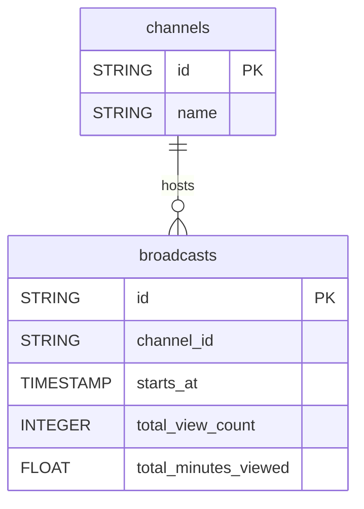

# BoxCast


Sync your BoxCast live streaming data (broadcasts with view metrics, channels) into your warehouse for broadcast performance analysis.


***

## Prerequisites

* A **Client ID** and **Client Secret**, obtained by registering an API client application with BoxCast customer support.

***

## Authentication

The connector uses **OAuth 2.0 client credentials**: your Client ID and Client Secret are used to request an access token.

***

## Setup Instructions



**Register an API client**

Contact BoxCast customer support to register an API client and receive a Client ID and Client Secret.



**Enter your credentials**

Enter your **Client ID** and **Client Secret**.



**Choose your reports**

Choose the reports to sync.



***

## Data Model

***

## Available Reports

### Broadcasts

Daily snapshot of all broadcasts with cumulative view metrics.

#### Dimensions

| Column | Type | Description |
|---|---|---|
| `id` | STRING | Unique broadcast identifier (primary key) |
| `name` | STRING | Broadcast title |
| `channel_id` | STRING | ID of the channel this broadcast belongs to |
| `stream_source` | STRING | Source of the broadcast stream (e.g. rtmp, upload) |
| `boxcaster_id` | STRING | ID of the encoder (BoxCaster) used for the broadcast |
| `boxcaster_name` | STRING | Name of the encoder used for the broadcast |
| `starts_at` | TIMESTAMP | Scheduled or actual start time of the broadcast (ISO 8601) |
| `stops_at` | TIMESTAMP | Scheduled or actual end time of the broadcast (ISO 8601) |
| `timeframe` | STRING | Temporal status of the broadcast: past, future, or current |
| `is_private` | BOOLEAN | Whether the broadcast is private (not publicly listed) |
| `is_ticketed` | BOOLEAN | Whether the broadcast requires a ticket to view |
| `ticket_price` | FLOAT | Price of the ticket in account currency (0 if free) |
| `viewer_url` | STRING | Public URL where viewers can watch the broadcast |

#### Metrics

| Column | Type | Description |
|---|---|---|
| `total_view_count` | INTEGER | Total number of views (live + recorded) since broadcast creation |
| `total_minutes_viewed` | FLOAT | Total viewing time in minutes across all viewers |
| `total_active_viewer_count` | INTEGER | Peak number of concurrent active viewers during the broadcast |

### Channels

List of channels with their configuration.

| Column | Type | Description |
|---|---|---|
| `id` | STRING | Unique channel identifier (primary key) |
| `name` | STRING | Channel display name |
| `description` | STRING | Channel description text |
| `is_ticketed` | BOOLEAN | Whether the channel requires a ticket for access |
| `ticket_price` | FLOAT | Ticket price for channel access in account currency |
| `static_playlist_url` | STRING | Static HLS playlist URL for the channel |

***

## Scheduling

| Setting | Default | Options |
|---|---|---|
| **Frequency** | Daily | Daily, Weekly |
| **Sync time** | 3:00 AM | — |
| **Lookback window** | Not available | — |
| **Historical load** | Not available | — |

***

## Notes

* Broadcasts is a snapshot loaded in append mode: each sync adds one row per broadcast with its cumulative view metrics at sync time. Do not sum metrics across syncs.
