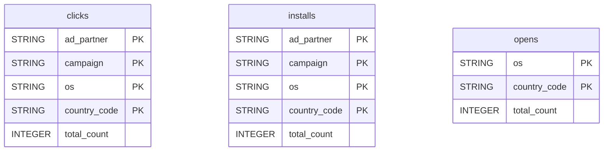

# Branch


Sync your Branch mobile attribution data (daily clicks, installs and app opens) into your warehouse for campaign performance, install and engagement analysis.


***

## Prerequisites

* A Branch user with the **Aggregate Data** access level.

***

## Authentication

The connector uses an **Access Token** and your numeric **App ID** to read the analytics data export APIs. The setup screen also asks for your **Branch Key** and **Branch Secret**.

***

## Setup Instructions



**Enter your Branch credentials**

Enter your **Branch Key** and **Branch Secret** (Branch Dashboard > **Account Settings > Profile**), and your **Access Token** (**Configuration > Security & Access > Credentials**).



**Enter your App ID**

Enter the numeric **App ID** of your application, found in **Settings > Profile > About your app**.



**Choose your reports**

Choose the reports to enable.



***

## Data Model

***

## Available Reports

### Clicks

Daily clicks grouped by ad partner, campaign, OS and country.

#### Dimensions

| Column | Type | Description |
|---|---|---|
| `ad_partner` | STRING | Advertising partner / network name, e.g. Facebook Ads, Google Ads (primary key) |
| `campaign` | STRING | Campaign name as reported by the ad network (primary key) |
| `os` | STRING | Operating system of the device, IOS or ANDROID (primary key) |
| `country_code` | STRING | ISO 3166-1 alpha-2 country code of the user (primary key) |

#### Metrics

| Column | Type | Description |
|---|---|---|
| `total_count` | INTEGER | Total number of clicks for this dimension combination |

### Installs

Daily attributed installs grouped by ad partner, campaign, OS and country.

#### Dimensions

| Column | Type | Description |
|---|---|---|
| `ad_partner` | STRING | Advertising partner / network name, e.g. Facebook Ads, Google Ads (primary key) |
| `campaign` | STRING | Campaign name as reported by the ad network (primary key) |
| `os` | STRING | Operating system of the device, IOS or ANDROID (primary key) |
| `country_code` | STRING | ISO 3166-1 alpha-2 country code of the user (primary key) |

#### Metrics

| Column | Type | Description |
|---|---|---|
| `total_count` | INTEGER | Total number of attributed installs for this dimension combination |

### App Opens

Daily app opens grouped by OS and country.

#### Dimensions

| Column | Type | Description |
|---|---|---|
| `os` | STRING | Operating system of the device, IOS or ANDROID (primary key) |
| `country_code` | STRING | ISO 3166-1 alpha-2 country code of the user (primary key) |

#### Metrics

| Column | Type | Description |
|---|---|---|
| `total_count` | INTEGER | Total number of app opens for this dimension combination |

***

## Scheduling

| Setting | Default | Options |
|---|---|---|
| **Frequency** | Daily | Daily, Weekly |
| **Sync time** | 6:00 AM | — |
| **Lookback window** | 3 days | 1, 3, 7 days |
| **Historical load** | Up to 365 days | 3, 6, 12 months or custom dates |

***

## Notes

* The three reports are daily aggregates: they contain counts, not individual events.
