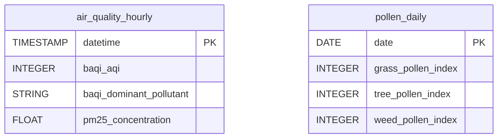

# BreezoMeter


Sync BreezoMeter air quality and pollen data for a given geographic location into your warehouse.


***

## Prerequisites

* A BreezoMeter API key.
* The latitude and longitude of the location to monitor.

***

## Authentication

The connector uses an **API key**, sent as a query parameter on every request.

***

## Setup Instructions



**Enter the API key and the location**

Enter the **API Key**, then the **Latitude** and **Longitude** of the location to monitor (e.g. `48.8566` and `2.3522` for Paris).



**Choose your reports**

Choose the reports to sync.



***

## Data Model

***

## Available Reports

### Air Quality (Hourly)

Hourly historical air quality data including AQI, pollutant concentrations and health recommendations for the configured location.

#### Dimensions

| Column | Type | Description |
|---|---|---|
| `datetime` | TIMESTAMP | Hour timestamp, UTC ISO 8601 (primary key) |
| `data_available` | BOOLEAN | Whether data is available for this hour |
| `baqi_category` | STRING | Air quality category (e.g. Good air quality) |
| `baqi_dominant_pollutant` | STRING | Dominant pollutant code (e.g. pm25, o3) |
| `pm25_units` | STRING | PM2.5 concentration units (ug/m3 or ppb) |
| `pm10_units` | STRING | PM10 concentration units |
| `o3_units` | STRING | Ozone (O3) concentration units |
| `no2_units` | STRING | NO2 concentration units |
| `co_units` | STRING | CO concentration units |
| `so2_units` | STRING | SO2 concentration units |
| `rec_general_population` | STRING | Health recommendation for the general population |
| `rec_elderly` | STRING | Health recommendation for elderly |
| `rec_lung_diseases` | STRING | Health recommendation for people with lung diseases |
| `rec_heart_diseases` | STRING | Health recommendation for people with heart diseases |
| `rec_active` | STRING | Health recommendation for active people |
| `rec_pregnant_women` | STRING | Health recommendation for pregnant women |
| `rec_children` | STRING | Health recommendation for children |

#### Metrics

| Column | Type | Description |
|---|---|---|
| `baqi_aqi` | INTEGER | BreezoMeter Air Quality Index (0-100, higher is better) |
| `pm25_concentration` | FLOAT | PM2.5 concentration value |
| `pm10_concentration` | FLOAT | PM10 concentration value |
| `o3_concentration` | FLOAT | Ozone (O3) concentration value |
| `no2_concentration` | FLOAT | Nitrogen dioxide (NO2) concentration value |
| `co_concentration` | FLOAT | Carbon monoxide (CO) concentration value |
| `so2_concentration` | FLOAT | Sulfur dioxide (SO2) concentration value |

### Pollen (Daily Forecast)

Daily pollen forecast (up to 5 days) for grass, tree and weed pollen at the configured location.

#### Dimensions

| Column | Type | Description |
|---|---|---|
| `date` | DATE | Forecast date (primary key) |
| `grass_pollen_category` | STRING | Grass pollen risk category (e.g. Low, Moderate, High) |
| `grass_pollen_in_season` | BOOLEAN | Whether grass pollen is in season |
| `grass_pollen_data_available` | BOOLEAN | Whether grass pollen data is available |
| `tree_pollen_category` | STRING | Tree pollen risk category |
| `tree_pollen_in_season` | BOOLEAN | Whether tree pollen is in season |
| `tree_pollen_data_available` | BOOLEAN | Whether tree pollen data is available |
| `weed_pollen_category` | STRING | Weed pollen risk category |
| `weed_pollen_in_season` | BOOLEAN | Whether weed pollen is in season |
| `weed_pollen_data_available` | BOOLEAN | Whether weed pollen data is available |

#### Metrics

| Column | Type | Description |
|---|---|---|
| `grass_pollen_index` | INTEGER | Grass pollen index value (0-100) |
| `tree_pollen_index` | INTEGER | Tree pollen index value (0-100) |
| `weed_pollen_index` | INTEGER | Weed pollen index value (0-100) |

***

## Scheduling

| Setting | Default | Options |
|---|---|---|
| **Frequency** | Daily | Daily, Weekly |
| **Sync time** | 3:00 AM | — |
| **Lookback window** | 2 days | 1, 2, 3 days |
| **Historical load** | Up to 30 days | 7, 14, 30 days or custom dates |

***

## Notes

* Each connector monitors a single location: the latitude/longitude pair entered at setup.
* Pollen is a forecast loaded in append mode: the same date can appear in several syncs, with updated values.
