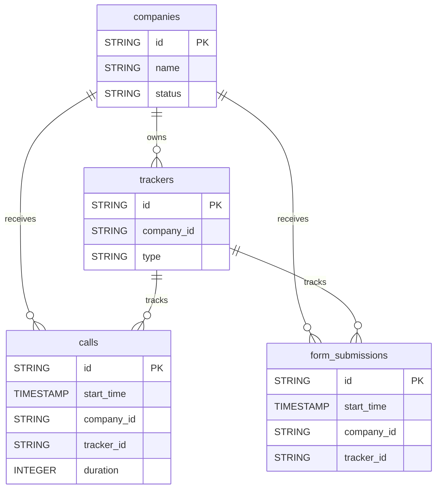

# CallRail


Sync your CallRail call tracking data (calls, form submissions, companies, trackers) into your warehouse for marketing attribution and lead analysis.


***

## Prerequisites

* A CallRail account with access to **Integrations > API Keys**.
* Your CallRail **Account ID**: the nine-digit number after `/a/` in your CallRail dashboard URL.

***

## Authentication

The connector uses an **API key**, sent in the Authorization header of every request, together with your Account ID.

***

## Setup Instructions



**Generate an API key**

In CallRail, select **Integrations** in the left navigation, then **Data Access > API Keys**, and click **Create New API v3 Key**. The key is shown only once.



**Enter your API key and Account ID**

Enter the **API Key** and your **Account ID** (the nine-digit number after `/a/` in your CallRail dashboard URL).



**Choose your reports**

Choose the reports to sync.



***

## Data Model

***

## Available Reports

### Calls

Daily inbound and outbound call records with attribution, duration and customer details.

#### Dimensions

| Column | Type | Description |
|---|---|---|
| `id` | STRING | Unique call identifier, prefix CAL (primary key) |
| `answered` | BOOLEAN | Whether the call was answered |
| `direction` | STRING | Call direction: inbound or outbound |
| `start_time` | TIMESTAMP | Call start timestamp (ISO 8601 with timezone) |
| `customer_name` | STRING | Caller ID name |
| `customer_phone_number` | STRING | Caller phone number in E.164 format |
| `customer_city` | STRING | Caller city from phone number geolocation |
| `customer_state` | STRING | Caller state (2-character abbreviation) |
| `customer_country` | STRING | Caller country code |
| `tracking_phone_number` | STRING | Tracking phone number that received the call (E.164) |
| `business_phone_number` | STRING | Business phone number that answered the call (E.164) |
| `voicemail` | BOOLEAN | Whether the call ended in voicemail |
| `recording_duration` | STRING | Recording duration in seconds (string, may be null) |
| `source` | STRING | Traffic source category that generated the call |
| `source_name` | STRING | Name of the tracking source (e.g. Google Ads, Organic Search) |
| `campaign` | STRING | Campaign name associated with the call |
| `keywords` | STRING | Search keywords that triggered the call |
| `lead_status` | STRING | Lead qualification status (good_lead, not_a_lead, not_scored) |
| `tracker_id` | STRING | ID of the tracking number, prefix TRK |
| `company_id` | STRING | ID of the company associated with the call, prefix COM |
| `first_call` | BOOLEAN | Whether this is the caller's first call to this number |

#### Metrics

| Column | Type | Description |
|---|---|---|
| `duration` | INTEGER | Call duration in seconds |

### Form Submissions

Daily form submission records with attribution and customer details.

| Column | Type | Description |
|---|---|---|
| `id` | STRING | Unique form submission identifier (primary key) |
| `company_id` | STRING | ID of the company associated with the form submission, prefix COM |
| `company_name` | STRING | Name of the associated company |
| `start_time` | TIMESTAMP | Form submission timestamp (ISO 8601 with timezone) |
| `customer_name` | STRING | Submitter name |
| `customer_phone_number` | STRING | Submitter phone number in E.164 format |
| `customer_city` | STRING | Submitter city |
| `customer_state` | STRING | Submitter state (2-character abbreviation) |
| `customer_country` | STRING | Submitter country code |
| `tracking_phone_number` | STRING | Tracking phone number associated with the form (E.164) |
| `landing_page_url` | STRING | URL of the page where the form appeared |
| `source_name` | STRING | Name of the tracking source (e.g. Google Ads, Organic Search) |
| `source` | STRING | Traffic source category that generated the form submission |
| `campaign` | STRING | Campaign name associated with the form submission |
| `keywords` | STRING | Search keywords that triggered the form submission |
| `lead_status` | STRING | Lead qualification status (good_lead, not_a_lead, not_scored) |
| `utm_source` | STRING | UTM source parameter from the form submission URL |
| `utm_medium` | STRING | UTM medium parameter from the form submission URL |
| `utm_campaign` | STRING | UTM campaign parameter from the form submission URL |
| `tracker_id` | STRING | ID of the tracking number associated with the form, prefix TRK |

### Companies

Companies (sub-accounts) within the CallRail account.

| Column | Type | Description |
|---|---|---|
| `id` | STRING | Unique company identifier, prefix COM (primary key) |
| `name` | STRING | Company name |
| `status` | STRING | Company status (active, disabled) |
| `created_at` | TIMESTAMP | Company creation timestamp (ISO 8601) |
| `disabled_at` | TIMESTAMP | Timestamp when the company was disabled (ISO 8601), null if active |

### Trackers

Call tracking numbers (source and session trackers) configured in the account.

| Column | Type | Description |
|---|---|---|
| `id` | STRING | Unique tracker identifier, prefix TRK (primary key) |
| `name` | STRING | Tracker name |
| `type` | STRING | Tracker type: source (static) or session (dynamic pool) |
| `status` | STRING | Tracker status (active, disabled) |
| `company_id` | STRING | ID of the company this tracker belongs to, prefix COM |
| `company_name` | STRING | Name of the company this tracker belongs to |
| `source_name` | STRING | Name of the tracking source associated with this tracker |
| `created_at` | TIMESTAMP | Tracker creation timestamp (ISO 8601) |

***

## Scheduling

| Setting | Default | Options |
|---|---|---|
| **Frequency** | Daily | Daily, Weekly |
| **Sync time** | 3:00 AM | — |
| **Lookback window** | 5 days | 1, 3, 5 days |
| **Historical load** | Up to 365 days | 3, 6, 12 months or custom dates |

***

## Notes

* `recording_duration` is stored as text (STRING), unlike `duration`.
