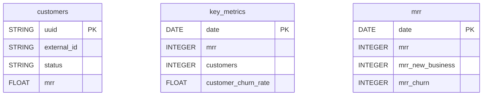

# ChartMogul


Sync your ChartMogul subscription analytics (MRR, ARR, churn, LTV, customers) into your warehouse.


***

## Prerequisites

* A **ChartMogul** account with access to **Profile > View Profile > API Keys**.

***

## Authentication

The connector uses an **API key**, created in ChartMogul under **Profile > View Profile > API Keys**.

***

## Setup Instructions



**Create an API key**

In ChartMogul, go to **Profile > View Profile > API Keys** and click **Add API Key**.



**Enter your API key**

Enter the **ChartMogul API Key**.



**Choose your reports**

Choose the reports to sync: customers, key metrics and MRR breakdown.



**Name your connector**

Give the connector a name, then click **Create**.



***

## Data Model

***

## Available Reports

### Customers

Current state of all customers with their subscription status, location and MRR.

#### Dimensions

| Column | Type | Description |
|---|---|---|
| `uuid` | STRING | ChartMogul customer UUID (primary key) |
| `external_id` | STRING | External ID from the billing system |
| `name` | STRING | Customer display name |
| `email` | STRING | Customer email address |
| `company` | STRING | Company name |
| `status` | STRING | Subscription status (Active, Cancelled, Past_Due, etc.) |
| `lead_status` | STRING | Lead status (New_Lead, Qualified_Lead, etc.) |
| `customer_since` | TIMESTAMP | Date when the customer became a paying customer |
| `currency` | STRING | Account currency code |
| `billing_system_type` | STRING | Billing system type (Stripe, Recurly, Custom, etc.) |
| `country` | STRING | Customer country code (ISO 3166-1 Alpha-2) |
| `city` | STRING | Customer city |
| `last_seen` | TIMESTAMP | Last seen date in ChartMogul |
| `data_source_uuid` | STRING | UUID of the data source (billing system integration) |

#### Metrics

| Column | Type | Description |
|---|---|---|
| `mrr` | FLOAT | Current Monthly Recurring Revenue in account currency |
| `arr` | FLOAT | Current Annual Recurring Revenue in account currency |

### Key Metrics

All key subscription metrics per day: MRR, ARR, churn rate, LTV, customers, ASP, ARPA.

#### Dimensions

| Column | Type | Description |
|---|---|---|
| `date` | DATE | End of the interval date (primary key) |

#### Metrics

| Column | Type | Description |
|---|---|---|
| `mrr` | INTEGER | Monthly Recurring Revenue in cents |
| `mrr_percentage_change` | FLOAT | MRR percentage change vs previous interval |
| `arr` | INTEGER | Annual Recurring Revenue in cents |
| `arr_percentage_change` | FLOAT | ARR percentage change vs previous interval |
| `customer_churn_rate` | FLOAT | Customer churn rate as a percentage |
| `customer_churn_rate_percentage_change` | FLOAT | Customer churn rate percentage change vs previous interval |
| `mrr_churn_rate` | FLOAT | Net MRR churn rate as a percentage |
| `mrr_churn_rate_percentage_change` | FLOAT | Net MRR churn rate percentage change vs previous interval |
| `ltv` | INTEGER | Lifetime Value in cents |
| `ltv_percentage_change` | FLOAT | LTV percentage change vs previous interval |
| `customers` | INTEGER | Number of active customers at end of interval |
| `customers_percentage_change` | FLOAT | Customers count percentage change vs previous interval |
| `asp` | INTEGER | Average Sale Price in cents |
| `asp_percentage_change` | FLOAT | ASP percentage change vs previous interval |
| `arpa` | INTEGER | Average Revenue Per Account in cents |
| `arpa_percentage_change` | FLOAT | ARPA percentage change vs previous interval |

### MRR

Daily MRR breakdown: new business, expansion, contraction, churn, reactivation.

#### Dimensions

| Column | Type | Description |
|---|---|---|
| `date` | DATE | End of the interval date (primary key) |

#### Metrics

| Column | Type | Description |
|---|---|---|
| `mrr` | INTEGER | Monthly Recurring Revenue in cents |
| `percentage_change` | FLOAT | MRR percentage change vs previous interval |
| `mrr_new_business` | INTEGER | New business MRR in cents |
| `mrr_expansion` | INTEGER | Expansion MRR in cents (upgrades) |
| `mrr_contraction` | INTEGER | Contraction MRR in cents (downgrades) |
| `mrr_churn` | INTEGER | Churn MRR in cents (cancellations) |
| `mrr_reactivation` | INTEGER | Reactivation MRR in cents (returning customers) |

***

## Scheduling

| Setting | Default | Options |
|---|---|---|
| **Frequency** | Daily | Daily, Weekly |
| **Sync time** | 3:00 AM | — |
| **Lookback window** | 3 days | 1, 3, 7 days |
| **Historical load** | Up to 3 years | 3, 6, 12 months or custom dates |

***

## Notes

* Amounts are in **cents** in all reports (Key Metrics, MRR and Customers `mrr`/`arr`): divide by 100.
* Key Metrics and MRR have one row per day; Customers is the current state of all customers.
