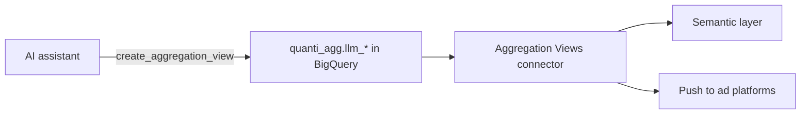

# Aggregation Views


Pre-aggregate cross-channel data in your warehouse, for faster analysis or to feed a push to an ad platform. Aggregation views can only be created through the AI assistant: ask the assistant to build one for you.


***

## Prerequisites

* A QUANTI: project whose data warehouse is **BigQuery**. Aggregation views are not available on Snowflake projects yet.
* The QUANTI: MCP server connected to your AI assistant. See [MCP Set-up](../../mcp-server/mcp-set-up.md).
* For your first view: a free connector slot on your plan. The first view creates the **Aggregation Views** connector in your project.

***

## Authentication

No authentication is required. Views are created in your warehouse with the credentials already configured on your QUANTI: project.

***

## Setup Instructions

There is no setup screen for this connector. The AI assistant creates each view with the MCP tool `create_aggregation_view`.



**Connect the QUANTI: MCP server**

Connect the QUANTI: MCP server to your AI assistant by following [MCP Set-up](../../mcp-server/mcp-set-up.md).



**Describe the aggregation you need**

Tell the assistant what the view should compute. For example:

> Create an aggregation view with weekly spend, clicks and impressions per channel, combining my Google Ads and Meta data.



**Review the SQL and the column descriptions**

The assistant writes the `CREATE MATERIALIZED VIEW` statement and describes every output column: name, type, business meaning, and whether it is a metric or a dimension. These descriptions feed the [Semantic Layer](../../mcp-server/semantic-layer.md).



**Create the view**

The assistant calls `create_aggregation_view`. The view is created in your warehouse and listed as a report of the **Aggregation Views** connector in your project.





### Rules

| Rule | Value |
|---|---|
| **Dataset** | `quanti_agg`, created automatically if it does not exist |
| **Name** | Must start with `llm_` (e.g. `quanti_agg.llm_weekly_channel_spend`) |
| **Statements** | `CREATE MATERIALIZED VIEW`, `CREATE OR REPLACE MATERIALIZED VIEW`, `CREATE PROCEDURE` |
| **Column descriptions** | Required for materialized views |
| **Limit** | 20 active views per project |
| **Existing name** | Use `OR REPLACE` to update a view that already exists |

***

## Managing Views

Ask the assistant in plain words. It uses the following MCP tools.

| Tool | What it does |
|---|---|
| `list_aggregation_views` | Lists the project's views with their ID, full name, type, description, SQL, status and creation date |
| `create_aggregation_view` | Creates a view, or replaces it when the SQL uses `OR REPLACE` |
| `unregister_aggregation_view` | Removes a view from QUANTI: and frees one of the 20 slots |


`unregister_aggregation_view` does **not** delete the object from your warehouse. A materialized view keeps refreshing, and keeps generating BigQuery costs, until you drop it yourself:

```sql
DROP MATERIALIZED VIEW IF EXISTS `quanti_agg`.`llm_weekly_channel_spend`
```


***

## Data Model

Aggregation views have **no fixed schema**. Each view's columns are defined by its own SQL, and described one by one when the assistant creates it.

To see the columns of an existing view, ask the assistant to list your aggregation views, or open the view in BigQuery under the `quanti_agg` dataset.

***

## Refresh

This connector has no sync schedule: QUANTI: does not load data into these views.

* **Materialized views** are refreshed by BigQuery every 12 hours. QUANTI: sets this interval when the SQL has no `OPTIONS` clause, instead of the BigQuery default of 30 minutes, to limit refresh costs.
* **Procedures** are created, not executed. They run only when they are called.

***

## Notes

* A view used as the source of a push to an ad platform is returned by `create_aggregation_view` with the identifiers the push configuration needs.
* Replacing a view with `OR REPLACE` keeps the same entry in QUANTI:.
