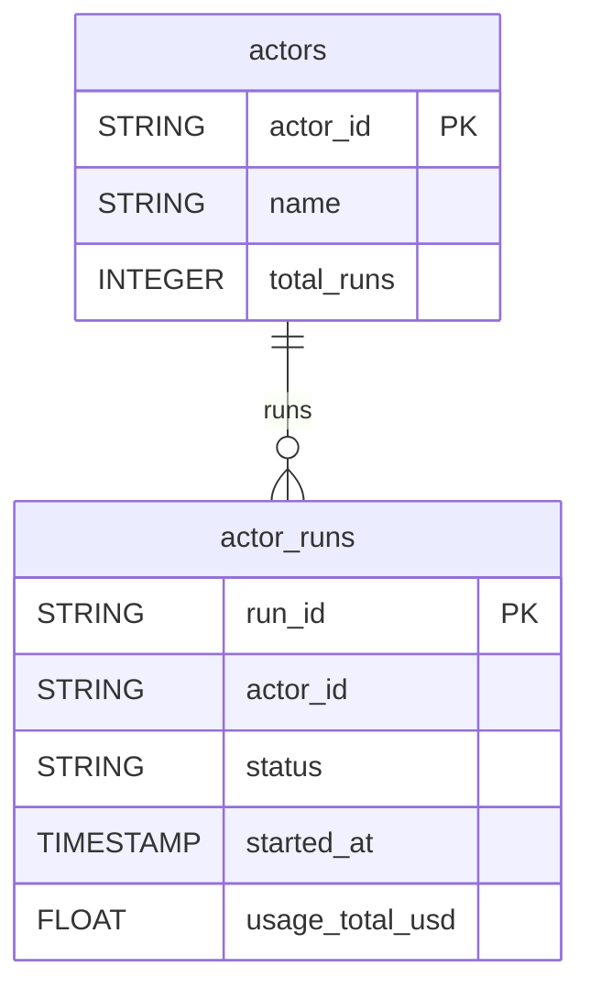

# Apify


Sync your Apify actors and their run history (status, duration, compute usage and cost) into your warehouse.


***

## Prerequisites

* An Apify account.
* An Apify API token.

***

## Authentication

The connector uses an **API token**. Generate it in **Apify Console > Settings > API & Integrations** and paste it in the setup screen.

***

## Setup Instructions



**Enter your API token**

Paste your **Apify API Token**.



**Choose your reports**

Select the reports to sync.



***

## Data Model

***

## Available Reports

### Actor Runs

One row per actor run, with execution metrics and compute usage.

#### Dimensions

| Column | Type | Description |
|---|---|---|
| `run_id` | STRING | Unique identifier of the actor run (primary key) |
| `actor_id` | STRING | ID of the actor that was run |
| `user_id` | STRING | ID of the user who initiated the run |
| `actor_task_id` | STRING | ID of the actor task if run was triggered by a scheduled task |
| `status` | STRING | Final execution status (SUCCEEDED, FAILED, ABORTED, TIMED-OUT, etc.) |
| `started_at` | TIMESTAMP | Timestamp when the run started |
| `finished_at` | TIMESTAMP | Timestamp when the run finished |
| `build_id` | STRING | ID of the actor build used for this run |
| `build_number` | STRING | Version number of the actor build |
| `default_dataset_id` | STRING | ID of the default output dataset for this run |
| `meta_origin` | STRING | How the run was triggered (API, MANUAL, SCHEDULER, WEBHOOK, etc.) |
| `meta_schedule_id` | STRING | ID of the schedule that triggered this run, if any |

#### Metrics

| Column | Type | Description |
|---|---|---|
| `usage_total_usd` | FLOAT | Total cost of the run in USD |
| `compute_units` | FLOAT | Compute units consumed by this run (Apify billing unit) |
| `duration_millis` | FLOAT | Total run wall-clock duration in milliseconds |
| `run_time_secs` | FLOAT | Active execution time in seconds |
| `mem_avg_bytes` | FLOAT | Average RAM usage in bytes during the run |
| `mem_max_bytes` | FLOAT | Peak RAM usage in bytes during the run |
| `net_rx_bytes` | FLOAT | Total network data received in bytes |
| `net_tx_bytes` | FLOAT | Total network data transmitted in bytes |
| `restart_count` | INTEGER | Number of times the actor process restarted |
| `resurrect_count` | INTEGER | Number of times the run was resurrected after failure |

### Actors

One row per actor of your account, with its metadata and run statistics.

#### Dimensions

| Column | Type | Description |
|---|---|---|
| `actor_id` | STRING | Unique identifier of the actor (primary key) |
| `name` | STRING | Internal actor slug name |
| `username` | STRING | Username of the actor owner |
| `title` | STRING | Display title of the actor |
| `description` | STRING | Description of what the actor does |
| `created_at` | TIMESTAMP | Timestamp when the actor was created |
| `modified_at` | TIMESTAMP | Timestamp of the last modification |
| `last_run_started_at` | TIMESTAMP | Timestamp of the most recent run |
| `is_public` | BOOLEAN | Whether the actor is publicly available on the Apify marketplace |

#### Metrics

| Column | Type | Description |
|---|---|---|
| `total_runs` | INTEGER | Total number of runs for this actor |

***

## Scheduling

| Setting | Default | Options |
|---|---|---|
| **Frequency** | Daily | Daily, Weekly |
| **Sync time** | 3:00 AM | — |
| **Lookback window** | 5 days | 1, 3, 5 days |
| **Historical load** | Up to 1 year | 3 months, 6 months, 12 months or custom dates |
