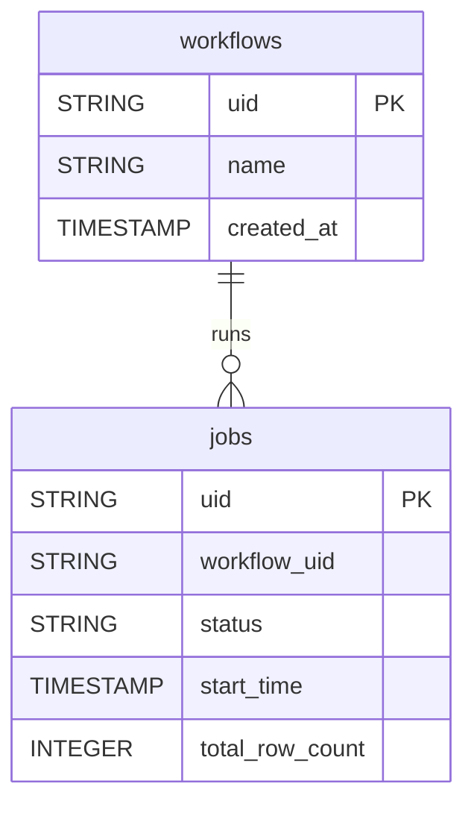

# Captain Data


Sync your Captain Data workflows and job executions into your warehouse for execution monitoring and automation analysis.


***

## Prerequisites

* A Captain Data account with access to **Settings > Developers**.
* The **Project UID** of the project to sync.

***

## Authentication

The connector uses your Captain Data **API key**, together with the UID of your project.

***

## Setup Instructions



**Find your credentials**

In Captain Data, go to **Settings > Developers** to find your API key.



**Enter your credentials**

Enter the **Captain Data API Key** and the **Project UID**.



**Choose your reports**

Choose the reports to sync.



***

## Data Model

***

## Available Reports

### Workflows

Captain Data workflow definitions in the project.

| Column | Type | Description |
|---|---|---|
| `uid` | STRING | Workflow unique identifier (primary key) |
| `name` | STRING | Workflow name |
| `created_at` | TIMESTAMP | Workflow creation timestamp |
| `project_id` | STRING | Associated project identifier |
| `template_uid` | STRING | Template unique identifier used to create this workflow |
| `steps` | STRING | Workflow steps as JSON array |

### Jobs

Job executions across all Captain Data workflows, with status and row counts.

#### Dimensions

| Column | Type | Description |
|---|---|---|
| `uid` | STRING | Job unique identifier (primary key) |
| `name` | STRING | Job name |
| `status` | STRING | Job execution status (e.g. running, finished, failed) |
| `workflow_uid` | STRING | UID of the workflow that triggered this job |
| `workflow_name` | STRING | Name of the workflow that triggered this job |
| `step_uid` | STRING | Step UID within the workflow |
| `main_job_uid` | STRING | UID of the parent job if this is a sub-job |
| `main_job_name` | STRING | Name of the parent job if this is a sub-job |
| `start_time` | TIMESTAMP | Timestamp when the job started |
| `scheduled_time` | TIMESTAMP | Timestamp when the job was scheduled |
| `finish_time` | TIMESTAMP | Timestamp when the job finished |
| `error_message` | STRING | Error message if the job failed |

#### Metrics

| Column | Type | Description |
|---|---|---|
| `total_row_count` | INTEGER | Total number of rows extracted by this job |
| `row_count` | INTEGER | Number of rows extracted in this step |
| `number_inputs` | INTEGER | Number of input rows provided to the job |

***

## Scheduling

| Setting | Default | Options |
|---|---|---|
| **Frequency** | Daily | Daily, Weekly |
| **Sync time** | 3:00 AM | — |
| **Lookback window** | Not available | — |
| **Historical load** | Not available | — |

***

## Notes

* `steps` holds the workflow steps as a JSON array stored in a STRING column.
