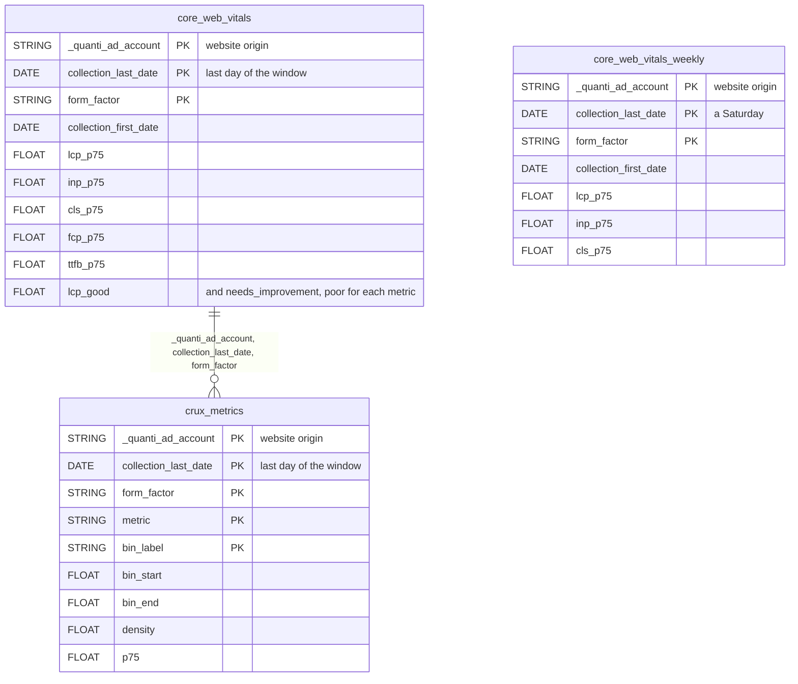

# Chrome UX Report

<a href="https://dbdiagram.io/d/[Chrome-UX-Report]-6afdd823d4a729077d2de1ef" class="button primary" data-icon="table-tree">Prebuilt reports and definition</a>

***

## Overview

The Chrome UX Report connector gives you the real-user web performance of the websites you follow, yours and your competitors', as measured by Google on Chrome users through the [Chrome UX Report](https://developer.chrome.com/docs/crux) (CrUX) API. Use it to track your Core Web Vitals (LCP, INP, CLS) day by day, see how they evolved over the last 10 months, compare your loading speed and responsiveness with your competitors', and relate them to your SEO and conversion results.


Chrome UX Report is a **Market Insights** connector that runs in your own project: it uses **your** Google API key and loads the data into your own dataset, like a regular connector.


***

## Prerequisites

* A Google Cloud project where you can enable APIs and create credentials.
* The websites to follow must be public and receive enough Chrome traffic. Google does not publish the threshold: a site below it returns no data.

***

## Authentication

The connector authenticates with a Google API key. The same key reads the daily Chrome UX Report API and its History API. Both are free and share a quota of 150 queries per minute per Google Cloud project.



#### Enable the API

In the [Google Cloud Console](https://console.cloud.google.com/), open **APIs & Services > Library**, search for **Chrome UX Report API** and click **Enable**.



#### Create the key

Open **APIs & Services > Credentials**, click **Create credentials > API key** and copy the key (it starts with `AIza`).



#### Restrict the key

Click the key, set **API restrictions** to **Restrict key**, select **Chrome UX Report API** and save. The key then cannot be used for any other Google API.



***

## Setup instructions



#### Enter your API key

Paste your Google API key. QUANTI checks it with a test query before going further.



#### Add the websites to follow

Add each website as an **origin**: `https://` followed by the exact host, without any path, e.g. `https://www.example.com`. Chrome UX Report treats `https://www.example.com` and `https://example.com` as two different websites: enter the one your visitors actually land on.



#### Select prebuilt reports

Review the available prebuilt reports and select the ones you want to activate.



#### Connector information

* **Connector Name**: Name your connector. It must be unique.
* **Dataset ID**: Define the ID of the dataset. It must not exist yet, as it will be created and your tables will be placed there.



***

## Prebuilt reports

Every value covers a **28-day window** of page loads. The Chrome UX Report API has no date parameter: it always returns the latest window, which Google refreshes once a day, about two days behind today. The connector therefore loads a **snapshot** on every run:

* `core_web_vitals` and `crux_metrics` get the latest window, so one daily run builds a day-by-day history over time.
* `core_web_vitals_weekly` gets the last 40 weekly windows from the History API, so you have about 10 months of history from the first run.

Each website is queried for four devices: `PHONE`, `DESKTOP`, `TABLET`, and `ALL` for every device together. `collection_last_date` identifies the window of each row.


Every run is **appended**: two runs that see the same window, or the weekly history loaded again on each run, give several copies of the same row. Keep the latest copy per website, device and window before aggregating:

```sql
SELECT * FROM core_web_vitals_weekly
QUALIFY ROW_NUMBER() OVER (
  PARTITION BY _quanti_ad_account, form_factor, collection_last_date
  ORDER BY _quanti_loaded_at DESC) = 1
```

For `crux_metrics`, add `metric` and `bin_label` to the `PARTITION BY`.


**core\_web\_vitals**: One row per website, device and run. The 75th percentile and the good / needs improvement / poor shares of the Core Web Vitals and the main loading metrics.

| Column | Type | Description |
|---|---|---|
| `form_factor` | STRING | Device the measure covers: PHONE, DESKTOP, TABLET, or ALL. |
| `collection_first_date` | DATE | First day of the 28-day window (Pacific time). |
| `collection_last_date` | DATE | Last day of the 28-day window (Pacific time). |
| `lcp_p75` | FLOAT | Largest Contentful Paint at the 75th percentile, in ms. |
| `lcp_good` / `lcp_needs_improvement` / `lcp_poor` | FLOAT | Share of page loads in each LCP bucket, between 0 and 1. |
| `inp_p75` | FLOAT | Interaction to Next Paint at the 75th percentile, in ms. |
| `inp_good` / `inp_needs_improvement` / `inp_poor` | FLOAT | Share of page loads in each INP bucket, between 0 and 1. |
| `cls_p75` | FLOAT | Cumulative Layout Shift at the 75th percentile (unitless score). |
| `cls_good` / `cls_needs_improvement` / `cls_poor` | FLOAT | Share of page loads in each CLS bucket, between 0 and 1. |
| `fcp_p75` | FLOAT | First Contentful Paint at the 75th percentile, in ms. |
| `fcp_good` / `fcp_needs_improvement` / `fcp_poor` | FLOAT | Share of page loads in each FCP bucket, between 0 and 1. |
| `ttfb_p75` | FLOAT | Time to First Byte at the 75th percentile, in ms. |
| `ttfb_good` / `ttfb_needs_improvement` / `ttfb_poor` | FLOAT | Share of page loads in each TTFB bucket, between 0 and 1. |

The three buckets are the ones Google returns for each metric; their shares add up to about 1.

**crux\_metrics**: The full distribution of every Chrome UX Report metric. One row per website, device, run, metric and bucket: histogram buckets with their share and the metric's 75th percentile, plus fraction metrics such as navigation types.

| Column | Type | Description |
|---|---|---|
| `form_factor` | STRING | Device the measure covers: PHONE, DESKTOP, TABLET, or ALL. |
| `metric` | STRING | Chrome UX Report metric name, e.g. `largest_contentful_paint`, `navigation_types`. |
| `bin_label` | STRING | Bucket: `start-end` for a histogram (e.g. `0-2500`, `4000+`), or the category for a fraction metric (e.g. `navigate`, `reload`). |
| `bin_start` | FLOAT | Lower bound of the histogram bucket, in the metric's unit. Empty for fraction metrics. |
| `bin_end` | FLOAT | Upper bound of the histogram bucket. Empty for the last bucket and for fraction metrics. |
| `density` | FLOAT | Share of page loads in this bucket, between 0 and 1. |
| `p75` | FLOAT | 75th percentile of the metric, repeated on each of its buckets: do not sum it. Empty for fraction metrics. |
| `collection_first_date` | DATE | First day of the 28-day window (Pacific time). |
| `collection_last_date` | DATE | Last day of the 28-day window (Pacific time). |

**core\_web\_vitals\_weekly**: The weekly history of the Core Web Vitals, from the Chrome UX Report History API. One row per website, device and week over the last 40 weeks, each over a 28-day window ending on a Saturday. Same columns as `core_web_vitals`. A week without enough Chrome traffic is left empty.

| Column | Type | Description |
|---|---|---|
| `form_factor` | STRING | Device the measure covers: PHONE, DESKTOP, TABLET, or ALL. |
| `collection_first_date` | DATE | First day of the 28-day window (Pacific time). |
| `collection_last_date` | DATE | Last day of the 28-day window, always a Saturday (Pacific time). |
| `lcp_p75` … `ttfb_poor` | FLOAT | Same 20 metric columns as `core_web_vitals`. |

Google adds a new week every Monday.



***

<a href="https://dbdiagram.io/d/[Chrome-UX-Report]-6afdd823d4a729077d2de1ef" class="button primary" data-icon="table-tree">Prebuilt reports and definition</a>

***

## Scheduling

| Setting | Default | Options |
|---|---|---|
| **Frequency** | Daily | Daily |
| **Sync time** | 6:00 AM | — |
| **Lookback window** | — | Not available |
| **Historical load** | Last 40 weeks | Loaded by `core_web_vitals_weekly` on every run |


The Chrome UX Report API only returns the current 28-day window, with no date parameter. The daily history of `core_web_vitals` and `crux_metrics` starts on the day you create the connector, and a day that is not loaded cannot be reloaded later. For the past, use the weekly points of `core_web_vitals_weekly`.


***

## Notes

* **No data for a website or device**: Google only publishes websites with enough Chrome traffic. A website or device below the threshold is skipped and gets no row for the day; the sync still succeeds.
* **Real users only**: the values come from Chrome users who opted in to share usage statistics, not from lab tests like PageSpeed Insights scores.
* **Rounding**: Google rounds the shares to 4 decimal places.
* **Attribution**: Chrome UX Report data by Google is licensed under [Creative Commons Attribution 4.0](https://creativecommons.org/licenses/by/4.0/). Mention "Chrome UX Report, Google" when you share it.
