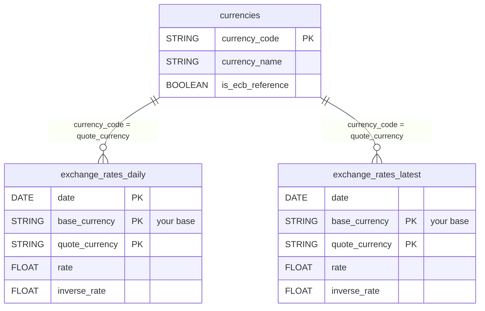

# Exchange Rates

<a href="https://dbdiagram.io/d/[Exchange-rate-currency]-6af5f32cdec310ec25f2c0ed" class="button primary" data-icon="table-tree">Prebuilt reports and definition</a>

***

## Overview

The Exchange Rates connector gives you the daily reference exchange rates published by the [European Central Bank](https://data.ecb.europa.eu/data/datasets/EXR) (ECB) for 29 currencies, expressed against the base currency of your choice. Use it to convert revenue and media spend across currencies directly in your warehouse, for consolidated financial reporting or as a control variable in marketing mix modeling (MMM).


Exchange Rates is a **Market Insights** connector: QUANTI loads the ECB rates once a day for all clients, and your project reads them through views limited to your base currency and the currencies you select. Nothing runs in your project and no data is copied into it.


No authentication is required.

***

## How a shared insight differs from a regular connector

| | Regular connector | Exchange Rates (shared insight) |
|---|---|---|
| **Who loads the data** | Your connector, in your project | QUANTI, once a day for all clients |
| **What lands in your dataset** | Tables | Views on the data shared by QUANTI |
| **Scheduling** | You choose frequency, hour and lookback | Nothing to schedule |
| **Your choices** | Accounts, reports | Your scope: base currency, destination currencies and reports |
| **Connector page** | Logs tab with each run | **Share** tab: shared dataset, your views, region, last update by QUANTI |
| **Warehouse** | BigQuery, Snowflake… | BigQuery only for now |


The insight must be available in the region of your BigQuery project. If it is not, the setup stops with "This insight is not available yet in the region of your project": contact us to open it.


***

## Setup instructions

The setup page opens with a **Shared by Quanti** banner: you only pick your scope.



#### Choose your base currency

Choose the currency all rates are expressed against (default **EUR**): `1 base_currency = rate quote_currency`. EUR or any of the 29 currencies below can be the base.



#### Select destination currencies

Choose the currencies you want rates for. Your rate views only show these currencies, against your base currency.

Available currencies: USD, JPY, CZK, DKK, GBP, HUF, PLN, RON, SEK, CHF, ISK, NOK, TRY, AUD, BRL, CAD, CNY, HKD, IDR, ILS, INR, KRW, MXN, MYR, NZD, PHP, SGD, THB, ZAR.



#### Select prebuilt reports

Review the available prebuilt reports and select the ones you want to activate.



#### Connector information

* **Connector Name**: Name your connector. It must be unique.
* **Dataset ID**: Define the ID of the dataset. It must not exist yet, as it will be created and your views will be placed there.



Once created, open the **Share** tab of the connector to see the shared dataset, your views and the date of the last update by QUANTI. To change your scope later, edit the base currency, the currencies or the reports: your views follow, history included.

***

## Prebuilt reports

All rates are expressed against the base currency chosen in the connector settings: `1 base_currency = rate quote_currency`. The ECB only publishes rates against the euro; for any other base, QUANTI computes the cross rate (`rate(base → X) = rate(EUR → X) / rate(EUR → base)`) for every base, so changing your base currency needs no reload.

**exchange\_rates\_daily**: One row per ECB publication day and per currency. Join it on `date` and `quote_currency` to convert any daily amount. The ECB publishes on TARGET working days only, so weekends and TARGET holidays have no row.

| Column | Type | Description |
|---|---|---|
| `date` | DATE | Reference date of the ECB publication (TARGET working day). |
| `base_currency` | STRING | Your base currency (ISO 4217, e.g. `EUR`). |
| `quote_currency` | STRING | ISO 4217 code of the quoted currency (e.g. `USD`). |
| `rate` | FLOAT | Units of quote currency for 1 unit of base currency. |
| `inverse_rate` | FLOAT | Units of base currency for 1 unit of quote currency (`1 / rate`, computed by QUANTI). |

**exchange\_rates\_latest**: The most recent rate for each currency, one row per currency against your base currency. The table is fully replaced on every load.

| Column | Type | Description |
|---|---|---|
| `date` | DATE | Publication date of this latest rate. |
| `base_currency` | STRING | Your base currency. |
| `quote_currency` | STRING | ISO 4217 code of the quoted currency. |
| `rate` | FLOAT | Units of quote currency for 1 unit of base currency. |
| `inverse_rate` | FLOAT | Units of base currency for 1 unit of quote currency. |

**currencies**: Reference list of the currencies covered by the connector, with their official English name. The table is fully replaced on every load.

| Column | Type | Description |
|---|---|---|
| `currency_code` | STRING | ISO 4217 code (e.g. `SEK`). |
| `currency_name` | STRING | Official English name (e.g. Swedish krona). |
| `is_ecb_reference` | BOOLEAN | Whether the ECB currently publishes a daily reference rate for this currency. |

***

<a href="https://dbdiagram.io/d/[Exchange-rate-currency]-6af5f32cdec310ec25f2c0ed" class="button primary" data-icon="table-tree">Prebuilt reports and definition</a>

***

## Notes

* **Refresh**: QUANTI loads the new rates once a day, in the evening after the ECB publication. Each load re-reads the last day.
* **History**: 3 years of daily rates are available from the start.
* **Base currency as destination**: a currency never has a row against itself (the rate would always be 1).
* **Missing days**: to convert amounts dated on a weekend or holiday, use the last available rate before that date.
* **No authentication required**: the ECB data portal is public.
