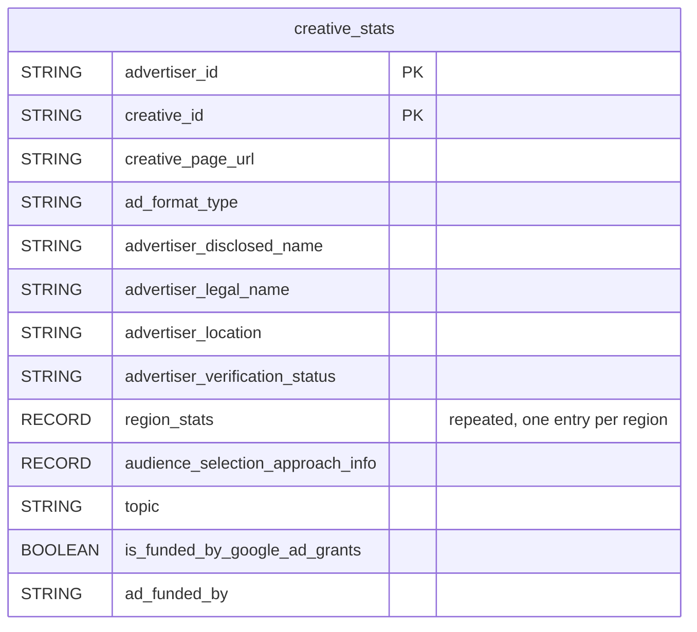

# Google Ads Transparency

<a href="https://dbdiagram.io/d/[Google-Ad-Transparency-Center]-6afec9dc03a79fafab019113" class="button primary" data-icon="table-tree">Prebuilt reports and definition</a>

***

## Overview

The Google Ads Transparency connector gives you the ads served through Google in the European Economic Area (EEA) and Turkey, as published by Google in the [Google Ads Transparency Center](https://adstransparency.google.com/): advertiser, ad format, serving countries, first and last serving dates, impression ranges and audience selection criteria. Use it to see which competitors advertise on Google, where, since when and with which targeting.


Google Ads Transparency is a **Market Insights** connector: QUANTI loads Google's public dataset once a day for all clients, and your project reads it through views limited to the advertisers you follow. Nothing runs in your project and no data is copied into it.


No authentication is required.

***

## How a shared insight differs from a regular connector

| | Regular connector | Google Ads Transparency (shared insight) |
|---|---|---|
| **Who loads the data** | Your connector, in your project | QUANTI, once a day for all clients |
| **What lands in your dataset** | Tables | Views on the data shared by QUANTI |
| **Scheduling** | You choose frequency, hour and lookback | Nothing to schedule: QUANTI refreshes the shared dataset once a day |
| **Your choices** | Accounts, reports | Your scope: the advertisers you follow and the reports |
| **Connector page** | Logs tab with each run | **Share** tab: shared dataset, your views, region, last update by QUANTI |
| **Warehouse** | BigQuery, Snowflake… | BigQuery only for now |


The insight must be available in the region of your BigQuery project. If it is not, the setup stops with "This insight is not available yet in the region of your project": contact us to open it.


***

## Setup instructions

The setup page opens with a **Shared by Quanti** banner: you only pick your scope.



#### Enter the advertisers to follow

In the **Advertisers** step, type the ID of each advertiser you want to follow. To find it, search the advertiser on [adstransparency.google.com](https://adstransparency.google.com/) and copy the ID from the page URL: `adstransparency.google.com/advertiser/AR06997959995430010881` → `AR06997959995430010881`.

An ID always starts with `AR` followed by 20 digits.


A brand can advertise under several advertiser IDs (one per legal entity or agency account). Add each ID you want to follow.




#### Select prebuilt reports

Review the available prebuilt reports and select the ones you want to activate.



#### Connector information

* **Connector Name**: Name your connector. It must be unique.
* **Dataset ID**: Define the ID of the dataset. It must not exist yet, as it will be created and your views will be placed there.



Once created, open the **Share** tab of the connector to see the shared dataset, your views and the date of the last update by QUANTI. To follow other advertisers later, edit the list in the **Advertisers** tab: your views follow.

***

## Prebuilt reports

**creative\_stats**: One row per ad, with one entry per serving country in `region_stats`. The table is a snapshot: Google rewrites its whole dataset every day, and QUANTI replaces the table on every load. Your view only shows the ads of the advertisers you follow.

| Column | Type | Description |
|---|---|---|
| `advertiser_id` | STRING | Unique identifier of the advertiser (`AR…`). |
| `creative_id` | STRING | Unique identifier of the ad. |
| `creative_page_url` | STRING | Link to the ad page in the Google Ads Transparency Center. The ad itself (text, image, video) is only visible there. |
| `ad_format_type` | STRING | Ad format (text, image, video). |
| `advertiser_disclosed_name` | STRING | Advertiser name used for transparency disclosures. |
| `advertiser_legal_name` | STRING | Legal name of the advertiser. |
| `advertiser_location` | STRING | Advertiser country (ISO 3166-1 alpha-2 code, e.g. `FR`). |
| `advertiser_verification_status` | STRING | Whether the advertiser has verified its identity with Google. |
| `region_stats` | RECORD (repeated) | One entry per serving region. See below. |
| `audience_selection_approach_info` | RECORD | How the audience was selected. See below. |
| `topic` | STRING | Topic of the ad. |
| `is_funded_by_google_ad_grants` | BOOLEAN | True if the ad is funded by a Google Ad Grants in-kind donation. |
| `ad_funded_by` | STRING | Payer of the ad when different from the advertiser disclosed name. |

**region\_stats** (one entry per region, read it with `UNNEST`):

| Field | Type | Description |
|---|---|---|
| `region_code` | STRING | Serving country (ISO 3166-1 alpha-2 code, e.g. `FR`), or `EEA` for the whole European Economic Area. |
| `first_shown` | STRING | First day the ad was shown in the region (`YYYY-MM-DD`). |
| `last_shown` | STRING | Last day the ad was shown in the region (`YYYY-MM-DD`). |
| `times_shown_lower_bound` | INTEGER | Lower bound of the number of impressions in the region. |
| `times_shown_upper_bound` | INTEGER | Upper bound of the number of impressions in the region. |
| `times_shown_start_date` | STRING | Start of the period covered by the impression range. |
| `times_shown_end_date` | STRING | End of the period covered by the impression range. |
| `times_shown_availability_date` | STRING | Date from which the impression range is published. |
| `surface_serving_stats.surface_serving_stats` | RECORD (repeated) | Impression ranges per Google surface: `surface`, `times_shown_lower_bound`, `times_shown_upper_bound`, `times_shown_availability_date`. |

**audience\_selection\_approach\_info**: for each criterion (`demographic_info`, `geo_location`, `contextual_signals`, `customer_lists`, `topics_of_interest`), one of `CRITERIA_INCLUDED`, `CRITERIA_EXCLUDED`, `CRITERIA_INCLUDED_AND_EXCLUDED` or `CRITERIA_UNUSED`.



### Example: active ads per advertiser and country

```sql
SELECT
  advertiser_disclosed_name,
  r.region_code,
  COUNT(DISTINCT creative_id) AS active_ads
FROM `your_dataset.creative_stats`,
  UNNEST(region_stats) AS r
WHERE r.region_code != 'EEA'
  AND DATE(r.last_shown) >= DATE_SUB(CURRENT_DATE(), INTERVAL 7 DAY)
GROUP BY 1, 2
ORDER BY active_ads DESC
```

***

<a href="https://dbdiagram.io/d/[Google-Ad-Transparency-Center]-6afec9dc03a79fafab019113" class="button primary" data-icon="table-tree">Prebuilt reports and definition</a>

***

## Notes

* **Coverage**: all ads (not only political ones) shown in the EEA and Turkey since March 2023. An advertiser that does not advertise in Europe does not appear.
* **Refresh**: QUANTI reloads the full dataset once a day. Serving dates (`first_shown`, `last_shown`) go up to the previous day.
* **Impressions are published late**: Google publishes impression ranges about 90 days after serving (`times_shown_availability_date`). Use serving dates for recent activity, impressions for older periods.
* **No history**: the table is replaced on every load and reflects Google's current state.
* **`EEA` region**: the `EEA` entry aggregates the whole area. Exclude it when you sum by country, or you will count impressions twice.
* **Dates are text**: date fields are `STRING` in `YYYY-MM-DD` format, as in Google's dataset. Cast them with `DATE()` before comparing.
* **Overseas territories**: French overseas territories (RE, GP, MQ, GF, YT, MF) have their own region code.
* **No authentication required**: the Google Ads Transparency Center dataset is public.
