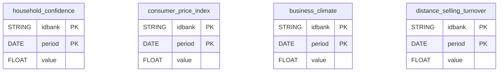

# INSEE Conjoncture


**Exogenous connector** — French macroeconomic indicators from INSEE (household confidence, consumer prices, business climate, distance-selling turnover). Each report is one official monthly series, identical for all projects. Join them by date to explain sales variations, or use them as control variables for Marketing Mix Modeling (MMM).


***

## Prerequisites

* None: no account or credentials are needed.

***

## Authentication

No authentication is required.

***

## Setup Instructions



**Select the country**

Select the country for the macroeconomic indicators. **France** is the only option.



**Choose your indicators**

Choose the indicators to sync. Each indicator is one monthly series.



**Name your connector**

Give the connector a name, then click **Create**.



***

## Data Model

Each report is an independent monthly series. Join them to your own data on `period` (first day of the month).

***

## Available Reports

### Household confidence (France)

Household confidence synthetic indicator, from the INSEE monthly consumer survey (seasonally adjusted, base 100 = long-term average). One row per month. INSEE series `001587668`.

#### Dimensions

| Column | Type | Description |
|---|---|---|
| `idbank` | STRING | INSEE series identifier (idBank) (primary key) |
| `title_en` | STRING | INSEE series English title |
| `period` | DATE | Observation month, first day of the month (YYYY-MM-01) (primary key) |
| `freq` | STRING | Series frequency (M = monthly) |
| `obs_status` | STRING | Observation status (A = normal/final) |

#### Metrics

| Column | Type | Description |
|---|---|---|
| `value` | FLOAT | Confidence index value (base 100 = long-term average) |

### Consumer Price Index (France)

Consumer Price Index (CPI): all households, France, all items, seasonally adjusted (base 100 = year 2025, eCOICOPv2). One row per month. INSEE series `011814131`.

#### Dimensions

| Column | Type | Description |
|---|---|---|
| `idbank` | STRING | INSEE series identifier (idBank) (primary key) |
| `title_en` | STRING | INSEE series English title |
| `period` | DATE | Observation month, first day of the month (YYYY-MM-01) (primary key) |
| `freq` | STRING | Series frequency (M = monthly) |
| `obs_status` | STRING | Observation status (A = normal/final) |

#### Metrics

| Column | Type | Description |
|---|---|---|
| `value` | FLOAT | CPI value (index, base 100 = year 2025) |

### Business climate (France)

Business climate composite indicator: all sectors, metropolitan France (base 100 = long-term average). One row per month. INSEE series `001565530`.

#### Dimensions

| Column | Type | Description |
|---|---|---|
| `idbank` | STRING | INSEE series identifier (idBank) (primary key) |
| `title_en` | STRING | INSEE series English title |
| `period` | DATE | Observation month, first day of the month (YYYY-MM-01) (primary key) |
| `freq` | STRING | Series frequency (M = monthly) |
| `obs_status` | STRING | Observation status (A = normal/final) |

#### Metrics

| Column | Type | Description |
|---|---|---|
| `value` | FLOAT | Business climate index value (base 100 = long-term average) |

### Distance-selling turnover (France)

Distance-selling turnover index: France, mail order and internet retail (NAF 47.91), raw (not seasonally adjusted). One row per month. INSEE series `010770790`.

#### Dimensions

| Column | Type | Description |
|---|---|---|
| `idbank` | STRING | INSEE series identifier (idBank) (primary key) |
| `title_en` | STRING | INSEE series English title |
| `period` | DATE | Observation month, first day of the month (YYYY-MM-01) (primary key) |
| `freq` | STRING | Series frequency (M = monthly) |
| `obs_status` | STRING | Observation status (DEF = definitive, SD = semi-definitive) |

#### Metrics

| Column | Type | Description |
|---|---|---|
| `value` | FLOAT | Turnover index value (base 100) |

***

## Scheduling

| Setting | Default | Options |
|---|---|---|
| **Frequency** | Monthly | — |
| **Sync time** | 3:00 AM | — |

***

## Notes

* Data is refreshed monthly: the most recent month may not be available yet.
* Publication timing differs by series: household confidence and business climate around the end of each month, consumer prices mid-month (provisional, then final about two weeks later), distance-selling turnover with a 30 to 40 day lag.
