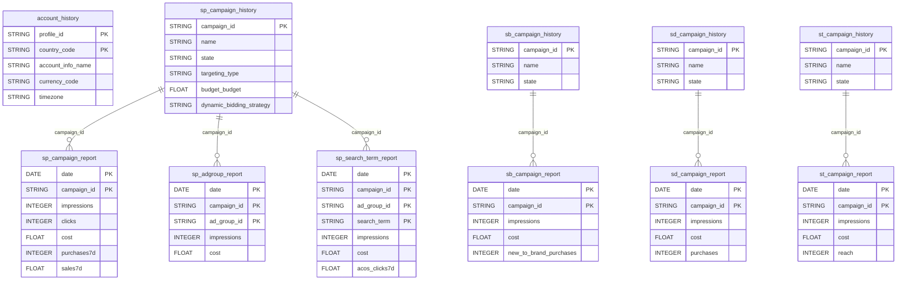

# Amazon Ads


Amazon Ads allows advertisers to promote their products and brands across Amazon's ecosystem. QUANTI: connects to the **Amazon Advertising API v3** and retrieves daily performance data for four ad product types: **Sponsored Products (SP)**, **Sponsored Brands (SB)**, **Sponsored Display (SD)**, and **Sponsored Television (ST)**.


***

## Prerequisites

* An active Amazon Advertising account with at least one Ad Profile
* Advertising API access enabled on your account
* The user authorizing the connector must have **Administrator** or **Manager** access on the profiles to be connected

***

## Authentication

Amazon Ads uses **OAuth 2.0**. During connector setup, you will be redirected to Amazon's login page to grant QUANTI: access to your advertising data. Only the `advertising::campaign_management` scope is requested.

***

## Setup Instructions



**Connect your Amazon Ads account**

Click **Connect** and sign in to Amazon. Authorize QUANTI: to access your advertising data. You will be redirected back automatically after granting permissions.



**Select Ad Profiles**

Choose the Ad Profiles (advertising accounts) you want to sync. Each profile corresponds to a marketplace (e.g. amazon.fr, amazon.de). You can select multiple profiles.



**Select pre-built reports**

Choose the reports to activate. Reports are organized by ad product type: Sponsored Products, Sponsored Brands, Sponsored Display, and Sponsored Television. You can also activate dimension (history) tables to enrich your campaign metadata.



**Configure scheduling**

Set the sync frequency, time, and lookback window. See [Scheduling](#scheduling) for details.



***

## Data Model

<a href="https://dbdiagram.io/e/amazon-ads-quanti" class="button primary" data-icon="table-tree">Open in dbdiagram</a>

***

## Available Reports

Amazon Ads provides **44 pre-built reports** organized in two categories:

* **History tables** (`isDimension: true`, `merge` insert): entity configuration snapshots — campaigns, ad groups, keywords, ads, creatives, targeting
* **Performance reports** (`isDimension: false`, `delete_insert` by `_quanti_ad_account` + `_quanti_date`): daily metrics broken down by various granularities

> **Attribution windows (SP):** Performance metrics are available for 1-day, 7-day, 14-day, and 30-day click attribution windows (suffixed `1d`, `7d`, `14d`, `30d`).

***

### Account

#### account\_history

Amazon Advertising profiles (accounts) selected during connector setup.

| Column | Type | Description |
|---|---|---|
| `profile_id` | STRING | Ad Profile ID (PK) |
| `country_code` | STRING | Country marketplace code (PK) |
| `currency_code` | STRING | Account currency |
| `daily_budget` | FLOAT | Profile daily budget |
| `timezone` | STRING | Account timezone |
| `account_info_marketplace_string_id` | STRING | Marketplace string ID (PK) |
| `account_info_id` | STRING | Advertiser account ID (PK) |
| `account_info_type` | STRING | Account type (vendor, seller…) |
| `account_info_name` | STRING | Account name (PK) |
| `account_info_sub_type` | STRING | Account sub-type (PK) |
| `account_info_valid_payment_method` | STRING | Payment method status (PK) |

***

### Sponsored Products (SP)

Sponsored Products are keyword- and product-targeted ads that appear in Amazon search results and on product detail pages.

#### History Tables

| Table | Description |
|---|---|
| `sp_campaign_history` | SP campaigns: budget, bidding strategy, state, targeting type, dates |
| `sp_ad_group_history` | SP ad groups: configuration, default bid, state |
| `sp_keyword_history` | SP keywords: text, match type, bid, state |
| `sp_product_ad_history` | SP product ads: ASIN, SKU, state |
| `sp_targeting_clause_history` | SP targeting clauses: expression type, bid, state |

**sp\_campaign\_history — key columns**

| Column | Type | Description |
|---|---|---|
| `campaign_id` | STRING | Campaign ID (PK) |
| `extended_data_last_update_date_time` | STRING | Last update timestamp (PK) |
| `name` | STRING | Campaign name |
| `state` | STRING | enabled / paused / archived |
| `targeting_type` | STRING | manual / auto |
| `start_date` | DATE | Campaign start date |
| `end_date` | DATE | Campaign end date |
| `portfolio_id` | STRING | Portfolio ID |
| `budget_budget` | FLOAT | Campaign budget amount |
| `budget_budget_type` | STRING | daily / monthly |
| `budget_effective_budget` | FLOAT | Effective budget in use |
| `dynamic_bidding_strategy` | STRING | legacyForSales / autoForSales / manual |
| `dynamic_bidding_placement_bidding` | STRING | Placement bid adjustments (JSON) |
| `auto_manage_campaign` | STRING | Auto-management flag |
| `extended_data_serving_status` | STRING | Campaign serving status |
| `tags` | STRING | Campaign tags (JSON) |

#### Performance Reports

**sp\_campaign\_report**

Sponsored Products campaign-level performance (API v3). Grouped by `campaign`.

**Dimensions**

| Column | Type | Description |
|---|---|---|
| `date` | DATE | Report date (PK, isQuantiDate) |
| `campaign_id` | STRING | Campaign ID (PK) |
| `campaign_name` | STRING | Campaign name |
| `campaign_status` | STRING | Campaign status |
| `campaign_budget_amount` | FLOAT | Budget amount |
| `campaign_budget_type` | STRING | Budget type |
| `campaign_budget_currency_code` | STRING | Currency |
| `campaign_bidding_strategy` | STRING | Bidding strategy |
| `campaign_rule_based_budget_amount` | FLOAT | Rule-based budget |
| `campaign_applicable_budget_rule_id` | STRING | Budget rule ID |
| `campaign_applicable_budget_rule_name` | STRING | Budget rule name |

**Metrics**

| Column | Type | Description |
|---|---|---|
| `impressions` | INTEGER | Total impressions |
| `clicks` | INTEGER | Total clicks |
| `cost` | FLOAT | Total spend |
| `cost_per_click` | FLOAT | CPC |
| `click_through_rate` | FLOAT | CTR |
| `top_of_search_impression_share` | FLOAT | Top-of-search impression share |
| `purchases1d` / `7d` / `14d` / `30d` | INTEGER | Purchases within attribution window |
| `purchases_same_sku1d` / `7d` / `14d` / `30d` | INTEGER | Same-SKU purchases |
| `sales1d` / `7d` / `14d` / `30d` | FLOAT | Attributed sales |
| `attributed_sales_same_sku1d` / `7d` / `14d` / `30d` | FLOAT | Same-SKU attributed sales |
| `units_sold_clicks1d` / `7d` / `14d` / `30d` | INTEGER | Units sold from clicks |
| `units_sold_same_sku1d` / `7d` / `14d` / `30d` | INTEGER | Same-SKU units sold |
| `add_to_list` | INTEGER | Add to list actions |
| `qualified_borrows` | INTEGER | Kindle Unlimited qualified borrows |
| `royalty_qualified_borrows` | INTEGER | Kindle Unlimited royalty borrows |
| `kindle_edition_normalized_pages_read14d` | INTEGER | KENP read (14d) |
| `kindle_edition_normalized_pages_royalties14d` | FLOAT | KENP royalties (14d) |

***

**sp\_adgroup\_report**

Sponsored Products ad group-level performance. Grouped by `campaign` + `adGroup`.

**Dimensions**

| Column | Type | Description |
|---|---|---|
| `date` | DATE | Report date (PK) |
| `campaign_id` | STRING | Campaign ID (PK) |
| `ad_group_id` | STRING | Ad group ID (PK) |
| `ad_group_name` | STRING | Ad group name |
| `campaign_name` | STRING | Campaign name |
| `campaign_status` | STRING | Campaign status |
| `campaign_budget_amount` | FLOAT | Budget amount |
| `campaign_budget_type` | STRING | Budget type |
| `campaign_budget_currency_code` | STRING | Currency |
| `campaign_bidding_strategy` | STRING | Bidding strategy |
| `campaign_rule_based_budget_amount` | FLOAT | Rule-based budget |
| `campaign_applicable_budget_rule_id` | STRING | Budget rule ID |
| `campaign_applicable_budget_rule_name` | STRING | Budget rule name |

**Metrics** — same as `sp_campaign_report` (impressions, clicks, cost, CPC, CTR, purchases 1d/7d/14d/30d, sales 1d/7d/14d/30d, units sold, KENP)

***

**sp\_advertised\_product\_report**

Performance by advertised ASIN/SKU. Grouped by `advertiser`.

Dimensions: `date`, `campaign_id`, `ad_group_id`, `advertised_asin`, `advertised_sku`\
Metrics: impressions, clicks, cost, purchases/sales with attribution windows

***

**sp\_campaign\_placement\_report**

Performance by campaign placement (Top of Search, Rest of Search, Product Pages). Grouped by `campaign` + `campaignPlacement`.

Dimensions: `date`, `campaign_id`, `campaign_name`, `placement`\
Metrics: impressions, clicks, cost, purchases/sales with attribution windows

***

**sp\_search\_term\_report**

Performance by customer search term. Grouped by `searchTerm`.

**Dimensions**

| Column | Type | Description |
|---|---|---|
| `date` | DATE | Report date (PK) |
| `campaign_id` | STRING | Campaign ID (PK) |
| `ad_group_id` | STRING | Ad group ID (PK) |
| `keyword_id` | STRING | Keyword ID (PK) |
| `search_term` | STRING | Customer search term (PK) |
| `campaign_name` | STRING | Campaign name |
| `campaign_status` | STRING | Campaign status |
| `campaign_budget_amount` | FLOAT | Budget amount |
| `campaign_budget_type` | STRING | Budget type |
| `campaign_budget_currency_code` | STRING | Currency |
| `ad_group_name` | STRING | Ad group name |
| `keyword` | STRING | Matched keyword text |
| `match_type` | STRING | exact / phrase / broad |

**Metrics**

| Column | Type | Description |
|---|---|---|
| `impressions` | INTEGER | Total impressions |
| `clicks` | INTEGER | Total clicks |
| `cost` | FLOAT | Total spend |
| `cost_per_click` | FLOAT | CPC |
| `click_through_rate` | FLOAT | CTR |
| `purchases1d` / `7d` / `14d` / `30d` | INTEGER | Purchases by attribution window |
| `purchases_same_sku1d` / `7d` / `14d` / `30d` | INTEGER | Same-SKU purchases |
| `sales1d` / `7d` / `14d` / `30d` | FLOAT | Attributed sales |
| `attributed_sales_same_sku1d` / `7d` / `14d` / `30d` | FLOAT | Same-SKU attributed sales |
| `sales_other_sku7d` | FLOAT | Sales of other SKUs (7d) |
| `units_sold_clicks1d` / `7d` / `14d` / `30d` | INTEGER | Units sold from clicks |
| `units_sold_same_sku1d` / `7d` / `14d` / `30d` | INTEGER | Same-SKU units sold |
| `units_sold_other_sku7d` | INTEGER | Other-SKU units sold (7d) |
| `acos_clicks7d` / `14d` | FLOAT | ACoS (7d / 14d) |
| `roas_clicks7d` / `14d` | FLOAT | RoAS (7d / 14d) |
| `add_to_list` | INTEGER | Add to list actions |
| `qualified_borrows` | INTEGER | Kindle qualified borrows |
| `royalty_qualified_borrows` | INTEGER | Kindle royalty borrows |
| `kindle_edition_normalized_pages_read14d` | INTEGER | KENP read (14d) |
| `kindle_edition_normalized_pages_royalties14d` | FLOAT | KENP royalties (14d) |

***

**sp\_targeting\_report**

Performance by targeting clause (keywords and product targets). Grouped by `targeting`.

Dimensions: `date`, `campaign_id`, `ad_group_id`, `targeting_id`, `targeting_expression`, `targeting_text`, `targeting_type`, `match_type`\
Metrics: same as `sp_adgroup_report`

***

**sp\_purchased\_product\_report**

Performance by purchased product (ASIN), including cross-selling attribution. Grouped by `purchasedProduct`.

Dimensions: `date`, `campaign_id`, `ad_group_id`, `keyword_id`, `advertised_asin`, `purchased_asin`\
Metrics: purchases7d, sales7d, units_sold7d and other attribution windows

***

**sp\_gross\_and\_invalids\_report**

Invalid traffic metrics per campaign for quality monitoring. Grouped by `campaign`.

| Column | Type | Description |
|---|---|---|
| `date` | DATE | Report date (PK) |
| `campaign_id` | STRING | Campaign ID (PK) |
| `gross_impressions` | INTEGER | Gross impressions before filtering |
| `gross_clicks` | INTEGER | Gross clicks before filtering |
| `invalid_impressions` | INTEGER | Invalid impressions filtered out |
| `invalid_clicks` | INTEGER | Invalid clicks filtered out |

***

### Sponsored Brands (SB)

Sponsored Brands are headline ads featuring your brand logo, custom headline, and multiple products. They appear prominently in search results and support video creatives.

#### History Tables

| Table | Description |
|---|---|
| `sb_campaign_history` | SB campaigns: budget, status, cost type, targeting |
| `sb_ad_group_history` | SB ad groups: configuration and status |
| `sb_keyword_history` | SB keywords: text, match type, bid |
| `sb_ad_history` | SB ads: creative association, status |
| `sb_creative_history` | SB creatives: landing page, brand logo, headline |

#### Performance Reports

**sb\_campaign\_report**

Sponsored Brands campaign-level performance (API v3). Grouped by `campaign`.

**Dimensions**

| Column | Type | Description |
|---|---|---|
| `date` | DATE | Report date (PK, isQuantiDate) |
| `campaign_id` | STRING | Campaign ID (PK) |
| `campaign_name` | STRING | Campaign name |
| `campaign_status` | STRING | Campaign status |
| `campaign_budget_amount` | FLOAT | Budget amount |
| `campaign_budget_type` | STRING | Budget type |
| `campaign_budget_currency_code` | STRING | Currency |
| `campaign_rule_based_budget_amount` | FLOAT | Rule-based budget |
| `cost_type` | STRING | Cost model (CPC, vCPM…) |
| `start_date` | DATE | Campaign start date |
| `end_date` | DATE | Campaign end date |

**Metrics**

| Column | Type | Description |
|---|---|---|
| `impressions` | INTEGER | Total impressions |
| `viewable_impressions` | INTEGER | Viewable impressions |
| `clicks` | INTEGER | Total clicks |
| `cost` | FLOAT | Total spend |
| `top_of_search_impression_share` | FLOAT | Top-of-search impression share |
| `purchases` | INTEGER | Attributed purchases |
| `purchases_clicks` | INTEGER | Purchases attributed to clicks |
| `purchases_promoted` | INTEGER | Purchases of promoted products |
| `sales` | FLOAT | Attributed sales |
| `sales_clicks` | FLOAT | Sales attributed to clicks |
| `sales_promoted` | FLOAT | Sales of promoted products |
| `units_sold` | INTEGER | Units sold |
| `units_sold_clicks` | INTEGER | Units sold from clicks |
| `new_to_brand_purchases` | INTEGER | New-to-brand purchases |
| `new_to_brand_purchases_clicks` | INTEGER | NTB purchases from clicks |
| `new_to_brand_purchases_percentage` | FLOAT | % purchases that are NTB |
| `new_to_brand_purchases_rate` | FLOAT | NTB purchase rate |
| `new_to_brand_sales` | FLOAT | New-to-brand sales |
| `new_to_brand_sales_clicks` | FLOAT | NTB sales from clicks |
| `new_to_brand_sales_percentage` | FLOAT | % sales that are NTB |
| `new_to_brand_units_sold` | INTEGER | NTB units sold |
| `new_to_brand_units_sold_clicks` | INTEGER | NTB units sold from clicks |
| `new_to_brand_units_sold_percentage` | FLOAT | % units sold that are NTB |
| `detail_page_views` | INTEGER | Product detail page views |
| `detail_page_views_clicks` | INTEGER | Detail page views from clicks |
| `new_to_brand_detail_page_views` | INTEGER | NTB detail page views |
| `new_to_brand_ecp_detail_page_view` | FLOAT | eCPDPV for NTB |
| `brand_store_page_view` | INTEGER | Brand Store page views |
| `branded_searches` | INTEGER | Branded search events |
| `branded_searches_clicks` | INTEGER | Branded searches from clicks |
| `add_to_cart` | INTEGER | Add to cart events |
| `add_to_cart_clicks` | INTEGER | Add to cart from clicks |
| `add_to_cart_rate` | FLOAT | Add-to-cart rate |
| `e_cp_add_to_cart` | FLOAT | eCPATC |
| `video5_second_view_rate` | FLOAT | 5-second video view rate |
| `video5_second_views` | INTEGER | 5-second video views |
| `video_complete_views` | INTEGER | Video completions |
| `video_first_quartile_views` | INTEGER | Video 25% views |
| `video_midpoint_views` | INTEGER | Video 50% views |
| `video_third_quartile_views` | INTEGER | Video 75% views |
| `video_unmutes` | INTEGER | Video unmutes |
| `view_click_through_rate` | FLOAT | View-through CTR |
| `viewability_rate` | FLOAT | Viewability rate |
| `long_term_sales` | FLOAT | Long-term attributed sales |
| `long_term_roas` | FLOAT | Long-term RoAS |
| `qualified_borrows` | INTEGER | Kindle qualified borrows |
| `royalty_qualified_borrows` | INTEGER | Kindle royalty borrows |
| `kindle_edition_normalized_pages_read14d` | INTEGER | KENP read (14d) |
| `kindle_edition_normalized_pages_royalties14d` | FLOAT | KENP royalties (14d) |

***

**sb\_adgroup\_report**

Sponsored Brands ad group-level performance. Grouped by `campaign` + `adGroup`.

Dimensions: `date`, `campaign_id`, `ad_group_id`, `ad_group_name`, + campaign metadata\
Metrics: same set as `sb_campaign_report`

***

**sb\_ad\_report**

Sponsored Brands ad-level performance. Grouped by `campaign` + `ad`.

Dimensions: `date`, `campaign_id`, `ad_id`, + campaign/ad group metadata\
Metrics: impressions, clicks, cost, purchases, sales, NTB metrics, video metrics

***

**sb\_campaign\_placement\_report**

Sponsored Brands performance by placement. Grouped by `campaign` + `campaignPlacement`.

Dimensions: `date`, `campaign_id`, `campaign_name`, `placement`\
Metrics: impressions, clicks, cost, purchases, sales, NTB metrics

***

**sb\_search\_term\_report**

Sponsored Brands performance by customer search term. Grouped by `searchTerm`.

Dimensions: `date`, `campaign_id`, `ad_group_id`, `keyword_id`, `search_term`, `keyword`, `match_type`\
Metrics: impressions, clicks, cost, purchases, sales, NTB metrics

***

**sb\_targeting\_report**

Sponsored Brands performance by targeting clause. Grouped by `targeting`.

Dimensions: `date`, `campaign_id`, `ad_group_id`, `targeting_id`, `targeting_expression`\
Metrics: same as `sb_campaign_report`

***

**sb\_purchased\_product\_report**

Sponsored Brands cross-sell attribution by purchased ASIN. Grouped by `purchasedProduct`.

Dimensions: `date`, `campaign_id`, `ad_group_id`, `advertised_asin`, `purchased_asin`\
Metrics: purchases, sales, units_sold, NTB equivalents

***

**sb\_gross\_and\_invalids\_report**

Sponsored Brands invalid traffic metrics per campaign.

| Column | Type | Description |
|---|---|---|
| `date` | DATE | Report date (PK) |
| `campaign_id` | STRING | Campaign ID (PK) |
| `gross_impressions` | INTEGER | Gross impressions |
| `gross_clicks` | INTEGER | Gross clicks |
| `invalid_impressions` | INTEGER | Invalid impressions |
| `invalid_clicks` | INTEGER | Invalid clicks |

***

### Sponsored Display (SD)

Sponsored Display ads appear on and off Amazon to reach relevant audiences based on shopping behavior and product interest.

#### History Tables

| Table | Description |
|---|---|
| `sd_campaign_history` | SD campaigns: budget, tactic, state |
| `sd_ad_group_history` | SD ad groups: bid, tactic, optimisation goal |
| `sd_product_ad_history` | SD product ads: ASIN, state |
| `sd_targeting_history` | SD targeting expressions: audience, contextual |

#### Performance Reports

> **SD attribution model:** Sponsored Display supports both click-through and **view-through** attribution. Metrics are suffixed `_clicks` (click-attributed) and `_views` (view-attributed).

**sd\_campaign\_report**

Sponsored Display campaign-level performance. Grouped by `campaign`.

**Dimensions**

| Column | Type | Description |
|---|---|---|
| `date` | DATE | Report date (PK) |
| `campaign_id` | STRING | Campaign ID (PK) |
| `campaign_name` | STRING | Campaign name |
| `campaign_budget_currency_code` | STRING | Currency |

**Metrics**

| Column | Type | Description |
|---|---|---|
| `impressions` | INTEGER | Total impressions |
| `impressions_views` | INTEGER | Viewable impressions |
| `clicks` | INTEGER | Total clicks |
| `cost` | FLOAT | Total spend |
| `sales` | FLOAT | Total attributed sales (click + view) |
| `purchases` | INTEGER | Total attributed purchases |
| `sales_clicks` | FLOAT | Sales attributed to clicks |
| `purchases_clicks` | INTEGER | Purchases attributed to clicks |
| `sales_promoted_clicks` | FLOAT | Promoted product sales (clicks) |
| `purchases_promoted_clicks` | INTEGER | Promoted product purchases (clicks) |
| `units_sold` | INTEGER | Total units sold |
| `units_sold_clicks` | INTEGER | Units sold from clicks |
| `detail_page_views` | INTEGER | Product page views |
| `detail_page_views_clicks` | INTEGER | Product page views from clicks |
| `add_to_cart` | INTEGER | Add to cart events |
| `add_to_cart_clicks` | INTEGER | Add to cart from clicks |
| `add_to_cart_views` | INTEGER | Add to cart from views |
| `add_to_cart_rate` | FLOAT | Add-to-cart rate |
| `e_cp_add_to_cart` | FLOAT | eCPATC |
| `new_to_brand_purchases` | INTEGER | NTB purchases |
| `new_to_brand_purchases_clicks` | INTEGER | NTB purchases from clicks |
| `new_to_brand_sales_clicks` | FLOAT | NTB sales from clicks |
| `new_to_brand_units_sold` | INTEGER | NTB units sold |
| `new_to_brand_units_sold_clicks` | INTEGER | NTB units sold from clicks |
| `branded_searches` | INTEGER | Branded searches |
| `branded_searches_clicks` | INTEGER | Branded searches from clicks |
| `branded_searches_views` | INTEGER | Branded searches from views |
| `branded_search_rate` | FLOAT | Branded search rate |
| `e_cp_brand_search` | FLOAT | eCPBS |
| `view_click_through_rate` | FLOAT | vCTR |
| `viewability_rate` | FLOAT | Viewability rate |
| `video_complete_views` | INTEGER | Video completions |
| `video_first_quartile_views` | INTEGER | Video 25% views |
| `video_midpoint_views` | INTEGER | Video 50% views |
| `video_third_quartile_views` | INTEGER | Video 75% views |
| `video_unmutes` | INTEGER | Video unmutes |
| `kindle_edition_normalized_pages_read` | INTEGER | KENP read |
| `kindle_edition_normalized_pages_royalties` | FLOAT | KENP royalties |
| `qualified_borrows` | INTEGER | Kindle qualified borrows |
| `royalty_qualified_borrows` | INTEGER | Kindle royalty borrows |

***

**sd\_advertised\_product\_report**

Sponsored Display performance by advertised product (ASIN). Grouped by `advertiser`.

Dimensions: `date`, `campaign_id`, `ad_group_id`, `advertised_asin`\
Metrics: impressions, clicks, cost, sales (click+view), purchases (click+view), NTB metrics

***

**sd\_campaign\_target\_report**

Sponsored Display performance by targeting expression. Grouped by `campaign` + `targeting`.

Dimensions: `date`, `campaign_id`, `targeting_expression`, `targeting_text`, `targeting_type`\
Metrics: same as `sd_campaign_report`

***

**sd\_targeting\_report**

Sponsored Display performance at ad group × targeting level.

Dimensions: `date`, `campaign_id`, `ad_group_id`, `targeting_id`, `targeting_expression`, `targeting_type`\
Metrics: same as `sd_campaign_report`

***

**sd\_purchased\_product\_report**

Sponsored Display cross-sell attribution by purchased ASIN.

Dimensions: `date`, `campaign_id`, `ad_group_id`, `advertised_asin`, `purchased_asin`\
Metrics: purchases, sales, units_sold (click + view attribution)

***

**sd\_gross\_and\_invalids\_report**

Sponsored Display invalid traffic metrics per campaign.

| Column | Type | Description |
|---|---|---|
| `date` | DATE | Report date (PK) |
| `campaign_id` | STRING | Campaign ID (PK) |
| `gross_impressions` | INTEGER | Gross impressions |
| `gross_clicks` | INTEGER | Gross clicks |
| `invalid_impressions` | INTEGER | Invalid impressions |
| `invalid_clicks` | INTEGER | Invalid clicks |

***

### Sponsored Television (ST)

Sponsored TV enables advertisers to run streaming video ads on Amazon-owned and third-party connected TV inventory (Prime Video, Freevee, Twitch, etc.).

#### History Tables

| Table | Description |
|---|---|
| `st_campaign_history` | ST campaigns: budget, status, targeting |
| `st_ad_group_history` | ST ad groups: configuration and budget |
| `st_ad_history` | ST ads: creative association, state |
| `st_targeting_history` | ST targeting: audience segments |

#### Performance Reports

> **ST attribution model:** Sponsored TV supports click-through and view-through attribution. TV-specific metrics include `reach`, `household_reach`, `frequency_average`, and `cost_per_thousand_impressions`.

**st\_campaign\_report**

Sponsored Television campaign-level performance. Grouped by `campaign`.

**Dimensions**

| Column | Type | Description |
|---|---|---|
| `date` | DATE | Report date (PK) |
| `campaign_id` | STRING | Campaign ID (PK) |
| `campaign_name` | STRING | Campaign name |
| `campaign_status` | STRING | Campaign status |
| `campaign_budget_amount` | FLOAT | Budget amount |
| `campaign_budget_type` | STRING | Budget type |
| `campaign_budget_currency_code` | STRING | Currency |
| `portfolio_id` | STRING | Portfolio ID |

**Metrics**

| Column | Type | Description |
|---|---|---|
| `impressions` | INTEGER | Total impressions |
| `clicks` | INTEGER | Total clicks |
| `cost` | FLOAT | Total spend |
| `cost_per_thousand_impressions` | FLOAT | CPM |
| `click_through_rate` | FLOAT | CTR |
| `reach` | INTEGER | Unique reach |
| `household_reach` | INTEGER | Unique household reach |
| `frequency_average` | FLOAT | Average frequency per user |
| `household_frequency_average` | FLOAT | Average frequency per household |
| `roas` | FLOAT | Return on ad spend |
| `long_term_sales` | FLOAT | Long-term attributed sales |
| `long_term_roas` | FLOAT | Long-term RoAS |
| `purchases` | INTEGER | Total attributed purchases |
| `purchases_clicks` | INTEGER | Purchases from clicks |
| `purchases_views` | INTEGER | Purchases from views |
| `sales` | FLOAT | Total attributed sales |
| `sales_clicks` | FLOAT | Sales from clicks |
| `sales_views` | FLOAT | Sales from views |
| `units_sold` | INTEGER | Total units sold |
| `units_sold_clicks` | INTEGER | Units sold from clicks |
| `units_sold_views` | INTEGER | Units sold from views |
| `detail_page_views` | INTEGER | Product page views |
| `detail_page_views_clicks` | INTEGER | Product page views from clicks |
| `detail_page_views_views` | INTEGER | Product page views from impressions |
| `add_to_cart` | INTEGER | Add to cart events |
| `add_to_cart_clicks` | INTEGER | Add to cart from clicks |
| `add_to_cart_views` | INTEGER | Add to cart from views |
| `new_to_brand_purchases` | INTEGER | NTB purchases |
| `new_to_brand_purchases_clicks` | INTEGER | NTB purchases from clicks |
| `new_to_brand_purchases_views` | INTEGER | NTB purchases from views |
| `new_to_brand_sales` | FLOAT | NTB sales |
| `new_to_brand_sales_clicks` | FLOAT | NTB sales from clicks |
| `new_to_brand_sales_views` | FLOAT | NTB sales from views |
| `new_to_brand_detail_page_views` | INTEGER | NTB detail page views |
| `new_to_brand_detail_page_view_clicks` | INTEGER | NTB DPVs from clicks |
| `new_to_brand_detail_page_view_views` | INTEGER | NTB DPVs from views |
| `branded_searches` | INTEGER | Branded searches |
| `branded_searches_clicks` | INTEGER | Branded searches from clicks |
| `branded_searches_views` | INTEGER | Branded searches from views |
| `video_complete_views` | INTEGER | Video completions |
| `video_first_quartile_views` | INTEGER | Video 25% views |
| `video_midpoint_views` | INTEGER | Video 50% views |
| `video_third_quartile_views` | INTEGER | Video 75% views |

***

**st\_adgroup\_report**

Sponsored Television ad group-level performance. Grouped by `campaign` + `adGroup`.

Dimensions: `date`, `campaign_id`, `ad_group_id`, `ad_group_name`\
Metrics: same as `st_campaign_report`

***

**st\_targeting\_report**

Sponsored Television performance by targeting segment. Grouped by `targeting`.

Dimensions: `date`, `campaign_id`, `ad_group_id`, `targeting_id`, `targeting_expression`\
Metrics: same as `st_campaign_report`

***

## Scheduling

| Setting | Default | Options |
|---|---|---|
| **Frequency** | Daily | Daily |
| **Sync time** | 3:00 AM | Any hour |
| **Lookback window** | 5 days | 1, 3, 5, 7, 14, 30 days |
| **Historical load** | Up to 60 days | Up to 60 days |


Amazon Ads reports have a **2-day data delay** at minimum. Attribution windows (especially 14d and 30d) may continue to be updated after the initial sync. The lookback window ensures late conversions are captured on subsequent runs.


***

## Notes

* **Ad Profile = Ad Account:** Each Amazon Advertising Profile corresponds to one marketplace. Cross-marketplace consolidation requires joining on `profile_id` from `account_history`.
* **Attribution windows:** SP reports offer 1d/7d/14d/30d windows. Use `purchases7d` and `sales7d` as standard conversion metrics for most analyses.
* **New-to-Brand (NTB):** Available for SB, SD and ST. NTB metrics count conversions from customers who have not purchased from your brand in the past 12 months.
* **View-through attribution:** SD and ST include `_views` metric variants for impressions that led to conversions without a click.
* **Gross and Invalids reports:** Available for SP, SB and SD. Use these to audit traffic quality and confirm that reported metrics exclude invalid activity.
