# Amazon Ads


Amazon Ads allows advertisers to promote their products and brands across Amazon's ecosystem. QUANTI: connects to the **Amazon Advertising API v3** and retrieves daily performance data for four ad product types: **Sponsored Products (SP)**, **Sponsored Brands (SB)**, **Sponsored Display (SD)**, and **Sponsored Television (ST)**.


***

## Prerequisites

* An active Amazon Advertising account with at least one Ad Profile
* Advertising API access enabled on your account
* The user authorizing the connector must have **Administrator** or **Manager** access on the profiles to be connected

***

## Authentication

Amazon Ads uses **OAuth 2.0**. During connector setup, you will be redirected to Amazon's login page to grant QUANTI: access to your advertising data. Only the `advertising::campaign_management` scope is requested.

***

## Setup Instructions



**Connect your Amazon Ads account**

Click **Connect** and sign in to Amazon. Authorize QUANTI: to access your advertising data. You will be redirected back automatically after granting permissions.



**Select Ad Profiles**

Choose the Ad Profiles (advertising accounts) you want to sync. Each profile corresponds to a marketplace (e.g. amazon.fr, amazon.de). You can select multiple profiles.



**Select pre-built reports**

Choose the reports to activate. Reports are organized by ad product type: Sponsored Products, Sponsored Brands, Sponsored Display, and Sponsored Television. You can also activate dimension (history) tables to enrich your campaign metadata.



**Configure scheduling**

Set the sync frequency, time, and lookback window. See [Scheduling](#scheduling) for details.



***

## Data Model

```mermaid
erDiagram
    account_history {
        STRING profile_id PK
        STRING country_code PK
        STRING account_info_id PK
        STRING account_info_name PK
        STRING account_info_type PK
        STRING currency_code
        STRING timezone
        FLOAT daily_budget
    }

    sp_campaign_history {
        STRING campaign_id PK
        STRING extended_data_last_update_date_time PK
        STRING name
        STRING state
        STRING targeting_type
        FLOAT budget_budget
        STRING dynamic_bidding_strategy
    }
    sp_ad_group_history {
        STRING ad_group_id PK
        STRING campaign_id FK
        STRING name
        STRING state
        FLOAT default_bid
    }
    sp_keyword_history {
        STRING keyword_id PK
        STRING ad_group_id FK
        STRING keyword_text
        STRING match_type
        FLOAT bid
    }
    sp_product_ad_history {
        STRING ad_id PK
        STRING ad_group_id FK
        STRING asin
        STRING sku
        STRING state
    }
    sp_targeting_clause_history {
        STRING targeting_clause_id PK
        STRING ad_group_id FK
        STRING expression_type
        FLOAT bid
        STRING state
    }

    sp_campaign_report {
        DATE date PK
        STRING campaign_id PK
        INTEGER impressions
        INTEGER clicks
        FLOAT cost
        INTEGER purchases7d
        FLOAT sales7d
        FLOAT top_of_search_impression_share
    }
    sp_adgroup_report {
        DATE date PK
        STRING campaign_id PK
        STRING ad_group_id PK
        INTEGER impressions
        INTEGER clicks
        FLOAT cost
        INTEGER purchases7d
        FLOAT sales7d
    }
    sp_advertised_product_report {
        DATE date PK
        STRING campaign_id PK
        STRING ad_group_id PK
        STRING advertised_asin PK
        INTEGER impressions
        INTEGER clicks
        FLOAT cost
        INTEGER purchases7d
        FLOAT sales7d
    }
    sp_campaign_placement_report {
        DATE date PK
        STRING campaign_id PK
        STRING placement PK
        INTEGER impressions
        INTEGER clicks
        FLOAT cost
        INTEGER purchases7d
    }
    sp_search_term_report {
        DATE date PK
        STRING campaign_id PK
        STRING ad_group_id PK
        STRING keyword_id PK
        STRING search_term PK
        STRING match_type
        INTEGER impressions
        FLOAT cost
        FLOAT acos_clicks7d
        FLOAT roas_clicks7d
    }
    sp_targeting_report {
        DATE date PK
        STRING campaign_id PK
        STRING ad_group_id PK
        STRING targeting_id PK
        STRING targeting_expression
        INTEGER impressions
        FLOAT cost
        INTEGER purchases7d
    }
    sp_purchased_product_report {
        DATE date PK
        STRING campaign_id PK
        STRING ad_group_id PK
        STRING advertised_asin PK
        STRING purchased_asin PK
        INTEGER purchases7d
        FLOAT sales7d
    }
    sp_gross_and_invalids_report {
        DATE date PK
        STRING campaign_id PK
        INTEGER gross_impressions
        INTEGER gross_clicks
        INTEGER invalid_impressions
        INTEGER invalid_clicks
    }

    sb_campaign_history {
        STRING campaign_id PK
        STRING extended_data_last_update_date PK
        STRING name
        STRING state
        FLOAT budget
        STRING cost_type
        STRING goal
    }
    sb_ad_group_history {
        STRING ad_group_id PK
        STRING campaign_id FK
        STRING name
        STRING state
    }
    sb_keyword_history {
        STRING keyword_id PK
        STRING ad_group_id FK
        STRING keyword_text
        STRING match_type
        FLOAT bid
    }
    sb_ad_history {
        STRING ad_id PK
        STRING campaign_id FK
        STRING ad_group_id
        STRING state
    }
    sb_creative_history {
        STRING creative_id PK
        STRING campaign_id FK
        STRING headline
        STRING landing_page
    }

    sb_campaign_report {
        DATE date PK
        STRING campaign_id PK
        INTEGER impressions
        INTEGER clicks
        FLOAT cost
        INTEGER purchases
        FLOAT sales
        INTEGER new_to_brand_purchases
        FLOAT new_to_brand_sales
        FLOAT top_of_search_impression_share
        INTEGER video_complete_views
    }
    sb_adgroup_report {
        DATE date PK
        STRING campaign_id PK
        STRING ad_group_id PK
        INTEGER impressions
        INTEGER clicks
        FLOAT cost
        INTEGER purchases
        FLOAT sales
    }
    sb_ad_report {
        DATE date PK
        STRING campaign_id PK
        STRING ad_id PK
        INTEGER impressions
        INTEGER clicks
        FLOAT cost
        INTEGER purchases
        FLOAT sales
    }
    sb_campaign_placement_report {
        DATE date PK
        STRING campaign_id PK
        STRING placement PK
        INTEGER impressions
        INTEGER clicks
        FLOAT cost
        INTEGER purchases
    }
    sb_search_term_report {
        DATE date PK
        STRING campaign_id PK
        STRING ad_group_id PK
        STRING keyword_id PK
        STRING search_term PK
        INTEGER impressions
        FLOAT cost
        INTEGER purchases
        FLOAT sales
    }
    sb_targeting_report {
        DATE date PK
        STRING campaign_id PK
        STRING ad_group_id PK
        STRING targeting_id PK
        INTEGER impressions
        FLOAT cost
        INTEGER purchases
    }
    sb_purchased_product_report {
        DATE date PK
        STRING campaign_id PK
        STRING ad_group_id PK
        STRING advertised_asin PK
        STRING purchased_asin PK
        INTEGER purchases
        FLOAT sales
    }
    sb_gross_and_invalids_report {
        DATE date PK
        STRING campaign_id PK
        INTEGER gross_impressions
        INTEGER gross_clicks
        INTEGER invalid_impressions
        INTEGER invalid_clicks
    }

    sd_campaign_history {
        STRING campaign_id PK
        STRING name
        STRING state
        FLOAT budget
        STRING tactic
        STRING cost_type
    }
    sd_ad_group_history {
        STRING ad_group_id PK
        STRING campaign_id FK
        STRING name
        STRING state
        FLOAT default_bid
    }
    sd_product_ad_history {
        STRING ad_id PK
        STRING campaign_id FK
        STRING ad_group_id
        STRING asin
        STRING state
    }
    sd_targeting_history {
        STRING targeting_id PK
        STRING campaign_id FK
        STRING ad_group_id
        STRING expression
        FLOAT bid
    }

    sd_campaign_report {
        DATE date PK
        STRING campaign_id PK
        INTEGER impressions
        INTEGER clicks
        FLOAT cost
        FLOAT sales
        INTEGER purchases
        FLOAT sales_clicks
        INTEGER purchases_clicks
        INTEGER add_to_cart
        INTEGER new_to_brand_purchases
    }
    sd_advertised_product_report {
        DATE date PK
        STRING campaign_id PK
        STRING ad_group_id PK
        STRING advertised_asin PK
        INTEGER impressions
        INTEGER clicks
        FLOAT cost
        FLOAT sales
    }
    sd_campaign_target_report {
        DATE date PK
        STRING campaign_id PK
        STRING targeting_expression PK
        INTEGER impressions
        INTEGER clicks
        FLOAT cost
        FLOAT sales
    }
    sd_targeting_report {
        DATE date PK
        STRING campaign_id PK
        STRING ad_group_id PK
        STRING targeting_id PK
        INTEGER impressions
        FLOAT cost
        FLOAT sales
    }
    sd_purchased_product_report {
        DATE date PK
        STRING campaign_id PK
        STRING ad_group_id PK
        STRING advertised_asin PK
        STRING purchased_asin PK
        INTEGER purchases
        FLOAT sales
    }
    sd_gross_and_invalids_report {
        DATE date PK
        STRING campaign_id PK
        INTEGER gross_impressions
        INTEGER gross_clicks
        INTEGER invalid_impressions
        INTEGER invalid_clicks
    }

    st_campaign_history {
        STRING campaign_id PK
        STRING extended_data_last_update_date PK
        STRING name
        STRING state
        STRING cost_type
        STRING targeting_type
        FLOAT budget_settings_budget_budget_value_amount
    }
    st_ad_group_history {
        STRING ad_group_id PK
        STRING campaign_id FK
        STRING name
        STRING state
    }
    st_ad_history {
        STRING ad_id PK
        STRING campaign_id FK
        STRING ad_group_id
        STRING state
    }
    st_targeting_history {
        STRING targeting_id PK
        STRING campaign_id FK
        STRING ad_group_id
        STRING expression
    }

    st_campaign_report {
        DATE date PK
        STRING campaign_id PK
        INTEGER impressions
        INTEGER clicks
        FLOAT cost
        FLOAT cost_per_thousand_impressions
        INTEGER reach
        INTEGER household_reach
        FLOAT frequency_average
        INTEGER purchases
        FLOAT sales
        INTEGER new_to_brand_purchases
        FLOAT roas
    }
    st_adgroup_report {
        DATE date PK
        STRING campaign_id PK
        STRING ad_group_id PK
        INTEGER impressions
        INTEGER clicks
        FLOAT cost
        INTEGER reach
        INTEGER purchases
        FLOAT sales
    }
    st_targeting_report {
        DATE date PK
        STRING campaign_id PK
        STRING ad_group_id PK
        STRING targeting_id PK
        INTEGER impressions
        FLOAT cost
        INTEGER reach
        INTEGER purchases
    }

    sp_campaign_history ||--o{ sp_ad_group_history : "campaign_id"
    sp_campaign_history ||--o{ sp_campaign_report : "campaign_id"
    sp_campaign_history ||--o{ sp_campaign_placement_report : "campaign_id"
    sp_campaign_history ||--o{ sp_gross_and_invalids_report : "campaign_id"
    sp_ad_group_history ||--o{ sp_keyword_history : "ad_group_id"
    sp_ad_group_history ||--o{ sp_product_ad_history : "ad_group_id"
    sp_ad_group_history ||--o{ sp_targeting_clause_history : "ad_group_id"
    sp_ad_group_history ||--o{ sp_adgroup_report : "ad_group_id"
    sp_ad_group_history ||--o{ sp_advertised_product_report : "ad_group_id"
    sp_ad_group_history ||--o{ sp_search_term_report : "ad_group_id"
    sp_ad_group_history ||--o{ sp_targeting_report : "ad_group_id"
    sp_ad_group_history ||--o{ sp_purchased_product_report : "ad_group_id"

    sb_campaign_history ||--o{ sb_ad_group_history : "campaign_id"
    sb_campaign_history ||--o{ sb_ad_history : "campaign_id"
    sb_campaign_history ||--o{ sb_creative_history : "campaign_id"
    sb_campaign_history ||--o{ sb_campaign_report : "campaign_id"
    sb_campaign_history ||--o{ sb_campaign_placement_report : "campaign_id"
    sb_campaign_history ||--o{ sb_gross_and_invalids_report : "campaign_id"
    sb_ad_group_history ||--o{ sb_keyword_history : "ad_group_id"
    sb_ad_group_history ||--o{ sb_adgroup_report : "ad_group_id"
    sb_ad_group_history ||--o{ sb_search_term_report : "ad_group_id"
    sb_ad_group_history ||--o{ sb_targeting_report : "ad_group_id"
    sb_ad_group_history ||--o{ sb_purchased_product_report : "ad_group_id"
    sb_ad_history ||--o{ sb_ad_report : "ad_id"

    sd_campaign_history ||--o{ sd_ad_group_history : "campaign_id"
    sd_campaign_history ||--o{ sd_campaign_report : "campaign_id"
    sd_campaign_history ||--o{ sd_campaign_target_report : "campaign_id"
    sd_campaign_history ||--o{ sd_gross_and_invalids_report : "campaign_id"
    sd_ad_group_history ||--o{ sd_product_ad_history : "ad_group_id"
    sd_ad_group_history ||--o{ sd_targeting_history : "ad_group_id"
    sd_ad_group_history ||--o{ sd_advertised_product_report : "ad_group_id"
    sd_ad_group_history ||--o{ sd_targeting_report : "ad_group_id"
    sd_ad_group_history ||--o{ sd_purchased_product_report : "ad_group_id"

    st_campaign_history ||--o{ st_ad_group_history : "campaign_id"
    st_campaign_history ||--o{ st_campaign_report : "campaign_id"
    st_ad_group_history ||--o{ st_ad_history : "ad_group_id"
    st_ad_group_history ||--o{ st_targeting_history : "ad_group_id"
    st_ad_group_history ||--o{ st_adgroup_report : "ad_group_id"
    st_ad_group_history ||--o{ st_targeting_report : "ad_group_id"
```

<a href="https://dbdiagram.io/e/6acdf7d110dbb6efb5e263d6/6acdfa80e308025ea5dc51c3" class="button primary" data-icon="table-tree">Open in dbdiagram</a>

***

## Available Reports

Amazon Ads provides **44 pre-built reports** organized in two categories:

* **History tables** (`isDimension: true`, `merge` insert): entity configuration snapshots — campaigns, ad groups, keywords, ads, creatives, targeting
* **Performance reports** (`isDimension: false`, `delete_insert` by `_quanti_ad_account` + `_quanti_date`): daily metrics broken down by various granularities

> **Attribution windows (SP):** Performance metrics are available for 1-day, 7-day, 14-day, and 30-day click attribution windows (suffixed `1d`, `7d`, `14d`, `30d`).

***

### Account

#### account\_history

| Column | Type | Description |
|---|---|---|
| `profile_id` | STRING | Ad Profile ID (PK) |
| `country_code` | STRING | Country marketplace code (PK) |
| `currency_code` | STRING | Account currency |
| `daily_budget` | FLOAT | Profile daily budget |
| `timezone` | STRING | Account timezone |
| `account_info_marketplace_string_id` | STRING | Marketplace string ID (PK) |
| `account_info_id` | STRING | Advertiser account ID (PK) |
| `account_info_type` | STRING | Account type (vendor, seller…) |
| `account_info_name` | STRING | Account name (PK) |
| `account_info_sub_type` | STRING | Account sub-type (PK) |
| `account_info_valid_payment_method` | STRING | Payment method status (PK) |

***

### Sponsored Products (SP)

#### History Tables

| Table | Description |
|---|---|
| `sp_campaign_history` | SP campaigns: budget, bidding strategy, state, targeting type, dates |
| `sp_ad_group_history` | SP ad groups: configuration, default bid, state |
| `sp_keyword_history` | SP keywords: text, match type, bid, state |
| `sp_product_ad_history` | SP product ads: ASIN, SKU, state |
| `sp_targeting_clause_history` | SP targeting clauses: expression type, bid, state |

#### Performance Reports

**sp\_campaign\_report** — campaign-level, grouped by `campaign`

| Column | Type | Description |
|---|---|---|
| `date` | DATE | Report date (PK) |
| `campaign_id` | STRING | Campaign ID (PK) |
| `campaign_name` | STRING | Campaign name |
| `impressions` | INTEGER | Total impressions |
| `clicks` | INTEGER | Total clicks |
| `cost` | FLOAT | Total spend |
| `purchases1d` / `7d` / `14d` / `30d` | INTEGER | Purchases by attribution window |
| `sales1d` / `7d` / `14d` / `30d` | FLOAT | Attributed sales |
| `units_sold_clicks1d` / `7d` / `14d` / `30d` | INTEGER | Units sold from clicks |
| `top_of_search_impression_share` | FLOAT | Top-of-search impression share |

**sp\_adgroup\_report** — ad group-level, grouped by `campaign` + `adGroup`

**sp\_advertised\_product\_report** — by advertised ASIN/SKU, grouped by `advertiser`

**sp\_campaign\_placement\_report** — by placement (Top of Search, Rest of Search, Product Pages)

**sp\_search\_term\_report** — by customer search term

| Column | Type | Description |
|---|---|---|
| `date` | DATE | Report date (PK) |
| `campaign_id` | STRING | Campaign ID (PK) |
| `ad_group_id` | STRING | Ad group ID (PK) |
| `keyword_id` | STRING | Keyword ID (PK) |
| `search_term` | STRING | Customer search term (PK) |
| `keyword` | STRING | Matched keyword text |
| `match_type` | STRING | exact / phrase / broad |
| `impressions` | INTEGER | Total impressions |
| `clicks` | INTEGER | Total clicks |
| `cost` | FLOAT | Total spend |
| `purchases1d` / `7d` / `14d` / `30d` | INTEGER | Purchases by attribution window |
| `sales1d` / `7d` / `14d` / `30d` | FLOAT | Attributed sales |
| `acos_clicks7d` / `14d` | FLOAT | ACoS |
| `roas_clicks7d` / `14d` | FLOAT | RoAS |

**sp\_targeting\_report** — by targeting clause

**sp\_purchased\_product\_report** — cross-sell by purchased ASIN

**sp\_gross\_and\_invalids\_report** — invalid traffic metrics

| Column | Type | Description |
|---|---|---|
| `date` | DATE | Report date (PK) |
| `campaign_id` | STRING | Campaign ID (PK) |
| `gross_impressions` | INTEGER | Gross impressions before filtering |
| `gross_clicks` | INTEGER | Gross clicks before filtering |
| `invalid_impressions` | INTEGER | Invalid impressions filtered out |
| `invalid_clicks` | INTEGER | Invalid clicks filtered out |

***

### Sponsored Brands (SB)

#### History Tables

| Table | Description |
|---|---|
| `sb_campaign_history` | SB campaigns: budget, status, cost type, targeting |
| `sb_ad_group_history` | SB ad groups: configuration and status |
| `sb_keyword_history` | SB keywords: text, match type, bid |
| `sb_ad_history` | SB ads: creative association, status |
| `sb_creative_history` | SB creatives: landing page, brand logo, headline |

#### Performance Reports

**sb\_campaign\_report** — campaign-level

| Column | Type | Description |
|---|---|---|
| `date` | DATE | Report date (PK) |
| `campaign_id` | STRING | Campaign ID (PK) |
| `impressions` | INTEGER | Total impressions |
| `clicks` | INTEGER | Total clicks |
| `cost` | FLOAT | Total spend |
| `purchases` | INTEGER | Attributed purchases |
| `sales` | FLOAT | Attributed sales |
| `new_to_brand_purchases` | INTEGER | New-to-brand purchases |
| `new_to_brand_sales` | FLOAT | New-to-brand sales |
| `new_to_brand_purchases_percentage` | FLOAT | % purchases that are NTB |
| `video_complete_views` | INTEGER | Video completions |
| `top_of_search_impression_share` | FLOAT | Top-of-search impression share |

**sb\_adgroup\_report** — ad group-level

**sb\_ad\_report** — ad-level

**sb\_campaign\_placement\_report** — by placement

**sb\_search\_term\_report** — by customer search term

**sb\_targeting\_report** — by targeting clause

**sb\_purchased\_product\_report** — cross-sell by purchased ASIN

**sb\_gross\_and\_invalids\_report** — invalid traffic metrics

***

### Sponsored Display (SD)

#### History Tables

| Table | Description |
|---|---|
| `sd_campaign_history` | SD campaigns: budget, tactic, state |
| `sd_ad_group_history` | SD ad groups: bid, tactic, optimisation goal |
| `sd_product_ad_history` | SD product ads: ASIN, state |
| `sd_targeting_history` | SD targeting expressions: audience, contextual |

#### Performance Reports

> SD supports click-through and view-through attribution. Metrics are suffixed `_clicks` and `_views` accordingly.

**sd\_campaign\_report** — campaign-level

| Column | Type | Description |
|---|---|---|
| `date` | DATE | Report date (PK) |
| `campaign_id` | STRING | Campaign ID (PK) |
| `impressions` | INTEGER | Total impressions |
| `clicks` | INTEGER | Total clicks |
| `cost` | FLOAT | Total spend |
| `sales` | FLOAT | Attributed sales (click + view) |
| `purchases` | INTEGER | Attributed purchases |
| `sales_clicks` | FLOAT | Sales attributed to clicks |
| `purchases_clicks` | INTEGER | Purchases attributed to clicks |
| `new_to_brand_purchases` | INTEGER | NTB purchases |
| `new_to_brand_sales_clicks` | FLOAT | NTB sales from clicks |
| `add_to_cart` | INTEGER | Add to cart events |
| `detail_page_views` | INTEGER | Product page views |

**sd\_advertised\_product\_report** — by advertised ASIN

**sd\_campaign\_target\_report** — by targeting expression

**sd\_targeting\_report** — ad group × targeting level

**sd\_purchased\_product\_report** — cross-sell by purchased ASIN

**sd\_gross\_and\_invalids\_report** — invalid traffic metrics

***

### Sponsored Television (ST)

#### History Tables

| Table | Description |
|---|---|
| `st_campaign_history` | ST campaigns: budget, status, targeting |
| `st_ad_group_history` | ST ad groups: configuration and budget |
| `st_ad_history` | ST ads: creative association, state |
| `st_targeting_history` | ST targeting: audience segments |

#### Performance Reports

> ST supports click-through and view-through attribution. TV-specific metrics include `reach`, `household_reach`, `frequency_average`, and `cost_per_thousand_impressions`.

**st\_campaign\_report** — campaign-level

| Column | Type | Description |
|---|---|---|
| `date` | DATE | Report date (PK) |
| `campaign_id` | STRING | Campaign ID (PK) |
| `impressions` | INTEGER | Total impressions |
| `clicks` | INTEGER | Total clicks |
| `cost` | FLOAT | Total spend |
| `cost_per_thousand_impressions` | FLOAT | CPM |
| `reach` | INTEGER | Unique reach |
| `household_reach` | INTEGER | Unique household reach |
| `frequency_average` | FLOAT | Average frequency per user |
| `purchases` | INTEGER | Attributed purchases |
| `sales` | FLOAT | Attributed sales |
| `new_to_brand_purchases` | INTEGER | NTB purchases |
| `new_to_brand_sales` | FLOAT | NTB sales |
| `video_complete_views` | INTEGER | Video completions |

**st\_adgroup\_report** — ad group-level

**st\_targeting\_report** — by targeting segment

***

## Scheduling

| Setting | Default | Options |
|---|---|---|
| **Frequency** | Daily | Daily |
| **Sync time** | 3:00 AM | Any hour |
| **Lookback window** | 5 days | 1, 3, 5, 7, 14, 30 days |
| **Historical load** | Up to 60 days | Up to 60 days |


Amazon Ads reports have a **2-day data delay** at minimum. Attribution windows (especially 14d and 30d) may continue to be updated after the initial sync. The lookback window ensures late conversions are captured on subsequent runs.


***

## Notes

* **Ad Profile = Ad Account:** Each Amazon Advertising Profile corresponds to one marketplace. Cross-marketplace consolidation requires joining on `profile_id` from `account_history`.
* **Attribution windows:** SP reports offer 1d/7d/14d/30d windows. Use `purchases7d` and `sales7d` as standard conversion metrics for most analyses.
* **New-to-Brand (NTB):** Available for SB, SD and ST. NTB metrics count conversions from customers who have not purchased from your brand in the past 12 months.
* **View-through attribution:** SD and ST include `_views` metric variants for impressions that led to conversions without a click.
* **Gross and Invalids reports:** Available for SP, SB and SD. Use these to audit traffic quality and confirm that reported metrics exclude invalid activity.
