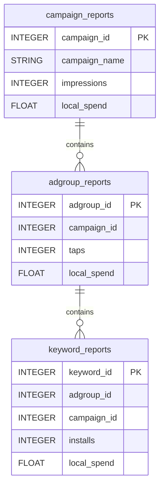

# Apple Search Ads


Sync your Apple Search Ads performance (campaigns, ad groups and keywords) into your warehouse.


***

## Prerequisites

* An Apple Ads user with an API role, invited by an account administrator.
* A public key uploaded in **Apple Ads > Account Settings > API**, and the matching private key (`.p8`).
* Your **Organization ID**.

***

## Authentication

The connector uses **OAuth 2.0 client credentials** signed with your private key. Upload a public key in **Apple Ads > Account Settings > API** to get your **Client ID**, **Team ID** and **Key ID**, then enter them with your **Organization ID** and **Private Key (.p8)**. You generate the private key yourself (for example with OpenSSL) and upload only the public key.

***

## Setup Instructions



**Enter your credentials**

Fill in **Client ID**, **Team ID**, **Key ID**, **Organization ID** and paste the content of your **Private Key (.p8)**.



**Choose your reports**

Select the reports to sync.



***

## Data Model

***

## Available Reports

### Campaign Reports

Daily performance, one row per campaign per day.

#### Dimensions

| Column | Type | Description |
|---|---|---|
| `campaign_id` | INTEGER | Unique identifier for the campaign (primary key) |
| `campaign_name` | STRING | Name of the campaign |
| `status` | STRING | Campaign serving status (ENABLED, PAUSED, DELETED) |
| `adam_id` | INTEGER | App Store application ID linked to the campaign |
| `currency` | STRING | Currency code for spend and cost metrics (e.g. USD) |

#### Metrics

| Column | Type | Description |
|---|---|---|
| `impressions` | INTEGER | Number of ad impressions |
| `taps` | INTEGER | Number of taps on the ad |
| `installs` | INTEGER | Total number of app installs |
| `new_downloads` | INTEGER | Number of first-time app downloads |
| `redownloads` | INTEGER | Number of app re-downloads |
| `lat_on_installs` | INTEGER | Installs from users with Limit Ad Tracking (LAT) enabled |
| `lat_off_installs` | INTEGER | Installs from users with Limit Ad Tracking (LAT) disabled |
| `ttr` | FLOAT | Tap-through rate (taps divided by impressions) |
| `conversion_rate` | FLOAT | Conversion rate (installs divided by taps) |
| `local_spend` | FLOAT | Total spend in the account local currency |
| `avg_cpa` | FLOAT | Average cost per acquisition in account currency |
| `avg_cpt` | FLOAT | Average cost per tap in account currency |
| `avg_cpm` | FLOAT | Average cost per thousand impressions in account currency |

### Ad Group Reports

Daily performance, one row per ad group per day.

#### Dimensions

| Column | Type | Description |
|---|---|---|
| `adgroup_id` | INTEGER | Unique identifier for the ad group (primary key) |
| `adgroup_name` | STRING | Name of the ad group |
| `campaign_id` | INTEGER | Unique identifier for the parent campaign |
| `status` | STRING | Ad group serving status (ENABLED, PAUSED, DELETED) |
| `pricing_model` | STRING | Bid pricing model for the ad group (CPC or CPT) |
| `default_bid_amount` | FLOAT | Default bid amount for the ad group in account currency |
| `currency` | STRING | Currency code for spend and cost metrics (e.g. USD) |

#### Metrics

| Column | Type | Description |
|---|---|---|
| `impressions` | INTEGER | Number of ad impressions |
| `taps` | INTEGER | Number of taps on the ad |
| `installs` | INTEGER | Total number of app installs |
| `new_downloads` | INTEGER | Number of first-time app downloads |
| `redownloads` | INTEGER | Number of app re-downloads |
| `ttr` | FLOAT | Tap-through rate (taps divided by impressions) |
| `conversion_rate` | FLOAT | Conversion rate (installs divided by taps) |
| `local_spend` | FLOAT | Total spend in the account local currency |
| `avg_cpa` | FLOAT | Average cost per acquisition in account currency |
| `avg_cpt` | FLOAT | Average cost per tap in account currency |
| `avg_cpm` | FLOAT | Average cost per thousand impressions in account currency |

### Keyword Reports

Daily performance, one row per keyword per day.

#### Dimensions

| Column | Type | Description |
|---|---|---|
| `keyword_id` | INTEGER | Unique identifier for the keyword (primary key) |
| `keyword` | STRING | Keyword text used for targeting |
| `match_type` | STRING | Keyword match type (BROAD or EXACT) |
| `status` | STRING | Keyword serving status (ACTIVE, PAUSED, DELETED) |
| `adgroup_id` | INTEGER | Unique identifier for the parent ad group |
| `campaign_id` | INTEGER | Unique identifier for the parent campaign |
| `bid_amount` | FLOAT | Keyword bid amount in account currency |
| `currency` | STRING | Currency code for spend and cost metrics (e.g. USD) |

#### Metrics

| Column | Type | Description |
|---|---|---|
| `impressions` | INTEGER | Number of ad impressions for this keyword |
| `taps` | INTEGER | Number of taps on the ad for this keyword |
| `installs` | INTEGER | Total number of app installs attributed to this keyword |
| `new_downloads` | INTEGER | Number of first-time app downloads attributed to this keyword |
| `redownloads` | INTEGER | Number of app re-downloads attributed to this keyword |
| `ttr` | FLOAT | Tap-through rate for this keyword |
| `conversion_rate` | FLOAT | Conversion rate for this keyword |
| `local_spend` | FLOAT | Total spend for this keyword in account local currency |
| `avg_cpa` | FLOAT | Average cost per acquisition for this keyword in account currency |
| `avg_cpt` | FLOAT | Average cost per tap for this keyword in account currency |

***

## Scheduling

| Setting | Default | Options |
|---|---|---|
| **Frequency** | Daily | Daily, Weekly |
| **Sync time** | 4:00 AM | — |
| **Lookback window** | 3 days | 1, 3, 7 days |
| **Historical load** | Up to 1 year | 3 months, 6 months, 12 months or custom dates |

***

## Notes

* Spend and cost metrics are in the account currency, given in the `currency` column.
* Daily reports have no date column of their own: the reporting day is stored in the `_quanti_date` column added by QUANTI:.
