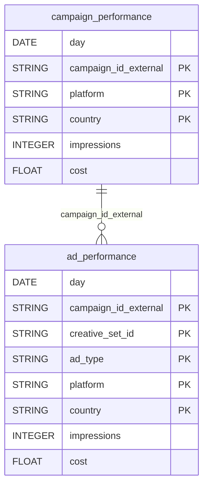

# AppLovin


Sync your AppLovin Growth advertiser performance (campaigns and creatives) into your warehouse.


***

## Prerequisites

* An AppLovin advertiser account.
* A **Report Key**, found by clicking your account in the top right of the AppLovin dashboard and selecting **Keys**.

***

## Authentication

The connector uses your AppLovin **Report Key**. Find it by clicking your account in the top right of the AppLovin dashboard and selecting **Keys**, then paste it in the setup screen.

***

## Setup Instructions



**Enter your Report Key**

Paste your AppLovin **Report Key**.



**Choose your reports**

Select the reports to sync.



***

## Data Model

***

## Available Reports

### Campaign Performance

Daily performance by campaign, platform and country.

#### Dimensions

| Column | Type | Description |
|---|---|---|
| `day` | DATE | Reporting date (YYYY-MM-DD) |
| `campaign` | STRING | Campaign name |
| `campaign_id_external` | STRING | Unique campaign reference ID (primary key) |
| `platform` | STRING | Target platform (android, fireos, ios, tvos) (primary key) |
| `country` | STRING | ISO 3166-1 alpha-2 country code (primary key) |

#### Metrics

| Column | Type | Description |
|---|---|---|
| `impressions` | INTEGER | Number of ad impressions served |
| `clicks` | INTEGER | Number of ad clicks |
| `conversions` | INTEGER | Number of attributed installs or conversions |
| `cost` | FLOAT | Total advertiser spend in USD |
| `ctr` | FLOAT | Click-through rate (clicks / impressions) |
| `conversion_rate` | FLOAT | Conversion rate (conversions / clicks) |
| `average_cpa` | FLOAT | Average cost per conversion in USD |

### Ad Performance

Daily creative-level performance by campaign, creative set, ad type, platform and country.

#### Dimensions

| Column | Type | Description |
|---|---|---|
| `day` | DATE | Reporting date (YYYY-MM-DD) |
| `campaign_id_external` | STRING | Unique campaign reference ID (primary key) |
| `creative_set_id` | STRING | Unique creative set identifier (primary key) |
| `ad` | STRING | Name of the advertisement |
| `ad_type` | STRING | Ad type (APPOPEN, GRAPHIC, PLAY, REWARD, VIDEO) (primary key) |
| `platform` | STRING | Target platform (android, fireos, ios, tvos) (primary key) |
| `country` | STRING | ISO 3166-1 alpha-2 country code (primary key) |

#### Metrics

| Column | Type | Description |
|---|---|---|
| `impressions` | INTEGER | Number of ad impressions served |
| `clicks` | INTEGER | Number of ad clicks |
| `cost` | FLOAT | Total advertiser spend in USD |
| `ctr` | FLOAT | Click-through rate (clicks / impressions) |

***

## Scheduling

| Setting | Default | Options |
|---|---|---|
| **Frequency** | Daily | Daily, Weekly |
| **Sync time** | 6:00 AM | — |
| **Lookback window** | 3 days | 1, 3, 7 days |
| **Historical load** | Up to 1 year | 3 months, 6 months, 12 months or custom dates |

