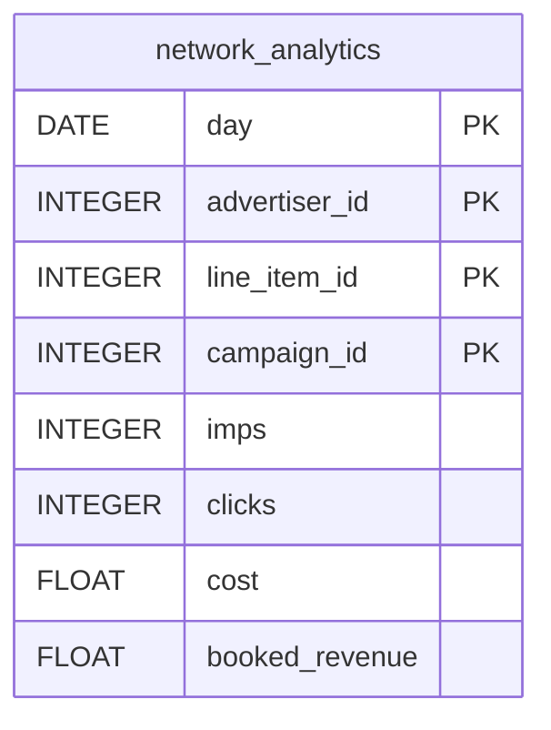

# AppNexus


Sync your AppNexus (Xandr) advertising performance into your warehouse.


***

## Prerequisites

* An AppNexus / Xandr username and password **with API access**.
* At least one active advertiser accessible with these credentials.

***

## Authentication

The connector uses your AppNexus **username** and **password**. QUANTI: generates a session token from them automatically.

***

## Setup Instructions



**Enter your credentials**

Enter your **AppNexus Username** and **AppNexus Password**.



**Select your advertisers**

Select the advertiser(s) to sync.



**Choose your reports**

Select the reports to sync.



***

## Data Model

***

## Available Reports

### Network Analytics

Daily performance by advertiser, line item and campaign: impressions, clicks, cost, revenue and conversions.

#### Dimensions

| Column | Type | Description |
|---|---|---|
| `day` | DATE | Report date (YYYY-MM-DD) (primary key) |
| `advertiser_id` | INTEGER | Advertiser ID (primary key) |
| `advertiser_name` | STRING | Advertiser name |
| `line_item_id` | INTEGER | Line item ID (primary key) |
| `line_item_name` | STRING | Line item name |
| `campaign_id` | INTEGER | Campaign ID (primary key) |
| `campaign_name` | STRING | Campaign name |

#### Metrics

| Column | Type | Description |
|---|---|---|
| `imps` | INTEGER | Total number of impressions served |
| `clicks` | INTEGER | Total number of clicks |
| `ctr` | FLOAT | Click-through rate (clicks / imps) |
| `cost` | FLOAT | Media cost paid to publishers (in member currency) |
| `booked_revenue` | FLOAT | Revenue booked through the buyer |
| `reseller_revenue` | FLOAT | Revenue earned by the reseller member |
| `profit` | FLOAT | Profit (booked_revenue minus cost) |
| `total_convs` | INTEGER | Total number of post-click and post-view conversions |
| `convs_rate` | FLOAT | Conversion rate (total_convs / clicks) |
| `cpm` | FLOAT | Cost per thousand impressions (cost / imps * 1000) |

***

## Scheduling

| Setting | Default | Options |
|---|---|---|
| **Frequency** | Daily | Daily, Weekly, Monthly |
| **Sync time** | 6:00 AM | — |
| **Lookback window** | 4 days | 1, 3, 4, 7, 14 days |
| **Historical load** | Up to 1 year | 3 months, 6 months, 12 months or custom dates |

