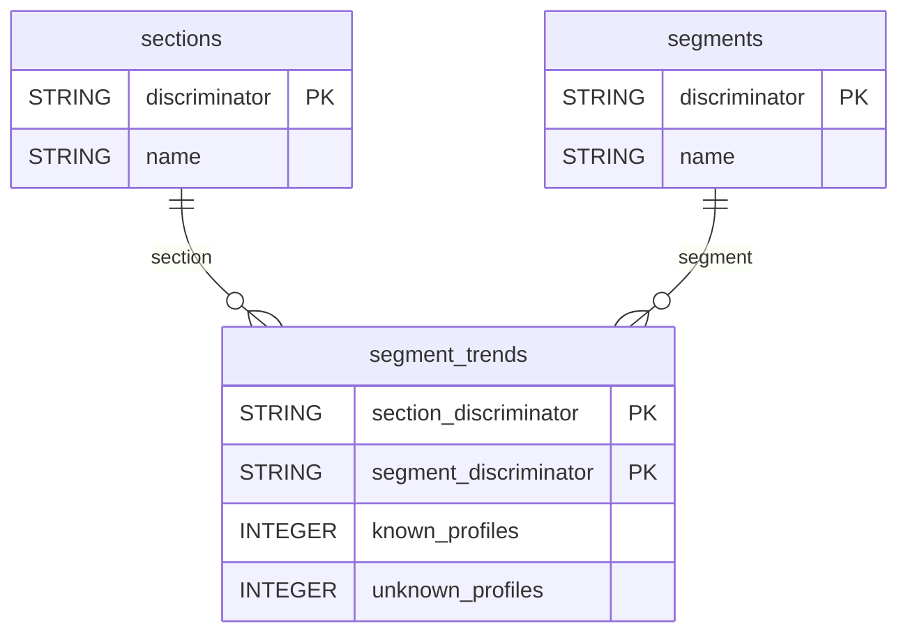

# Apsis One


Sync your Apsis One audience data (sections, segments and daily segment profile counts) into your warehouse.


***

## Prerequisites

* An Apsis One user with **Admin** rights.
* An API key (Client ID and Client Secret).

***

## Authentication

The connector uses **OAuth 2.0 client credentials**. Create an API key in **Profile icon > Account settings > API Management**, then enter its **Client ID** and **Client Secret**. The secret is shown only once at creation.

***

## Setup Instructions



**Enter your API key**

Enter your **Client ID** and **Client Secret**, then select your **Region**: Europe (`api.apsis.one`) or Asia-Pacific (`api-apac.apsis.one`).



**Choose your reports**

Select the reports to sync.



***

## Data Model

***

## Available Reports

### Segment Trends

Daily snapshot of matching profile counts, one row per section and segment per day.

#### Dimensions

| Column | Type | Description |
|---|---|---|
| `section_discriminator` | STRING | Section identifier the segment trend was measured in (primary key) |
| `segment_discriminator` | STRING | Segment identifier (primary key) |
| `segment_name` | STRING | Segment display name |

#### Metrics

| Column | Type | Description |
|---|---|---|
| `known_profiles` | INTEGER | Number of identified profiles matching the segment in this section |
| `unknown_profiles` | INTEGER | Number of anonymous profiles matching the segment in this section |

### Sections

One row per audience section.

| Column | Type | Description |
|---|---|---|
| `discriminator` | STRING | Unique section identifier (slug) (primary key) |
| `name` | STRING | Section display name |
| `description` | STRING | Section description |
| `id` | STRING | Section numeric identifier |

### Segments

One row per audience segment.

| Column | Type | Description |
|---|---|---|
| `discriminator` | STRING | Unique segment identifier (slug) (primary key) |
| `name` | STRING | Segment display name |
| `description` | STRING | Segment description |

***

## Scheduling

| Setting | Default | Options |
|---|---|---|
| **Frequency** | Daily | Daily, Weekly |
| **Sync time** | 3:00 AM | — |
| **Lookback window** | 5 days | 1, 3, 5 days |
| **Historical load** | Up to 1 year | 3 months, 6 months, 12 months or custom dates |

***

## Notes

* Daily reports have no date column of their own: the reporting day is stored in the `_quanti_date` column added by QUANTI:.
