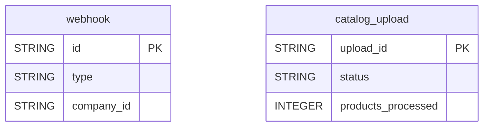

# Attentive


Sync your Attentive SMS marketing configuration data (webhooks and product catalog uploads) into your warehouse for operational monitoring.


***

## Prerequisites

* An Attentive account with access to the **Marketplace**, to create a custom app.

***

## Authentication

The connector uses an **API key**. It is sent as a Bearer token in the Authorization header of every request.

***

## Setup Instructions



**Generate an API key**

In Attentive, go to **Marketplace > Create App**, grant it access to the needed APIs, and copy the API key. It is shown only once.



**Enter the API key**

Paste the key in the **Attentive API Key** field.



**Choose your reports**

Choose the reports to sync.



***

## Data Model

***

## Available Reports

### Webhooks

List of configured Attentive webhook subscriptions with their event types and status.

| Column | Type | Description |
|---|---|---|
| `id` | STRING | Webhook unique identifier (primary key) |
| `url` | STRING | Destination URL receiving webhook payloads |
| `type` | STRING | Webhook type: SUBSCRIPTION or STATIC |
| `events` | STRING | Comma-separated list of subscribed event types (e.g. sms.subscribed, sms.sent) |
| `company_id` | STRING | Attentive company identifier that installed this webhook |
| `disabled_at` | STRING | Timestamp when the webhook was disabled (null if active) |

### Catalog Uploads

History of product catalog uploads and their ingestion status.

#### Dimensions

| Column | Type | Description |
|---|---|---|
| `upload_id` | STRING | Unique identifier for the catalog upload job (primary key) |
| `status` | STRING | Upload workflow status: initialized, validating, validated, or completed |
| `last_updated` | TIMESTAMP | Timestamp of the most recent status update for this upload |
| `validate_only` | BOOLEAN | Whether this upload was validation-only (products not saved to catalog) |

#### Metrics

| Column | Type | Description |
|---|---|---|
| `products_received` | INTEGER | Total number of products seen during validation |
| `products_processed` | INTEGER | Number of products successfully validated and ingested |

***

## Scheduling

| Setting | Default | Options |
|---|---|---|
| **Frequency** | Daily | Daily, Weekly |
| **Sync time** | 3:00 AM | — |
| **Lookback window** | Not available | — |
| **Historical load** | Not available | — |

***

## Notes

* `disabled_at` is stored as text (STRING), not as a timestamp.
* Catalog Uploads is loaded in append mode: each sync adds new rows, so the same upload can appear several times.
