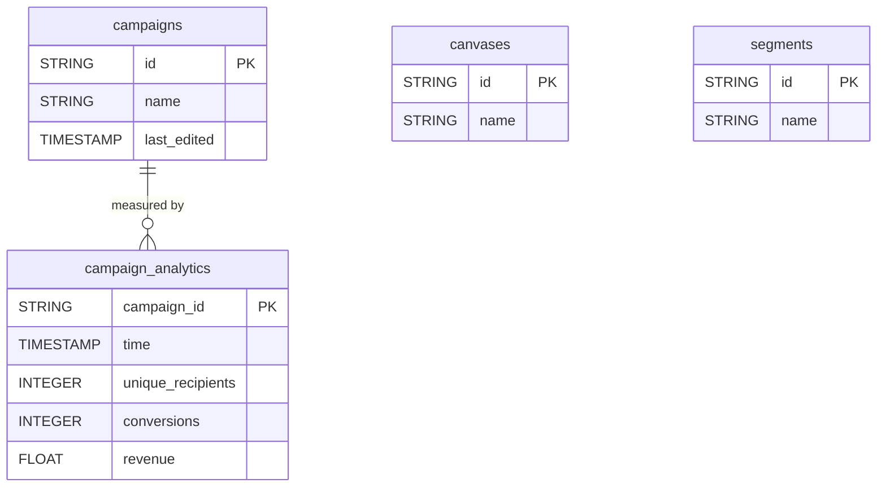

# Braze


Sync your Braze customer engagement data (campaign analytics, campaigns, Canvases, segments) into your warehouse for campaign and audience analysis.


***

## Prerequisites

* A Braze **REST API key** with read permissions on the desired endpoints.
* Your instance-specific **REST endpoint** (e.g. `rest.iad-01.braze.com`).

***

## Authentication

The connector uses a **REST API key** together with your instance-specific REST endpoint.

***

## Setup Instructions



**Generate a REST API key**

In the Braze Dashboard, go to **Settings > APIs and Identifiers** and create a REST API key with read permissions.



**Copy your REST endpoint**

On the same page, copy your instance-specific REST endpoint (e.g. `rest.iad-01.braze.com`). Do not include `https://`.



**Enter both values**

Enter the **REST API Key** and the **REST Endpoint** in the connector setup.



**Choose your reports**

Choose the reports to sync.



***

## Data Model

***

## Available Reports

### Campaign Analytics

Daily campaign-level performance metrics (recipients, conversions, revenue) across all message channels.

#### Dimensions

| Column | Type | Description |
|---|---|---|
| `campaign_id` | STRING | Unique campaign API identifier, joins `campaigns.id` (primary key) |
| `time` | TIMESTAMP | Date of the analytics data point |

#### Metrics

| Column | Type | Description |
|---|---|---|
| `unique_recipients` | INTEGER | Number of unique recipients for the campaign on this date |
| `conversions` | INTEGER | Number of conversions for the primary conversion event |
| `conversions1` | INTEGER | Number of conversions for the second conversion event |
| `conversions2` | INTEGER | Number of conversions for the third conversion event |
| `conversions3` | INTEGER | Number of conversions for the fourth conversion event |
| `revenue` | FLOAT | Total revenue generated by this campaign on this date |

### Campaigns

Braze campaigns with their metadata.

| Column | Type | Description |
|---|---|---|
| `id` | STRING | Unique campaign API identifier (primary key) |
| `name` | STRING | Campaign name |
| `last_edited` | TIMESTAMP | Datetime the campaign was last modified |
| `is_api_campaign` | BOOLEAN | Whether the campaign is an API-triggered campaign |
| `tags` | STRING | Comma-separated list of campaign tags |

### Canvases

Braze Canvases with their metadata.

| Column | Type | Description |
|---|---|---|
| `id` | STRING | Unique Canvas API identifier (primary key) |
| `name` | STRING | Canvas name |
| `last_edited` | TIMESTAMP | Datetime the Canvas was last modified |
| `tags` | STRING | Comma-separated list of Canvas tags |

### Segments

Braze segments with their metadata.

| Column | Type | Description |
|---|---|---|
| `id` | STRING | Unique segment API identifier (primary key) |
| `name` | STRING | Segment name |
| `analytics_tracking_enabled` | BOOLEAN | Whether analytics tracking is enabled for this segment |
| `tags` | STRING | Comma-separated list of segment tags |

***

## Scheduling

| Setting | Default | Options |
|---|---|---|
| **Frequency** | Daily | Daily, Weekly |
| **Sync time** | 3:00 AM | — |
| **Lookback window** | 5 days | 1, 3, 5 days |
| **Historical load** | Up to 365 days | 3, 6, 12 months or custom dates |

***

## Notes

* Campaigns, Canvases and Segments are loaded in append mode: each sync adds new rows, so the same item can appear several times.
