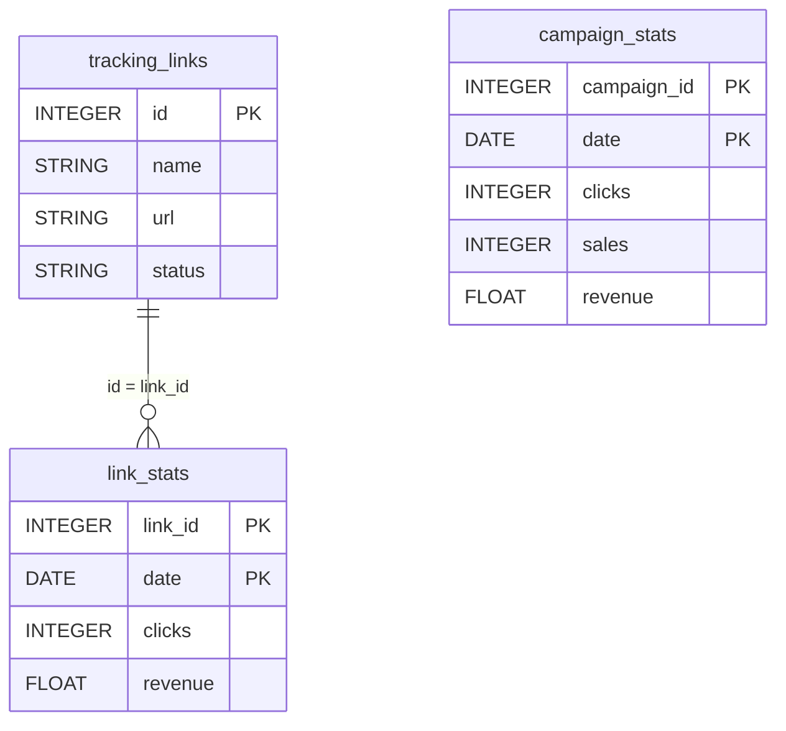

# ClickMagick


Sync your ClickMagick click tracking data (tracking links, link stats, campaign stats) into your warehouse for campaign performance and conversion analysis.


***

## Prerequisites

* A **ClickMagick** account with access to the **API** page (**Profile** dropdown > **Integrations > API**).

***

## Authentication

The connector uses an **API key**, generated in ClickMagick from the **Profile** dropdown, under **Integrations > API**.

***

## Setup Instructions



**Generate an API key**

In ClickMagick, open the **Profile** dropdown, go to **Integrations > API** and click **Generate API Key**.



**Enter your API key**

Enter the **ClickMagick API Key**.



**Choose your reports**

Choose the reports to sync: tracking links, link stats and campaign stats.



**Name your connector**

Give the connector a name, then click **Create**.



***

## Data Model

***

## Available Reports

### Tracking Links

List of all tracking links with their configuration and metadata.

| Column | Type | Description |
|---|---|---|
| `id` | INTEGER | Unique tracking link ID (primary key) |
| `name` | STRING | Tracking link display name |
| `nickname` | STRING | Short URL slug or nickname for the tracking link |
| `url` | STRING | Full tracking URL |
| `primary_url` | STRING | Destination (primary redirect) URL |
| `group` | STRING | Link group or folder name |
| `status` | STRING | Link status (active, paused, etc.) |
| `type` | STRING | Link type (standard, rotator, etc.) |
| `created_at` | TIMESTAMP | Timestamp when the link was created |
| `updated_at` | TIMESTAMP | Timestamp when the link was last updated |

### Link Stats

Daily click and conversion statistics per tracking link.

#### Dimensions

| Column | Type | Description |
|---|---|---|
| `link_id` | INTEGER | Tracking link ID (primary key) |
| `link_name` | STRING | Tracking link display name |
| `date` | DATE | Statistics date (primary key) |

#### Metrics

| Column | Type | Description |
|---|---|---|
| `clicks` | INTEGER | Total number of clicks |
| `unique_clicks` | INTEGER | Number of unique clicks (deduplicated by visitor) |
| `actions` | INTEGER | Number of action conversions (intermediate goals) |
| `leads` | INTEGER | Number of lead/opt-in conversions |
| `sales` | INTEGER | Number of sale conversions |
| `cost` | FLOAT | Total ad spend / cost for the link |
| `revenue` | FLOAT | Total revenue generated from conversions |
| `profit` | FLOAT | Net profit (revenue minus cost) |
| `roi` | FLOAT | Return on investment as a decimal (e.g. 2.5 = 250%) |
| `epc` | FLOAT | Earnings per click |
| `ctr` | FLOAT | Click-through rate as a decimal |

### Campaign Stats

Daily click and conversion statistics per campaign (project), including actions, leads and sales.

#### Dimensions

| Column | Type | Description |
|---|---|---|
| `campaign_id` | INTEGER | Campaign (project) ID (primary key) |
| `campaign_name` | STRING | Campaign (project) name |
| `date` | DATE | Statistics date (primary key) |

#### Metrics

| Column | Type | Description |
|---|---|---|
| `clicks` | INTEGER | Total number of clicks |
| `unique_clicks` | INTEGER | Number of unique clicks |
| `actions` | INTEGER | Number of action conversions (intermediate goals) |
| `engagements` | INTEGER | Number of engagement (lead/opt-in) conversions |
| `sales` | INTEGER | Number of sale conversions |
| `cost` | FLOAT | Total ad spend / cost for the campaign |
| `revenue` | FLOAT | Total revenue from sales conversions |
| `profit` | FLOAT | Net profit (revenue minus cost) |
| `roi` | FLOAT | Return on investment as a decimal |
| `epc` | FLOAT | Earnings per click |

***

## Scheduling

| Setting | Default | Options |
|---|---|---|
| **Frequency** | Daily | Daily, Weekly |
| **Sync time** | 3:00 AM | — |
| **Lookback window** | 3 days | 1, 3, 7 days |
| **Historical load** | Up to 1 year | 3, 6, 12 months or custom dates |

***

## Notes

* In ClickMagick, a campaign is a project: `campaign_id` and `campaign_name` refer to the project.
