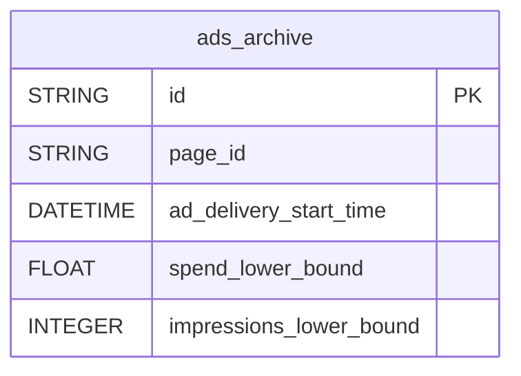

# Meta Ads Library


Track archived Facebook and Instagram ads, yours or your competitors', from the Meta Ad Library: creatives, delivery windows and, where available, spend and reach ranges.


***

## Prerequisites

* The **ID** of each Facebook Page to track (numeric, e.g. `109061981944231`).

***

## Authentication

No authentication is required: you only enter the IDs of the Facebook Pages to track.

***

## Setup Instructions



**Enter your Facebook Pages**

Enter the ID(s) of the Facebook Page(s) to track, yours or a competitor's. Page IDs are numeric.



**Choose your reports**

Choose the reports to enable.



**Name your connector**

Give the connector a name, then click **Create**.



***

## Data Model

***

## Available Reports

### Ads Archive

Archived ads (active and past) delivered by the selected Page, with creative metadata, spend and impressions ranges for political/issue ads, and EU reach for ads delivered to the EU.

#### Dimensions

| Column | Type | Description |
|---|---|---|
| `id` | STRING | Ad Library ID of the archived ad (primary key) |
| `page_id` | STRING | Facebook Page ID that ran the ad |
| `page_name` | STRING | Name of the Facebook Page that ran the ad |
| `ad_creation_time` | DATETIME | UTC timestamp when the ad was created |
| `ad_delivery_start_time` | DATETIME | Scheduled ad delivery start date/time (UTC) |
| `ad_delivery_stop_time` | DATETIME | Scheduled ad delivery end date/time (UTC). Null while the ad is still active |
| `ad_creative_bodies` | STRING | Text displayed in each unique ad card variation (JSON array, serialized as string) |
| `ad_creative_link_titles` | STRING | Link titles in the call-to-action section (JSON array, serialized as string) |
| `ad_creative_link_descriptions` | STRING | Link descriptions in the call-to-action section (JSON array, serialized as string) |
| `ad_creative_link_captions` | STRING | Call-to-action captions for each ad card (JSON array, serialized as string) |
| `ad_snapshot_url` | STRING | URL to the archived ad's full rendered snapshot (media included) |
| `publisher_platforms` | STRING | Meta platforms where the ad appeared (FACEBOOK, INSTAGRAM, AUDIENCE_NETWORK, MESSENGER, THREADS) — JSON array, serialized as string |
| `languages` | STRING | Languages of the ad, ISO 639-1 codes (JSON array, serialized as string) |
| `currency` | STRING | ISO currency code for spend, when available |
| `bylines` | STRING | Funding source attribution disclosed for political/issue ads |

#### Metrics

| Column | Type | Description |
|---|---|---|
| `spend_lower_bound` | FLOAT | Lower bound of estimated spend range. Only populated for POLITICAL_AND_ISSUE_ADS or ads reaching the EU (DSA) — null otherwise |
| `spend_upper_bound` | FLOAT | Upper bound of estimated spend range. Only populated for POLITICAL_AND_ISSUE_ADS or ads reaching the EU (DSA) — null otherwise |
| `impressions_lower_bound` | INTEGER | Lower bound of estimated impressions range. Only populated for POLITICAL_AND_ISSUE_ADS or ads reaching the EU (DSA) — null otherwise |
| `impressions_upper_bound` | INTEGER | Upper bound of estimated impressions range. Only populated for POLITICAL_AND_ISSUE_ADS or ads reaching the EU (DSA) — null otherwise |
| `estimated_audience_size_lower_bound` | INTEGER | Lower bound of estimated accounts meeting targeting criteria. Only populated for POLITICAL_AND_ISSUE_ADS or ads reaching the EU (DSA) — null otherwise |
| `estimated_audience_size_upper_bound` | INTEGER | Upper bound of estimated accounts meeting targeting criteria. Only populated for POLITICAL_AND_ISSUE_ADS or ads reaching the EU (DSA) — null otherwise |
| `eu_total_reach` | INTEGER | Combined estimated reach across EU locations. Only populated for ads reaching the EU |
| `br_total_reach` | INTEGER | Estimated reach for Brazil political ads. Only populated for POLITICAL_AND_ISSUE_ADS reaching Brazil |

***

## Custom Requests

Besides the Ads Archive report, you can build custom requests on the Ad Library with the parameters below.

| Parameter | Required | Default | Description |
|---|---|---|---|
| `fields` | ✅ | — | Ad Library fields to retrieve (e.g. `id`, `page_name`, `ad_creative_bodies`, `spend`, `impressions`) |
| `ad_type` | — | `ALL` | Ad category: `ALL`, `EMPLOYMENT_ADS`, `FINANCIAL_PRODUCTS_AND_SERVICES_ADS`, `HOUSING_ADS` or `POLITICAL_AND_ISSUE_ADS`. Spend and impressions are only returned for `POLITICAL_AND_ISSUE_ADS` |
| `ad_active_status` | — | `ALL` | Delivery status: `ACTIVE`, `INACTIVE` or `ALL` |
| `ad_reached_countries` | — | EU countries + `GB` | ISO country codes the ad must have reached. Use EU country codes, not `ALL`, to surface commercial ads |
| `publisher_platforms` | — | — | Restrict to specific platforms: `FACEBOOK`, `INSTAGRAM`, `AUDIENCE_NETWORK`, `MESSENGER`, `THREADS` |

***

## Scheduling

| Setting | Default | Options |
|---|---|---|
| **Frequency** | Daily | Daily, Weekly |
| **Sync time** | 6:00 AM | — |
| **Lookback window** | 3 days | 3, 7, 14, 30 days |
| **Historical load** | Up to 5 years | 3, 6, 12, 24 months or custom dates |

***

## Notes

* Spend, impressions and audience size ranges are only populated for **political/issue ads**. `eu_total_reach` is only populated for ads delivered to the EU.
* A commercial (non-political) ad that never reached the EU is not in the Ad Library archive at all.
* List columns (`ad_creative_*`, `publisher_platforms`, `languages`) hold a JSON array serialized as a string.
* `ad_delivery_stop_time` is empty while the ad is still active.
