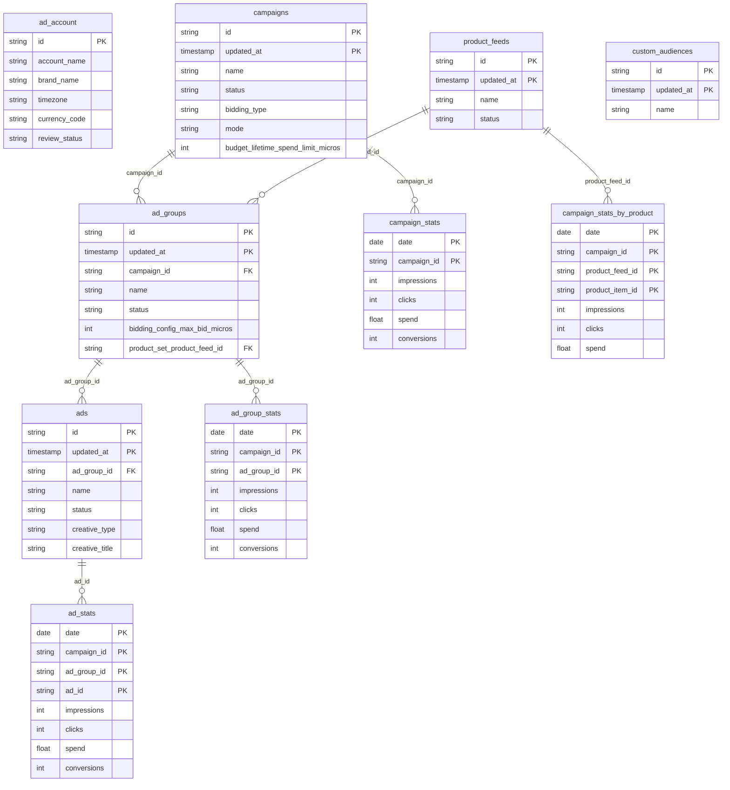

# OpenAI Ads


This connector pulls your **ChatGPT Ads** data from OpenAI Ads Manager through the [OpenAI Ads API](https://developers.openai.com/ads). It authenticates with an Ads Manager API key.


<a href="https://dbdiagram.io/d/[OpenAi-Ads]-6b0855db4af980b2fb9c018d" class="button primary" data-icon="table-tree">Prebuilt reports and definition</a>

***

## Overview

The OpenAI Ads connector loads the structure of your ChatGPT campaigns (campaigns, ad groups, ads) and their daily performance into your data warehouse, so you can report on ChatGPT alongside your other advertising channels.

Data is split into two types:

* **Configuration tables**: campaigns, ad groups, ads, custom audiences, product feeds and the ad account itself. A new row is appended whenever an object changes (`updated_at`).
* **Stats tables**: daily delivery metrics (impressions, clicks, spend) and attributed conversions, at account, campaign, ad group and ad level, with optional breakdowns by country, device, platform or product.

***

## Prerequisites

* An active **OpenAI Ads Manager** account ([ads.openai.com](https://ads.openai.com))
* An **Ads Manager API key**


The Ads Manager API key is **not** your OpenAI platform API key (the one used for the OpenAI API). Ads Manager keys start with `sk-ads-`.


***

## Authentication

Generate the API key in Ads Manager: **ads.openai.com > Settings > API Keys**.

One API key gives access to **one ad account**. To sync several ad accounts, create one connector per account, each with its own key.

***

## Setup Instructions



**Enter your API key**

Paste the Ads Manager API key generated in the previous section.



**Select your Prebuilt reports**

Choose which prebuilt reports to activate. See the [Prebuilt Reports](#prebuilt-reports) section for a description of each table.



**Name your connector**

Give the connector a unique name within your QUANTI: project, then click **Create**.



***

## Prebuilt Reports

The connector provides **27 prebuilt tables** organized into three groups: configuration, delivery performance and conversions.

### Data model

👉 [Open interactive diagram on dbdiagram.io](https://dbdiagram.io/d/[OpenAi-Ads]-6b0855db4af980b2fb9c018d)


Amounts are expressed in the ad account currency (`ad_account.currency_code`). Fields ending in `_micros` are in micros: divide by 1,000,000 to get the actual amount.


### Configuration

| Table | Description |
|---|---|
| `ad_account` | Ad account settings: names, destination URL, status, timezone, currency and brand review status. Key: `id`. |
| `campaigns` | Campaign configuration: status, schedule, optimization goal (`bidding_type`), mode (`product_feed` or standard), lifetime budget, location/platform/audience targeting. Key: `id` + `updated_at`. |
| `ad_groups` | Ad group configuration: status, context hints, billing event, max bid, audience bid multipliers, product feed and filters. Key: `id` + `updated_at`. |
| `ads` | Ad configuration and creative content: format (e.g. `chat_card`), title, body, landing page URL. Key: `id` + `updated_at`. |
| `custom_audiences` | Custom audiences available for targeting. Key: `id` + `updated_at`. |
| `product_feeds` | Merchant product feeds used by product-feed campaigns. Key: `id` + `updated_at`. |

Targeting and filter fields that hold lists (e.g. `targeting_locations_include`, `context_hints`, `product_set_filters`) are stored as a JSON array serialized as a string.

### Delivery performance

Daily metrics, one row per day and per object. Tables with a breakdown add one column to the key.

| Table | Level | Breakdown |
|---|---|---|
| `ad_account_stats` | Ad account | None |
| `ad_account_stats_by_country` | Ad account | `country_name` |
| `campaign_stats` | Campaign | None |
| `campaign_stats_by_country` | Campaign | `country_name` |
| `campaign_stats_by_device` | Campaign | `device_type` |
| `campaign_stats_by_platform` | Campaign | `platform` |
| `campaign_stats_by_product` | Campaign | `product_feed_id` + `product_item_id` |
| `ad_group_stats` | Ad group | None |
| `ad_group_stats_by_device` | Ad group | `device_type` |
| `ad_group_stats_by_platform` | Ad group | `platform` |
| `ad_group_stats_by_product` | Ad group | `product_feed_id` + `product_item_id` |
| `ad_stats` | Ad | None |
| `ad_stats_by_country` | Ad | `country_name` |
| `ad_stats_by_device` | Ad | `device_type` |
| `ad_stats_by_platform` | Ad | `platform` |
| `ad_stats_by_product` | Ad | `product_feed_id` + `product_item_id` |

The OpenAI Ads API returns only one breakdown per report, which is why each breakdown is a separate table.

`platform` values: `android_app`, `android_web`, `desktop_web`, `ios_app`, `ios_web`, `web`. Use it to compare the ChatGPT apps with the web.

Product tables also include the product details from the feed: `product_title`, `product_brand`, `product_price`, `product_availability`, `product_target_url`.

All delivery tables share these metrics:

| Metric | Type | Description |
|---|---|---|
| `impressions` | INTEGER | Number of ad impressions delivered |
| `clicks` | INTEGER | Number of clicks on the ad |
| `spend` | FLOAT | Amount spent, in the ad account currency |
| `ctr` | FLOAT | Click-through rate (clicks / impressions) |
| `cpc` | FLOAT | Average cost per click |
| `cpm` | FLOAT | Average cost per 1,000 impressions |

Tables without a breakdown (`ad_account_stats`, `campaign_stats`, `ad_group_stats`, `ad_stats`) add conversion metrics:

| Metric | Type | Description |
|---|---|---|
| `conversions` | INTEGER | Attributed goal conversions |
| `cpa` | FLOAT | Spend divided by conversions, in account currency |
| `post_click_cvr` | FLOAT | Click-through conversions divided by clicks |
| `order_created_attributed_sales` | FLOAT | Attributed purchase (`order_created`) value, in account currency |
| `order_created_roas` | FLOAT | Attributed purchase value divided by spend |

### Conversions

Daily attributed conversions, split between click-through and view-through.

| Table | Level | Key |
|---|---|---|
| `ad_account_conversion_stats` | Ad account | `date` + `ad_account_id` |
| `campaign_conversion_stats` | Campaign | `date` + `campaign_id` |
| `ad_group_conversion_stats` | Ad group | `date` + `campaign_id` + `ad_group_id` |
| `ad_conversion_stats` | Ad | `date` + `campaign_id` + `ad_group_id` + `ad_id` |

| Metric | Type | Description |
|---|---|---|
| `conversions` | INTEGER | Total attributed conversions. When a conversion is eligible to both, the click takes precedence over the view. |
| `click_through_conversions` | INTEGER | Conversions attributed to a click, within the click attribution window set in Ads Manager |
| `view_through_conversions` | INTEGER | Conversions attributed to a view only, within a fixed 1-day window. Not summed into `conversions`. |
| `order_created_attributed_sales` | FLOAT | Attributed purchase (`order_created`) value |
| `order_created_attributed_sales_currency` | STRING | Currency of the attributed sales |


Conversion tables are only filled if conversion tracking (Measurement Pixel or Conversions API) is set up in Ads Manager.


***

<a href="https://dbdiagram.io/d/[OpenAi-Ads]-6b0855db4af980b2fb9c018d" class="button primary" data-icon="table-tree">Prebuilt reports and definition</a>

***

## Scheduling

| Setting | Default | Options |
|---|---|---|
| **Frequency** | Daily | Daily |
| **Sync time** | 3:00 AM | — |
| **Lookback window** | 30 days | 7, 14, 30 days |
| **Historical load** | — | 3, 6, 12 months or custom dates (up to 365 days) |


Stats tables use a **delete-insert** strategy: each run deletes and reloads every day of the lookback window, so late conversions are picked up. Configuration tables are **append-only**: a new row is added when an object changes.


***

## Troubleshooting

Authentication error (401)

Check that you used an **Ads Manager** API key (`sk-ads-…`), not an OpenAI platform key. If the key was deleted or regenerated in Ads Manager, update it in the connector's **Settings** tab.

Conversion tables are empty

Conversions only appear once a conversion event is set up in Ads Manager (Measurement Pixel or Conversions API) and attached to your campaigns.

Product tables are empty

`*_stats_by_product` tables and `product_feeds` only contain data for campaigns running in **product feed** mode. They stay empty for standard campaigns.

Need help?

Contact QUANTI: support at support@quanti.io or consult our documentation at https://docs.quanti.io

