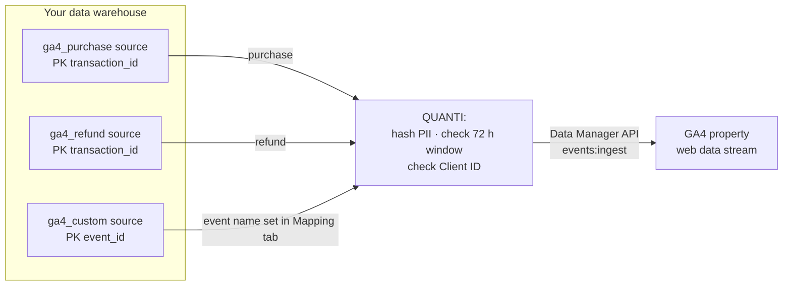

# Google Analytics 4 (Reverse)


**Reverse connector** — this connector pushes events **from** your data warehouse **to** a Google Analytics 4 property, through the Google **Data Manager API**. Use it to bring events the Google tag cannot see (orders confirmed in your back-office, in-store sales, refunds, qualified leads) into your GA4 reports and audiences.

To send offline conversions for Google Ads bidding, use the **Google Ads (Reverse)** connector. Both connectors can run side by side on the same source tables.


***

## Prerequisites

* A **Google account** with **Editor** access to the target GA4 property.
* A GA4 property with **one web data stream** (or a single app data stream). QUANTI: detects the stream automatically — see [Notes](#notes).
* A **GA4 Client ID** (or App Instance ID) for every event, in your data warehouse. In practice it comes from the native GA4 BigQuery export, where `user_pseudo_id` **is** the Client ID, or from a column captured on your site. The QUANTI: tag does not collect it.
* A source table or view in your data warehouse with **one row per event**.

***

## Authentication

The connector uses **Google OAuth 2.0**. You authorize QUANTI: once from the setup screen; no API key to copy.

Requested scopes: `datamanager` (send events), `analytics.readonly` (list your accounts, properties and data streams) and `userinfo.email`.

***

## Setup Instructions



**Authorize your Google account**

Click **Continue with Google** and sign in with the Google account that has **Editor** access to the GA4 property you want to send events to.



**Select your GA4 account**

Select the Google Analytics account that owns the property.



**Select your property**

Pick the GA4 property that will receive the events. Its web data stream is detected automatically.



**Choose your event types**

Pick the events you want to push: **Purchase**, **Refund**, or **Custom event** to push an event of your own. Each template comes with the parameters that matter for it.



**Name your connector**

Give the connector a name, then click **Create**. The source table and field mapping of each activated event template are configured in the **Mapping** tab after creation.



***

## Data Model

Each event template reads its own source table (or view). QUANTI: turns every row into one GA4 event and sends it to the selected property.

***

## Event Types

### Purchase

Sends server-side `purchase` events. Use it to bring offline or back-office revenue (orders confirmed after payment, in-store sales) into your GA4 reports and audiences, alongside what the Google tag collects on the site.

One row per purchase — or one row per purchased item, see [Basket items](#basket-items).

| Field | Type | Required | Description |
|---|---|---|---|
| `transaction_id` | STRING | ✅ | Order identifier (primary key). Required by GA4 for purchase events, and used as the deduplication key against the client-side event. |
| `event_timestamp` | TIMESTAMP | ✅ | UTC timestamp of the event (RFC3339). GA4 rejects anything older than **72 hours**: rows outside that window are skipped and reported as `EVENT_TIMESTAMP_TOO_OLD`. |
| `value` | FLOAT | ✅ | Total revenue of the purchase in the specified currency. |
| `currency` | STRING | ✅ | ISO 4217 currency code (`EUR`, `USD`, `GBP`…). |
| `client_id` | STRING | — | GA4 Client ID of the web visitor — the value GA4 exports as `user_pseudo_id`. Each row needs `client_id` or `app_instance_id`, see [User identifier](#user-identifier). |
| `app_instance_id` | STRING | — | Firebase app instance identifier — the app equivalent of the Client ID. Only for app data streams. |
| `user_id` | STRING | — | Your own user identifier, for User-ID measurement. Use it when the event comes from a logged-in context. |
| `gclid` | STRING | — | Google click identifier captured at conversion time. Improves attribution. |
| `item_id` | STRING | — | Identifier of the purchased product (SKU). One item per row. |
| `item_name` | STRING | — | Human-readable product name. |
| `quantity` | INTEGER | — | Number of units for this item. |
| `unit_price` | FLOAT | — | Price of a single unit, in the event currency. |
| `email` | STRING | — | User email. QUANTI: normalizes it (lowercase, whitespace removed, Gmail dot/alias rules) then hashes it with SHA-256. |
| `phone_number` | STRING | — | User phone. QUANTI: normalizes it to E.164 (default region FR) then hashes it with SHA-256. |
| `first_name` | STRING | — | User first name. Hashed with SHA-256. |
| `last_name` | STRING | — | User last name. Hashed with SHA-256. |
| `country_code` | STRING | — | ISO 3166-1 alpha-2 country code (`FR`, `US`…). Sent unhashed, as Google expects. |
| `postal_code` | STRING | — | Postal code. Sent unhashed, as Google expects. |
| `consent_ad_user_data` | STRING | — | DMA consent to send this user's data to Google, see [Consent](#consent-and-dma-european-users). |
| `consent_ad_personalization` | STRING | — | DMA consent to use this user's data for ad personalization. |

### Refund

Sends `refund` events so reported revenue reflects what was actually kept. Map the **same Transaction ID as the original purchase**: GA4 uses it to tie the refund back to the order.

| Field | Type | Required | Description |
|---|---|---|---|
| `transaction_id` | STRING | ✅ | Identifier of the order being refunded (primary key). Must match the Transaction ID sent with the original purchase event. |
| `event_timestamp` | TIMESTAMP | ✅ | UTC timestamp of the event (RFC3339). Must be less than **72 hours** old. |
| `value` | FLOAT | — | Amount refunded in the specified currency. Leave unmapped for a full refund of the original order. |
| `currency` | STRING | — | ISO 4217 currency code. Required whenever a value is sent. |
| `client_id` | STRING | — | GA4 Client ID (`user_pseudo_id`). Each row needs `client_id` or `app_instance_id`. |
| `app_instance_id` | STRING | — | Firebase app instance identifier. Only for app data streams. |
| `user_id` | STRING | — | Your own user identifier, for User-ID measurement. |
| `gclid` | STRING | — | Google click identifier captured at conversion time. |
| `item_id` | STRING | — | Identifier of the refunded product (SKU). One item per row. |
| `item_name` | STRING | — | Human-readable product name. |
| `quantity` | INTEGER | — | Number of units for this item. |
| `unit_price` | FLOAT | — | Price of a single unit, in the event currency. |
| `email` | STRING | — | User email — normalized then hashed with SHA-256. |
| `phone_number` | STRING | — | User phone — normalized to E.164 then hashed with SHA-256. |
| `first_name` | STRING | — | User first name — hashed with SHA-256. |
| `last_name` | STRING | — | User last name — hashed with SHA-256. |
| `country_code` | STRING | — | ISO 3166-1 alpha-2 country code. Sent unhashed. |
| `postal_code` | STRING | — | Postal code. Sent unhashed. |
| `consent_ad_user_data` | STRING | — | DMA consent — Ad User Data. |
| `consent_ad_personalization` | STRING | — | DMA consent — Ad Personalization. |

### Custom event

Sends any event of your own. Unlike Purchase and Refund, you choose the **event name** yourself in the **Mapping** tab — either a GA4 recommended event (`sign_up`, `login`, `add_to_cart`, `begin_checkout`, `search`…) or a name of your own. GA4 reserved event names are rejected (`INVALID_EVENT_NAME`).

| Field | Type | Required | Description |
|---|---|---|---|
| `event_id` | STRING | ✅ | Unique identifier of the row (primary key), used by QUANTI: as the deduplication key. Also sent to GA4 as an event parameter, which helps when debugging in DebugView. |
| `event_timestamp` | TIMESTAMP | ✅ | UTC timestamp of the event (RFC3339). Must be less than **72 hours** old. |
| `client_id` | STRING | — | GA4 Client ID (`user_pseudo_id`). Each row needs `client_id` or `app_instance_id`. |
| `app_instance_id` | STRING | — | Firebase app instance identifier. Only for app data streams. |
| `user_id` | STRING | — | Your own user identifier, for User-ID measurement. |
| `gclid` | STRING | — | Google click identifier captured at conversion time. |
| `transaction_id` | STRING | — | Transaction identifier, when the event relates to an order. |
| `value` | FLOAT | — | Monetary value of the event, when it has one. |
| `currency` | STRING | — | ISO 4217 currency code. Required whenever a value is sent. |
| `email` | STRING | — | User email — normalized then hashed with SHA-256. |
| `phone_number` | STRING | — | User phone — normalized to E.164 then hashed with SHA-256. |
| `first_name` | STRING | — | User first name — hashed with SHA-256. |
| `last_name` | STRING | — | User last name — hashed with SHA-256. |
| `country_code` | STRING | — | ISO 3166-1 alpha-2 country code. Sent unhashed. |
| `postal_code` | STRING | — | Postal code. Sent unhashed. |
| `consent_ad_user_data` | STRING | — | DMA consent — Ad User Data. |
| `consent_ad_personalization` | STRING | — | DMA consent — Ad Personalization. |


**Hashing is automatic.** QUANTI: normalizes and hashes `email`, `phone_number`, `first_name` and `last_name` with SHA-256 before any data leaves your warehouse. Map raw, readable values — do not pre-hash them.


***

## User identifier

GA4 attaches a server-side event to a device. Each row therefore needs a **`client_id`** (web) or an **`app_instance_id`** (app).

`user_id`, `gclid` and hashed user data **enrich** the event but do not replace the Client ID. A row with neither `client_id` nor `app_instance_id` is skipped and reported as `MISSING_USER_IDENTIFIER`.

***

## Basket items

`item_id`, `item_name`, `quantity` and `unit_price` describe **one item per row**. For a multi-item basket, either send one row per item, or leave these columns unmapped to send the transaction total only.

***

## Consent and DMA (European users)

Two optional fields carry the consent signal **per row**, on every event type:

| Field | Accepted values | Meaning |
|---|---|---|
| `consent_ad_user_data` | `granted` / `denied` (also `true` / `false`, `1` / `0`) | Consent to send this user's data to Google |
| `consent_ad_personalization` | same | Consent to use this data for ad personalization |

Map the consent column captured by your tag or CMP. Left unmapped, no consent signal is sent and EEA data may be unusable.

***

## Scheduling

| Setting | Default | Options |
|---|---|---|
| **Frequency** | Daily | — |
| **Sync time** | 3:00 AM | — |
| **Lookback window** | 2 days | 1, 2 days |


**No backfill.** GA4 refuses any event older than **72 hours**, which is why the lookback window stops at 2 days. Events that could not be sent within that window — for example after several failed runs in a row — cannot be sent later.


***

## Notes

* The connector sends events to the property's data stream, detected automatically at the start of each run. Web streams take precedence over app streams; a single app stream is also usable. A property exposing **several web data streams** is refused, rather than sending events to the wrong stream.
* The Data Manager API accepts or rejects a batch of events **as a whole**. This is why QUANTI: skips invalid rows (too old, no Client ID) before sending, instead of letting one row reject the others.
* Any field that is not a structured GA4 field is sent as an **event parameter**.
* Server-side events show up in **GA4 → Reports → Realtime** within minutes, and in **DebugView**.

***

## Troubleshooting

Rows are skipped with EVENT_TIMESTAMP_TOO_OLD

The `event_timestamp` is more than 72 hours old at the time of the run. GA4 does not accept these events. Make sure the source table is refreshed before the connector runs, and that `event_timestamp` holds the actual event time in UTC.

Rows are skipped with MISSING_USER_IDENTIFIER

The row has neither `client_id` nor `app_instance_id`. A `user_id` or a `gclid` alone is not enough. Map the GA4 Client ID — `user_pseudo_id` in the native GA4 BigQuery export.

The run fails with PERMISSION_DENIED

The Google account used to authorize QUANTI: does not have **Editor** access to the GA4 property. Grant it Editor access on the property, then run the connector again. If the error persists, contact QUANTI: support.

A custom event is rejected with INVALID_EVENT_NAME

The event name entered in the Mapping tab is reserved by GA4. Pick another name.

Need help?

Contact QUANTI: support at support@quanti.io or consult our documentation at https://docs.quanti.io

