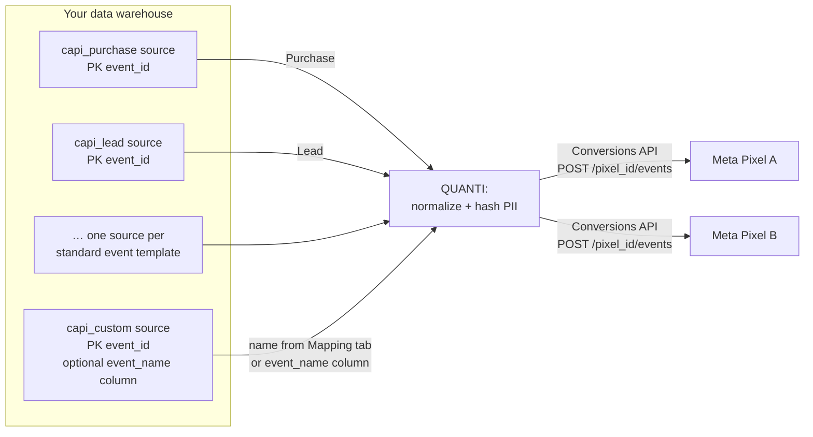

# Meta Conversions API (Reverse)


**Reverse connector** — this connector pushes server-side events **from** your data warehouse **to** your Meta Pixels, through the **Conversions API** (CAPI). It closes the attribution loop when client-side Pixel events are blocked (iOS ATT, ad blockers…), and improves the audience signal Meta optimizes on.

To push Custom Audiences, use the **Meta Custom Audiences** connector instead.


***

## Prerequisites

* A **Meta Business** account with access to the ad account that owns your Pixel(s).
* At least one **Meta Pixel** attached to that ad account.
* A source table or view in your data warehouse with **one row per event**.
* To deduplicate with your browser Pixel: the **same `event_id`** stored on both sides.

***

## Authentication

Authentication uses **Facebook OAuth 2.0**. During setup you are redirected to Meta to authorize QUANTI:.

Requested permissions: `ads_management`, `ads_read`, `business_management`.

***

## Setup Instructions



**Authorize your Meta account**

Click **Continue with Facebook** and connect your Meta Business account to let QUANTI: send server-side events to your Pixels.



**Select your ad account**

Select the Meta ad account that owns the Pixels you want to push events to.



**Select your Pixels**

Pick one or more Pixels of the selected ad account. Each Pixel becomes a target for Conversions API events: every event is sent to **each** selected Pixel.



**Choose your event types**

Pick the events you want to push. Each Meta standard event (Purchase, Lead, AddToCart, Subscribe…) has its own template with the parameters that matter for it. Pick **Custom event** to push a conversion of your own.



**Name your connector**

Give the connector a name, then click **Create**. Source, field mapping — and the event name for Custom event — are configured in the **Mapping** tab after creation.



***

## Data Model

Each event template reads its own source table (or view). QUANTI: turns every row into one Conversions API event and sends it to every selected Pixel.

***

## Common Fields

Every event template — standard events and Custom event — shares the fields below. Each event type then adds its own [event parameters](#event-types).

| Field | Type | Required | Description |
|---|---|---|---|
| `event_id` | STRING | ✅ | Unique event identifier (primary key). Used as the deduplication key with the client-side Pixel event — send the same value on both sides. |
| `event_time` | TIMESTAMP | ✅ | UTC timestamp of the event, sent to Meta as a Unix epoch. Must be within **7 days** of the upload time. |
| `action_source` | STRING | ✅ | Origin of the event: `website`, `app`, `physical_store`, `phone_call`, `chat`, `email`, `system_generated` or `other`. Defaults to `website` when the column is empty. |
| `event_source_url` | STRING | — | URL of the page where the event occurred. Improves matching quality when `action_source` is `website`. |
| `email` | STRING | — | User email. QUANTI: normalizes it (lowercase, all whitespace removed) then hashes it with SHA-256. |
| `phone` | STRING | — | User phone. QUANTI: normalizes it to E.164 (default region FR) then hashes it with SHA-256. |
| `first_name` | STRING | — | User first name. Lowercased (accents kept, as Meta expects) and hashed with SHA-256. |
| `last_name` | STRING | — | User last name. Lowercased (accents kept, as Meta expects) and hashed with SHA-256. |
| `city` | STRING | — | User city. Meta expects it without spaces or punctuation (e.g. `newyork`): QUANTI: lowercases and hashes it, but does not remove spaces. |
| `state` | STRING | — | Two-letter state or region code (e.g. `ca`). Lowercased and hashed. |
| `postal_code` | STRING | — | Postal code — first 5 digits only for the US. Hashed, case preserved. |
| `country_code` | STRING | — | Two-letter ISO 3166-1 country code (e.g. `fr`). Lowercased and hashed. |
| `date_of_birth` | STRING | — | Date of birth in `YYYYMMDD` format. Hashed. |
| `gender` | STRING | — | Single letter: `f` or `m`. Hashed. |
| `external_id` | STRING | — | Your own stable user identifier (CRM ID, customer number…). Hashed. One of the strongest matching signals when the same ID is also sent by the browser Pixel. |
| `client_ip_address` | STRING | — | IP address of the browser that triggered the event. Sent unhashed, as required by Meta. |
| `client_user_agent` | STRING | — | User agent of the browser that triggered the event. Sent unhashed, as required by Meta. |
| `fbc` | STRING | — | Facebook click identifier captured at landing time (cookie `_fbc`). |
| `fbp` | STRING | — | Facebook browser identifier (cookie `_fbp`). |


**Hashing is automatic.** QUANTI: normalizes and hashes user data with SHA-256 before sending it to Meta. Map raw, readable values — do not pre-hash them.


***

## Event Types

The templates are grouped in two sections: **Standard events** (one template per Meta standard event, the event name is built in) and **Custom event**.

The event parameters below come **in addition** to the [common fields](#common-fields). Shared definitions:

| Parameter | Type | Description |
|---|---|---|
| `value` | FLOAT | Monetary value of the event, in the currency below. Meta uses it for value-based optimization and ROAS reporting. |
| `currency` | STRING | ISO 4217 currency code (`EUR`, `USD`, `GBP`…). Required as soon as `value` is set. |
| `content_ids` | STRING | Comma-separated list of product / SKU identifiers involved in the event. |
| `content_type` | STRING | `product` or `product_group` — tells Meta how to interpret the content IDs against your catalog. |
| `content_name` | STRING | Name of the page or product associated with the event. |
| `content_category` | STRING | Category of the page or product associated with the event. |
| `num_items` | INTEGER | Number of items involved in the event (basket size, quantity ordered…). |
| `order_id` | STRING | Your order reference. Lets Meta deduplicate repeated uploads of the same transaction. |
| `predicted_ltv` | FLOAT | Predicted lifetime value of the user — feeds Meta's value optimization. |
| `search_string` | STRING | Search term entered by the user. |
| `status` | STRING | Status of the registration or subscription (e.g. `completed`, `trial`). |

### Purchase

Event `Purchase` — a purchase is completed. This is the event Meta optimizes campaigns on.

| Parameter | Required |
|---|---|
| `value` | ✅ |
| `currency` | ✅ |
| `content_ids` | — |
| `content_type` | — |
| `content_name` | — |
| `content_category` | — |
| `num_items` | — |
| `order_id` | — |

### Lead

Event `Lead` — a lead is captured (form submission, B2B lead, off-website conversion…).

| Parameter | Required |
|---|---|
| `value` | — |
| `currency` | — |
| `content_name` | — |
| `content_category` | — |
| `predicted_ltv` | — |

### AddPaymentInfo

Event `AddPaymentInfo` — payment information is entered during checkout.

| Parameter | Required |
|---|---|
| `value` | — |
| `currency` | — |
| `content_ids` | — |
| `content_type` | — |
| `content_category` | — |
| `num_items` | — |

### AddToCart

Event `AddToCart` — a product is added to the cart.

| Parameter | Required |
|---|---|
| `value` | — |
| `currency` | — |
| `content_ids` | — |
| `content_type` | — |
| `content_name` | — |
| `content_category` | — |
| `num_items` | — |

### AddToWishlist

Event `AddToWishlist` — a product is added to a wishlist.

| Parameter | Required |
|---|---|
| `value` | — |
| `currency` | — |
| `content_ids` | — |
| `content_type` | — |
| `content_name` | — |
| `content_category` | — |

### CompleteRegistration

Event `CompleteRegistration` — a registration form is completed (account creation, newsletter…).

| Parameter | Required |
|---|---|
| `value` | — |
| `currency` | — |
| `status` | — |
| `content_name` | — |

### Contact

Event `Contact` — a contact is made with your business (phone, SMS, email, chat…). Common fields only.

### CustomizeProduct

Event `CustomizeProduct` — a product is customized through a configuration tool.

| Parameter | Required |
|---|---|
| `content_ids` | — |
| `content_type` | — |
| `content_name` | — |

### Donate

Event `Donate` — a donation is made.

| Parameter | Required |
|---|---|
| `value` | — |
| `currency` | — |

### FindLocation

Event `FindLocation` — a user looks for one of your physical locations.

| Parameter | Required |
|---|---|
| `content_ids` | — |
| `content_type` | — |
| `content_name` | — |

### InitiateCheckout

Event `InitiateCheckout` — the checkout process is started.

| Parameter | Required |
|---|---|
| `value` | — |
| `currency` | — |
| `content_ids` | — |
| `content_type` | — |
| `content_category` | — |
| `num_items` | — |

### PageView

Event `PageView` — a page is viewed. Common fields only.

### Schedule

Event `Schedule` — an appointment is booked. Common fields only.

### Search

Event `Search` — a search is performed on your site.

| Parameter | Required |
|---|---|
| `search_string` | — |
| `value` | — |
| `currency` | — |
| `content_ids` | — |
| `content_type` | — |
| `content_category` | — |

### StartTrial

Event `StartTrial` — a free trial is started.

| Parameter | Required |
|---|---|
| `value` | — |
| `currency` | — |
| `predicted_ltv` | — |

### SubmitApplication

Event `SubmitApplication` — an application is submitted (job, program, credit…).

| Parameter | Required |
|---|---|
| `value` | — |
| `currency` | — |
| `content_name` | — |
| `content_category` | — |

### Subscribe

Event `Subscribe` — a paid subscription is started.

| Parameter | Required |
|---|---|
| `value` | — |
| `currency` | — |
| `predicted_ltv` | — |
| `order_id` | — |

### ViewContent

Event `ViewContent` — a key page is viewed (product sheet, landing page…).

| Parameter | Required |
|---|---|
| `value` | — |
| `currency` | — |
| `content_ids` | — |
| `content_type` | — |
| `content_name` | — |
| `content_category` | — |

### Custom event

Sends any server-side event. You choose the event name yourself — either a Meta standard event or a custom event of your own, which you can then turn into a custom conversion in Meta Events Manager.

Two ways to name the event, exclusive of each other:

* **One event for the whole table** — type the event name in the **Mapping** tab. It applies to every row.
* **Several events from one table** — map the `event_name` field to a column of your source. Each row is sent under its own event name. A row whose `event_name` is empty is **skipped**, never sent under another event.

Custom event accepts every [common field](#common-fields), plus:

| Parameter | Type | Required | Description |
|---|---|---|---|
| `event_name` | STRING | — | Name of the Meta event carried by the row. Map it only to push several different events from the same table. |
| `value` | FLOAT | — | Monetary value of the event. Required by Meta for value-optimized events (Purchase, Subscribe, StartTrial…). |
| `currency` | STRING | — | ISO 4217 currency code. Required as soon as `value` is set. |
| `content_ids` | STRING | — | Comma-separated list of product / SKU identifiers. |
| `content_type` | STRING | — | `product` or `product_group`. |
| `content_name` | STRING | — | Name of the page or product. |
| `content_category` | STRING | — | Category of the page or product. |
| `num_items` | INTEGER | — | Number of items involved in the event. |
| `order_id` | STRING | — | Your order reference. |
| `search_string` | STRING | — | Search term — relevant for the Search event. |
| `status` | STRING | — | Status of a registration or subscription — relevant for CompleteRegistration and Subscribe. |
| `predicted_ltv` | FLOAT | — | Predicted lifetime value — relevant for Lead, Subscribe and StartTrial. |


**Event names are case-sensitive at Meta.** `purchase` is not rejected: Meta treats it as a custom event, and it no longer feeds optimization. QUANTI: restores the official casing of Meta standard event names (`purchase` → `Purchase`), both in the Mapping tab and on values coming from an `event_name` column. Names that are not standard events are sent as they are.


***

## Testing with a test event code

Events accepted by Meta do not show up right away in the Pixel view of Events Manager. To check a setup live, copy the **test event code** from **Events Manager → Test events** and paste it into the push's **Mapping** tab: events then appear in the Test events tab.


**Clear the test event code once your test is over.** Meta excludes test events from attribution **and** optimization. With a code left in place, runs stay green and events are still counted, but they no longer produce any result. QUANTI: shows a **Test mode** badge on the push card while a code is set.


***

## Scheduling

| Setting | Default | Options |
|---|---|---|
| **Frequency** | Daily | — |
| **Sync time** | 3:00 AM | — |
| **Lookback window** | 2 days | 1, 2 days |
| **Historical load** | — | Custom dates, up to 7 days |


Meta only accepts events whose `event_time` is within **7 days** of the upload time. Older rows cannot be sent, whatever the historical load range.


***

## Notes

* Every event is sent to **each** selected Pixel.
* Meta answers with a number of events received, without detail per event: an invalid event is counted as invalid but not identified.
* The browser Pixel and the Conversions API deduplicate on `event_id`: store the same value on both sides to avoid counting an event twice.

***

## Troubleshooting

Events are sent but nothing appears in Events Manager

The Pixel view of Events Manager is aggregated and delayed. To see events live, use a test event code (see [Testing with a test event code](#testing-with-a-test-event-code)) — and remove it once the test is over.

Runs are green but campaigns get no conversions

Check that no **test event code** is left in the push's Mapping tab (look for the **Test mode** badge on the push card). Test events are excluded from attribution and optimization.

A Custom event push skips some rows

With an `event_name` column mapped, rows where that column is empty are skipped rather than sent under the wrong event. Fill the column, or switch to a single event name typed in the Mapping tab.

Low match quality in Events Manager

Meta matches events on user data. Map as many identifiers as you have — `email`, `phone`, `external_id`, `fbc`, `fbp`, `client_ip_address`, `client_user_agent` — in their raw, readable form. A column already hashed in your warehouse would be hashed a second time and never match.

Need help?

Contact QUANTI: support at support@quanti.io or consult our documentation at https://docs.quanti.io

