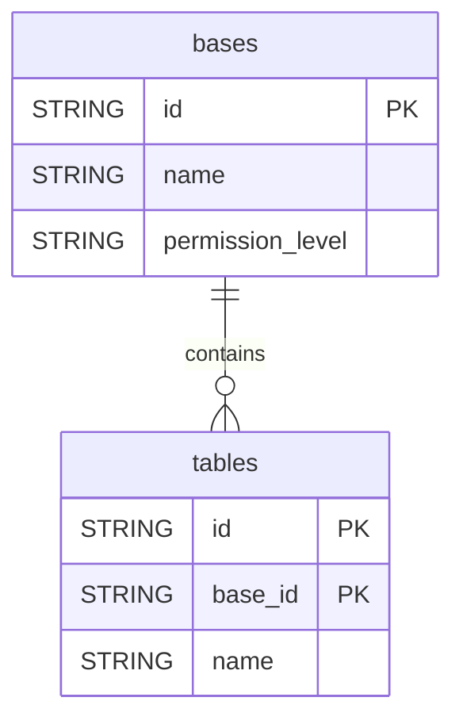

# Airtable


Sync the structure of your Airtable workspace (bases and tables) into your warehouse.


***

## Prerequisites

* An Airtable account with access to the bases you want to sync.
* A Personal Access Token with the `schema.bases:read` scope.

***

## Authentication

The connector uses a **Personal Access Token**. Create it at **airtable.com/create/tokens** (**Create new token**) and paste it in the setup screen.

***

## Setup Instructions



**Enter your token**

Paste your Airtable **Personal Access Token**.



**Choose your reports**

Select the reports to sync.



***

## Data Model

***

## Available Reports

### Bases

One row per Airtable base accessible with the token.

| Column | Type | Description |
|---|---|---|
| `id` | STRING | Unique base identifier (appXXXXXXXX) (primary key) |
| `name` | STRING | Base name |
| `permission_level` | STRING | Permission level for the authenticated user (none, read, comment, edit, create) |

### Tables

One row per table across all accessible bases.

| Column | Type | Description |
|---|---|---|
| `id` | STRING | Unique table identifier (tblXXXXXXXX) (primary key) |
| `base_id` | STRING | Parent base identifier (appXXXXXXXX) (primary key) |
| `name` | STRING | Table name |
| `description` | STRING | Table description |
| `primary_field_id` | STRING | Primary field identifier for this table |

***

## Scheduling

| Setting | Default | Options |
|---|---|---|
| **Frequency** | Daily | Daily, Weekly |
| **Sync time** | 3:00 AM | — |
| **Lookback window** | — | Not available |
| **Historical load** | — | Not available |

***

## Notes

* The connector syncs workspace metadata only (bases and tables), not the records stored in the tables.
