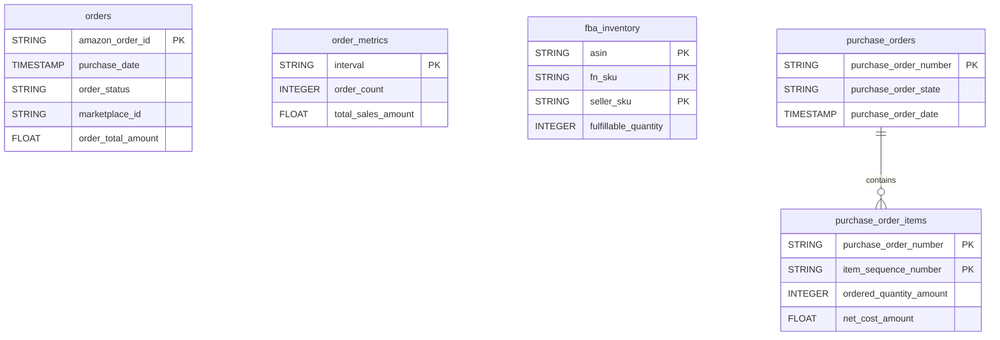

# Amazon Selling Partner


Sync your Amazon Seller Central data (orders, sales metrics, FBA inventory) or your Vendor Central data (purchase orders) into your warehouse, depending on your account type.


***

## Prerequisites

* An Amazon **Seller Central** or **Vendor Central** account.
* Permission to authorize third-party applications on that account.
* At least one active marketplace.

***

## Authentication

The connector uses **OAuth 2.0** through Login with Amazon. You authorize QUANTI: once from the setup screen; no API key to copy.

***

## Setup Instructions



**Authorize QUANTI:**

Pick your **Region** and **Account Type**, then click **Continue with Amazon** to authorize QUANTI:.



**Select your marketplaces**

Select the marketplace(s) to sync, and confirm your account type (Seller or Vendor).



**Choose your reports**

Choose the reports to sync. Seller accounts get orders, order metrics and FBA inventory; Vendor accounts get purchase orders and their items.



***

## Data Model

***

## Available Reports

### Orders (Seller)

One row per Amazon order.

#### Dimensions

| Column | Type | Description |
|---|---|---|
| `amazon_order_id` | STRING | Amazon-defined order identifier (primary key) |
| `purchase_date` | TIMESTAMP | Date the order was placed |
| `last_update_date` | TIMESTAMP | Date the order was last updated |
| `order_status` | STRING | Current status of the order (Pending, Unshipped, Shipped, Canceled…) |
| `fulfillment_channel` | STRING | Fulfillment source: AFN (Amazon) or MFN (Merchant) |
| `sales_channel` | STRING | Sales channel where the order was placed |
| `ship_service_level` | STRING | Shipping service tier selected by the buyer |
| `order_total_currency_code` | STRING | Currency code of the order total |
| `payment_method` | STRING | Payment method used for the order (Other, COD, CVS) |
| `marketplace_id` | STRING | Amazon marketplace identifier where the order was placed |

#### Metrics

| Column | Type | Description |
|---|---|---|
| `order_total_amount` | FLOAT | Total order amount |
| `number_of_items_shipped` | INTEGER | Number of items that have been shipped |
| `number_of_items_unshipped` | INTEGER | Number of items that have not yet been shipped |

### Order Metrics (Seller)

Aggregated sales figures per time interval.

#### Dimensions

| Column | Type | Description |
|---|---|---|
| `interval` | STRING | Time interval covered by the entry, ISO 8601 format (primary key) |
| `average_unit_price_currency_code` | STRING | Currency code of the average unit price |
| `total_sales_currency_code` | STRING | Currency code of total sales |

#### Metrics

| Column | Type | Description |
|---|---|---|
| `unit_count` | INTEGER | Number of units sold during the interval |
| `order_item_count` | INTEGER | Number of order items placed during the interval |
| `order_count` | INTEGER | Number of orders placed during the interval |
| `average_unit_price_amount` | FLOAT | Average selling price per unit during the interval |
| `total_sales_amount` | FLOAT | Total sales revenue during the interval |

### FBA Inventory (Seller)

Current stock held in Amazon fulfillment centers, one row per product.

#### Dimensions

| Column | Type | Description |
|---|---|---|
| `asin` | STRING | Amazon Standard Identification Number of the product (primary key) |
| `fn_sku` | STRING | Fulfillment network SKU assigned by Amazon (primary key) |
| `seller_sku` | STRING | Seller-assigned SKU of the item (primary key) |
| `condition` | STRING | Condition of the item (NewItem, UsedGood…) |

#### Metrics

| Column | Type | Description |
|---|---|---|
| `total_quantity` | INTEGER | Total units inbound or in fulfillment centers |
| `fulfillable_quantity` | INTEGER | Units available for picking and shipping to customers |
| `inbound_working_quantity` | INTEGER | Units in notified inbound shipments not yet received |
| `inbound_shipped_quantity` | INTEGER | Units in shipments with a tracking number |
| `reserved_quantity_total` | INTEGER | Units reserved and not available for purchase |

### Purchase Orders (Vendor)

One row per purchase order sent by Amazon to the vendor.

| Column | Type | Description |
|---|---|---|
| `purchase_order_number` | STRING | Unique purchase order number (primary key) |
| `purchase_order_state` | STRING | Current state (New, Acknowledged, Closed) |
| `purchase_order_date` | TIMESTAMP | Date the purchase order was created |
| `purchase_order_changed_date` | TIMESTAMP | Date the purchase order was last modified |
| `purchase_order_state_changed_date` | TIMESTAMP | Date the state last changed |
| `purchase_order_type` | STRING | Type of purchase order (RegularOrder, ConsignedOrder…) |
| `payment_method` | STRING | Payment method (Invoice, Consignment, CreditCard, Prepaid) |
| `buying_party_id` | STRING | Identifier of the buying party (Amazon) |
| `selling_party_id` | STRING | Identifier of the selling party (vendor) |
| `ship_to_party_id` | STRING | Identifier of the ship-to fulfillment center |
| `bill_to_party_id` | STRING | Identifier of the bill-to party |
| `ship_window` | STRING | Expected ship window, ISO 8601 interval |
| `delivery_window` | STRING | Expected delivery window, ISO 8601 interval |

### Purchase Order Items (Vendor)

One row per line item of a purchase order.

#### Dimensions

| Column | Type | Description |
|---|---|---|
| `purchase_order_number` | STRING | Purchase order number, joins `purchase_orders` (primary key) |
| `item_sequence_number` | STRING | Sequence number of the item within the order (primary key) |
| `purchase_order_date` | TIMESTAMP | Date the parent purchase order was created |
| `amazon_product_identifier` | STRING | ASIN of the product |
| `vendor_product_identifier` | STRING | Vendor product identifier (SKU or EAN) |
| `ordered_quantity_unit_of_measure` | STRING | Unit of measure (Cases, Eaches…) |
| `ordered_quantity_unit_size` | INTEGER | Individual units per ordered unit |
| `is_back_order_allowed` | BOOLEAN | Whether the item can be fulfilled on backorder |
| `net_cost_currency_code` | STRING | Currency code of the net cost |
| `list_price_currency_code` | STRING | Currency code of the list price |

#### Metrics

| Column | Type | Description |
|---|---|---|
| `ordered_quantity_amount` | INTEGER | Number of units ordered by Amazon |
| `net_cost_amount` | FLOAT | Net cost per unit agreed with Amazon |
| `list_price_amount` | FLOAT | List price per unit |

***

## Scheduling

| Setting | Default | Options |
|---|---|---|
| **Frequency** | Daily | Daily, Weekly, Monthly |
| **Sync time** | 5:00 AM | — |
| **Lookback window** | 7 days | 1, 3, 5, 7, 14, 30 days |
| **Historical load** | Up to 2 years | 3, 6, 12, 24 months or custom dates |

***

## Notes

* Seller and Vendor reports are exclusive: the reports offered depend on the account type chosen at setup.
