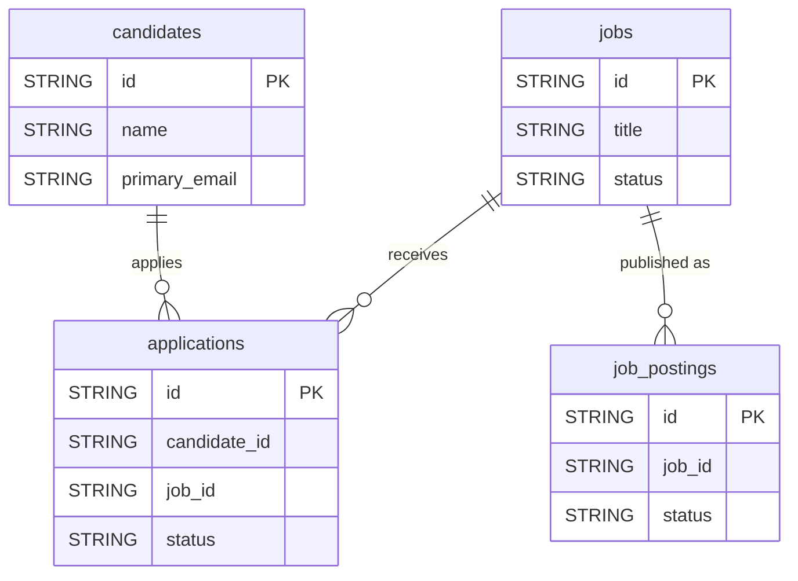

# Ashby


Sync your Ashby recruiting data (candidates, applications, jobs and job postings) into your warehouse.


***

## Prerequisites

* An Ashby API key, created by an **Organization Admin**, with read permissions on the **Candidates**, **Jobs** and **Organization** modules.

***

## Authentication

The connector uses an **API key**. Generate it in **Ashby > Admin > Integrations > API Credentials**, grant it read permissions on the Candidates, Jobs and Organization modules, and paste it in the setup screen.

***

## Setup Instructions



**Enter your API key**

Paste your **Ashby API Key**.



**Choose your reports**

Select the reports to sync.



***

## Data Model

***

## Available Reports

### Candidates

One row per candidate, with contact details and metadata.

| Column | Type | Description |
|---|---|---|
| `id` | STRING | Candidate unique identifier (primary key) |
| `name` | STRING | Full name of the candidate |
| `primary_email` | STRING | Primary email address value |
| `primary_email_type` | STRING | Primary email address type (Work, Personal, etc.) |
| `email_addresses` | STRING | All email addresses as JSON array |
| `phone_numbers` | STRING | Phone numbers as JSON array |
| `social_links` | STRING | Social profile links as JSON array |
| `tags` | STRING | Candidate tags as JSON array |
| `position` | STRING | Current job position/title |
| `company` | STRING | Current employer company |
| `school` | STRING | School or university attended |
| `application_ids` | STRING | List of application IDs for this candidate as JSON array |
| `profile_url` | STRING | URL of the candidate profile in Ashby |
| `created_at` | TIMESTAMP | Timestamp when the candidate record was created |
| `updated_at` | TIMESTAMP | Timestamp when the candidate record was last updated |

### Applications

One row per job application, with its stage, status and source.

| Column | Type | Description |
|---|---|---|
| `id` | STRING | Application unique identifier (primary key) |
| `candidate_id` | STRING | Candidate ID associated with this application |
| `job_id` | STRING | Job ID this application belongs to |
| `interview_stage_id` | STRING | Current interview stage ID |
| `status` | STRING | Application status (Active, Hired, Archived, Lead) |
| `source_id` | STRING | Sourcing channel ID |
| `source_label` | STRING | Sourcing channel label (e.g. LinkedIn, Referral) |
| `credited_to_user_id` | STRING | ID of the user credited for sourcing this application |
| `created_at` | TIMESTAMP | Timestamp when the application was created |
| `updated_at` | TIMESTAMP | Timestamp when the application was last updated |

### Jobs

One row per job, with its status, department and location.

| Column | Type | Description |
|---|---|---|
| `id` | STRING | Job unique identifier (primary key) |
| `title` | STRING | Job title |
| `status` | STRING | Job status (Draft, Open, Closed, Archived) |
| `employment_type` | STRING | Employment type (FullTime, PartTime, Intern, Contract, Temporary) |
| `department_id` | STRING | Department ID this job belongs to |
| `location_ids` | STRING | Location IDs for this job as JSON array |
| `interview_plan_id` | STRING | Interview plan ID assigned to this job |
| `requisition_id` | STRING | Requisition ID for this job (if configured) |
| `created_at` | TIMESTAMP | Timestamp when the job was created |
| `updated_at` | TIMESTAMP | Timestamp when the job was last updated |

### Job Postings

One row per job posting, published or not.

| Column | Type | Description |
|---|---|---|
| `id` | STRING | Job posting unique identifier (primary key) |
| `job_id` | STRING | Job ID this posting belongs to |
| `title` | STRING | Job posting title |
| `status` | STRING | Posting status (Published, Unpublished) |
| `employment_type` | STRING | Employment type (FullTime, PartTime, Intern, Contract, Temporary) |
| `location_id` | STRING | Location ID associated with this posting |
| `is_remote` | BOOLEAN | Whether the position is fully remote |
| `workplace_type` | STRING | Workplace type (OnSite, Remote, Hybrid) |
| `published_at` | TIMESTAMP | Timestamp when the posting was published |
| `apply_url` | STRING | URL to apply for this job posting |
| `job_url` | STRING | URL of the job posting page |

***

## Scheduling

| Setting | Default | Options |
|---|---|---|
| **Frequency** | Daily | Daily, Weekly |
| **Sync time** | 3:00 AM | — |
| **Lookback window** | Not available | — |
| **Historical load** | Not available | — |

***

## Notes

* List columns (`email_addresses`, `phone_numbers`, `social_links`, `tags`, `application_ids`, `location_ids`) are stored as JSON arrays in a STRING column.
* All reports are full snapshots of the current data: no lookback or historical load.
