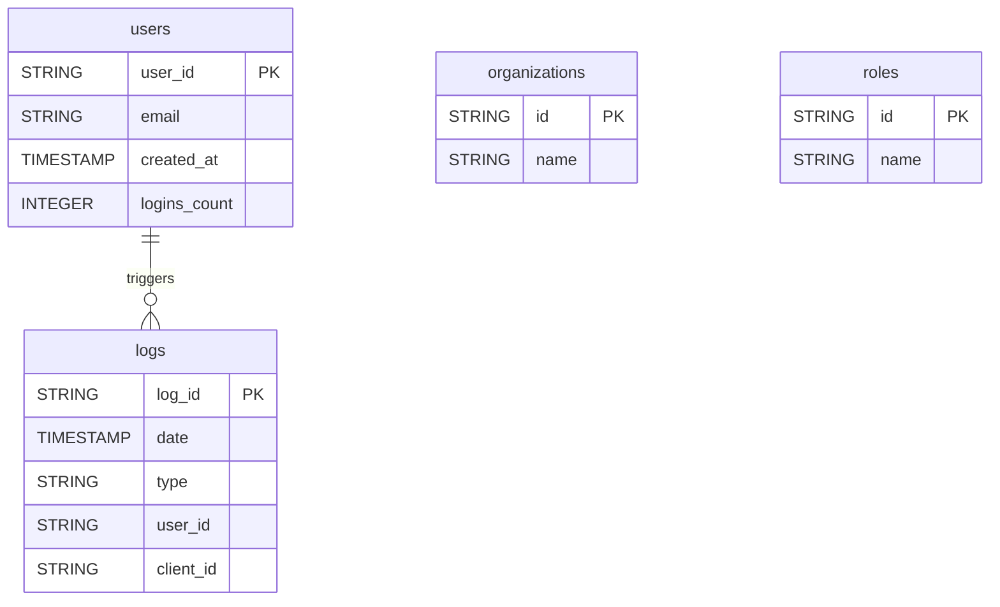

# Auth0


Sync your Auth0 tenant data (users, logs, organizations, roles) into your warehouse for identity and access management analysis.


***

## Prerequisites

* An Auth0 tenant.
* A **Machine-to-Machine** application in Auth0, authorized to access the Auth0 Management API (v2) with the required scopes.

***

## Authentication

The connector uses the **Client ID** and **Client Secret** of your Machine-to-Machine application, together with your Auth0 domain.

***

## Setup Instructions



**Create a Machine-to-Machine application**

In the Auth0 Dashboard, go to **Applications** and create a Machine-to-Machine application.



**Authorize the Management API**

Authorize the application to access the Auth0 Management API with the required scopes.



**Enter your credentials**

Enter your **Auth0 Domain** (e.g. `your-tenant.auth0.com`, found in **Applications > Applications > [your app] > Settings**), the **Client ID** and the **Client Secret** of the application.



**Choose your reports**

Choose the reports to sync.



***

## Data Model

***

## Available Reports

### Users

All users in the Auth0 tenant with their profile and login statistics.

#### Dimensions

| Column | Type | Description |
|---|---|---|
| `user_id` | STRING | Unique user identifier (primary key) |
| `email` | STRING | User email address |
| `email_verified` | BOOLEAN | Whether the user email address has been verified |
| `name` | STRING | Full display name |
| `nickname` | STRING | User nickname |
| `given_name` | STRING | Given (first) name |
| `family_name` | STRING | Family (last) name |
| `created_at` | TIMESTAMP | Account creation timestamp |
| `updated_at` | TIMESTAMP | Last profile update timestamp |
| `last_login` | TIMESTAMP | Timestamp of the last login |
| `last_ip` | STRING | IP address of the last login |
| `blocked` | BOOLEAN | Whether the user account is blocked |
| `picture` | STRING | Avatar or profile picture URL |

#### Metrics

| Column | Type | Description |
|---|---|---|
| `logins_count` | INTEGER | Total number of logins |

### Logs

Auth0 tenant activity log events, one entry per authentication or management event.

| Column | Type | Description |
|---|---|---|
| `log_id` | STRING | Unique log event identifier (primary key) |
| `date` | TIMESTAMP | Timestamp of the log event (ISO 8601) |
| `type` | STRING | Event type code (e.g. 's' for success, 'f' for failure, 'sapi' for Management API call) |
| `description` | STRING | Human-readable description of the event |
| `client_id` | STRING | ID of the application associated with the event |
| `client_name` | STRING | Name of the application associated with the event |
| `user_id` | STRING | ID of the user who triggered the event |
| `user_name` | STRING | Name or email of the user who triggered the event |
| `ip` | STRING | IP address from which the event originated |
| `connection` | STRING | Name of the connection (identity provider) used for the event |
| `is_mobile` | BOOLEAN | Whether the event originated from a mobile device |

### Organizations

All organizations defined in the Auth0 tenant.

| Column | Type | Description |
|---|---|---|
| `id` | STRING | Unique organization identifier (primary key) |
| `name` | STRING | Machine-readable name of the organization |
| `display_name` | STRING | Human-readable display name of the organization |

### Roles

All roles defined in the Auth0 tenant.

| Column | Type | Description |
|---|---|---|
| `id` | STRING | Unique role identifier (primary key) |
| `name` | STRING | Role name |
| `description` | STRING | Role description |

***

## Scheduling

| Setting | Default | Options |
|---|---|---|
| **Frequency** | Daily | Daily, Weekly |
| **Sync time** | 3:00 AM | — |
| **Lookback window** | 5 days | 1, 3, 5 days |
| **Historical load** | Up to 365 days | 3, 6, 12 months or custom dates |

***

## Notes

* Logs are dated by the event timestamp (`date`). Users, Organizations and Roles are full lists of the tenant.
