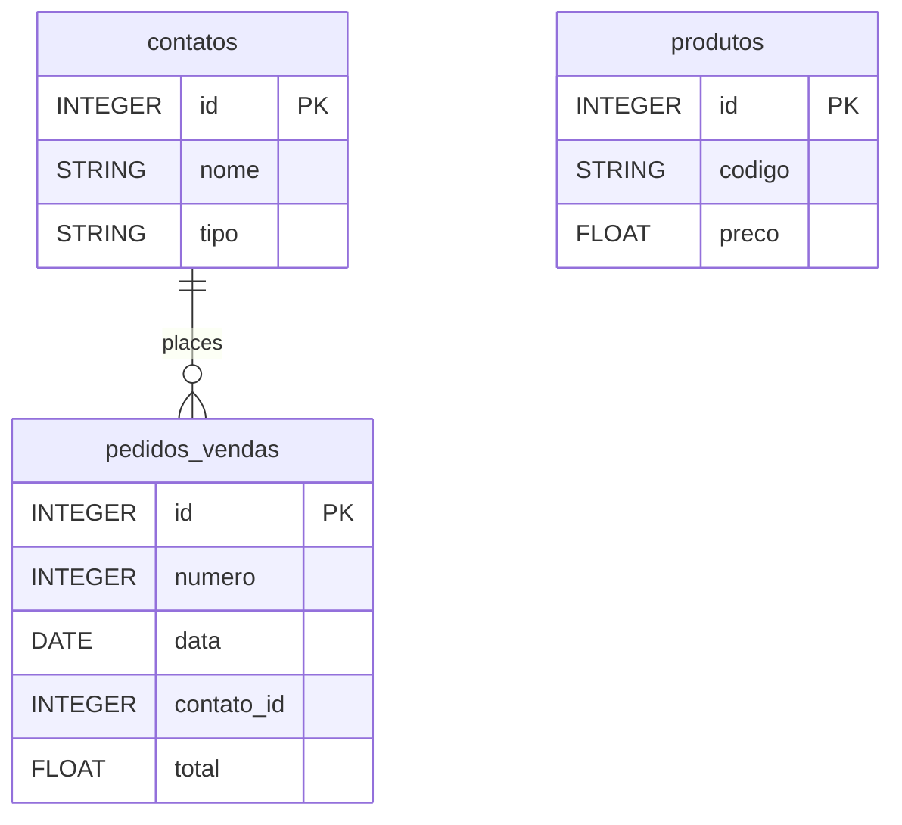

# Bling


Sync your Bling ERP data (sales orders, products, contacts) into your warehouse for e-commerce and operations analysis.


***

## Prerequisites

* A Bling account.

***

## Authentication

The connector uses **OAuth 2.0**. You authorize QUANTI: once from the setup screen; no API key to copy.

***

## Setup Instructions



**Authorize QUANTI:**

Click **Continue with Bling** and authorize QUANTI: on your Bling account.



**Choose your reports**

Choose the reports to enable.



***

## Data Model

***

## Available Reports

### Sales Orders

Daily sales orders with contact, status, amounts and shipping data.

#### Dimensions

| Column | Type | Description |
|---|---|---|
| `id` | INTEGER | Bling internal order identifier (primary key) |
| `numero` | INTEGER | Sequential sales order number |
| `numero_loja` | STRING | Order number from the external store |
| `data` | DATE | Order date (YYYY-MM-DD) |
| `data_saida` | DATE | Departure / shipment date (YYYY-MM-DD) |
| `data_prevista` | DATE | Expected delivery date (YYYY-MM-DD) |
| `contato_id` | INTEGER | Customer / contact identifier |
| `contato_nome` | STRING | Customer / contact name |
| `contato_numero_documento` | STRING | Customer CPF or CNPJ document number |
| `situacao_id` | INTEGER | Order status identifier |
| `situacao_valor` | INTEGER | Order status numeric value |
| `loja_id` | INTEGER | Store identifier the order belongs to |

#### Metrics

| Column | Type | Description |
|---|---|---|
| `total_produtos` | FLOAT | Sum of all order line amounts before discounts and freight |
| `total` | FLOAT | Total order amount including freight and discounts |
| `desconto_valor` | FLOAT | Discount amount or percentage applied to the order |
| `transporte_frete` | FLOAT | Freight cost for the order |
| `tributacao_total_icms` | FLOAT | Total ICMS tax amount |
| `tributacao_total_ipi` | FLOAT | Total IPI tax amount |
| `taxas_taxa_comissao` | FLOAT | Commission rate (%) |
| `taxas_custo_frete` | FLOAT | Freight cost from marketplace fees |
| `taxas_valor_base` | FLOAT | Base value used to calculate commission |

### Contacts

Customer and supplier contact list with address and document info.

| Column | Type | Description |
|---|---|---|
| `id` | INTEGER | Bling internal contact identifier (primary key) |
| `nome` | STRING | Contact full name |
| `codigo` | STRING | Contact internal code |
| `situacao` | STRING | Contact status: A=Active, I=Inactive |
| `numero_documento` | STRING | CPF (individuals) or CNPJ (companies) document number |
| `telefone` | STRING | Phone number |
| `celular` | STRING | Mobile phone number |
| `email` | STRING | Contact email address |
| `tipo` | STRING | Person type: F=Individual, J=Company |
| `fantasia` | STRING | Trade name (for companies) |
| `municipio` | STRING | City of the contact |
| `uf` | STRING | State abbreviation (e.g. SP, RJ) |

### Products

Product catalog with pricing, dimensions, stock levels and category.

#### Dimensions

| Column | Type | Description |
|---|---|---|
| `id` | INTEGER | Bling internal product identifier (primary key) |
| `nome` | STRING | Product name |
| `codigo` | STRING | Product SKU / internal code |
| `tipo` | STRING | Product type: P=Product, S=Service, E=Composition |
| `situacao` | STRING | Product status: A=Active, I=Inactive |
| `formato` | STRING | Product format: S=Simple, C=With variations, V=Variation |
| `unidade` | STRING | Unit of measure (e.g. UN, KG, CX) |
| `peso_liquido` | FLOAT | Net weight in kilograms |
| `peso_bruto` | FLOAT | Gross weight in kilograms |
| `gtin` | STRING | GTIN/EAN barcode |
| `marca` | STRING | Product brand |
| `descricao_curta` | STRING | Short product description |
| `categoria_id` | INTEGER | Product category identifier |
| `estoque_minimo` | FLOAT | Minimum stock level threshold |
| `estoque_maximo` | FLOAT | Maximum stock level threshold |

#### Metrics

| Column | Type | Description |
|---|---|---|
| `preco` | FLOAT | Sale price of the product |
| `estoque_saldo_virtual_total` | FLOAT | Total virtual stock balance across all warehouses |

***

## Scheduling

| Setting | Default | Options |
|---|---|---|
| **Frequency** | Daily | Daily, Weekly, Monthly |
| **Sync time** | 6:00 AM | — |
| **Lookback window** | 1 day | 1, 3, 5, 7, 14, 30 days |
| **Historical load** | All history | All history |

***

## Notes

* Column names keep the original Portuguese field names of the Bling API.
* Contacts and Products are loaded in append mode: each sync adds new rows, so the same contact or product can appear several times.
