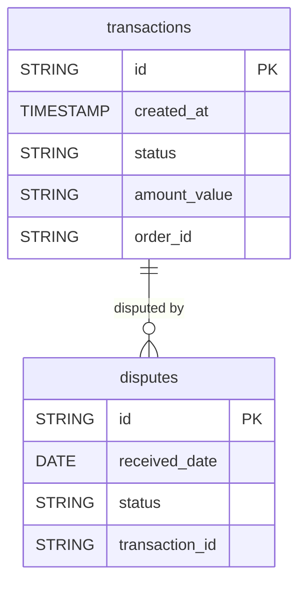

# Braintree


Sync your Braintree payment data (transactions and disputes) into your warehouse for transaction and dispute analysis.


***

## Prerequisites

* Access to the Braintree Control Panel, to copy your Merchant ID and API keys.

***

## Authentication

The connector uses your Braintree **Merchant ID**, **Public Key** and **Private Key**, for the **Production** or **Sandbox** environment.

***

## Setup Instructions



**Copy your API credentials**

Log in to the Braintree Control Panel. Copy your **Merchant ID** from **Settings > Business**, then your **Public Key** and **Private Key** from **Settings > API > API Keys** (click **View** for the private key).



**Enter your credentials**

Enter the three values and select your **Environment** (Production or Sandbox).



**Choose your reports**

Choose the reports to sync.



***

## Data Model

***

## Available Reports

### Transactions

Payment transactions processed through Braintree, synced by creation date.

| Column | Type | Description |
|---|---|---|
| `id` | STRING | Unique transaction ID, GraphQL global ID (primary key) |
| `legacy_id` | STRING | Legacy transaction ID (REST API format) |
| `amount_value` | STRING | Transaction amount as a string (e.g. '10.00') |
| `amount_currency_iso_code` | STRING | ISO 4217 currency code for the transaction amount |
| `status` | STRING | Transaction status (e.g. AUTHORIZED, SETTLED, VOIDED, FAILED) |
| `created_at` | TIMESTAMP | ISO 8601 timestamp when the transaction was created |
| `order_id` | STRING | Merchant-provided order identifier |
| `merchant_account_id` | STRING | Merchant account ID associated with the transaction |
| `channel_id` | STRING | Channel identifier used to create the transaction |
| `processor_response_code` | STRING | Processor legacy response code (e.g. '1000' for Approved) |
| `processor_response_message` | STRING | Human-readable processor response message |

### Disputes

Payment disputes (chargebacks) filed against transactions, synced by received date.

| Column | Type | Description |
|---|---|---|
| `id` | STRING | Unique dispute ID, GraphQL global ID (primary key) |
| `legacy_id` | STRING | Legacy dispute ID (REST API format) |
| `amount_disputed_value` | STRING | Disputed amount as a string (e.g. '25.00') |
| `amount_disputed_currency` | STRING | ISO 4217 currency code for the disputed amount |
| `amount_won_value` | STRING | Amount won back by the merchant as a string |
| `status` | STRING | Current dispute status (e.g. OPEN, WON, LOST, ACCEPTED) |
| `reason` | STRING | Dispute reason code (e.g. FRAUD, NOT_RECOGNIZED, CREDIT_NOT_PROCESSED) |
| `received_date` | DATE | Date the dispute was received from the card issuer (YYYY-MM-DD) |
| `reply_by_date` | DATE | Deadline date to submit evidence or accept the dispute (YYYY-MM-DD) |
| `created_at` | TIMESTAMP | ISO 8601 timestamp when the dispute record was created |
| `updated_at` | TIMESTAMP | ISO 8601 timestamp when the dispute record was last updated |
| `case_number` | STRING | Card issuer case number for the dispute |
| `transaction_id` | STRING | ID of the original transaction, joins `transactions.id` |

***

## Scheduling

| Setting | Default | Options |
|---|---|---|
| **Frequency** | Daily | Daily, Weekly |
| **Sync time** | 3:00 AM | — |
| **Lookback window** | 5 days | 1, 3, 5 days |
| **Historical load** | Up to 365 days | 3, 6, 12 months or custom dates |

***

## Notes

* Amounts (`amount_value`, `amount_disputed_value`, `amount_won_value`) are stored as text (STRING). Cast them to a numeric type before aggregating.
