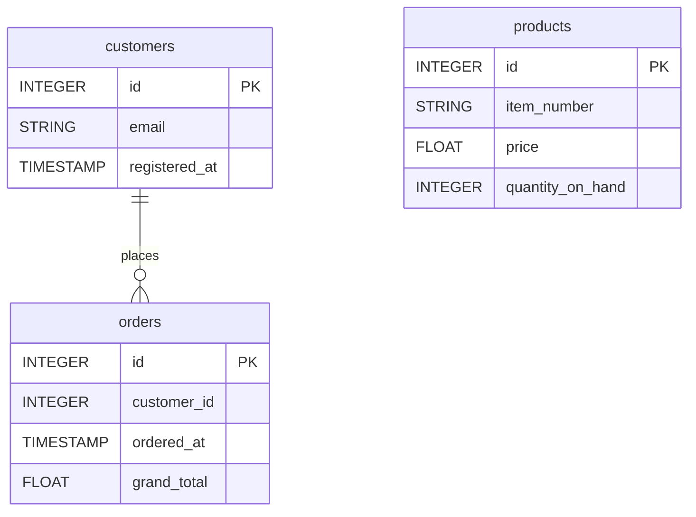

# Cart.com


Sync your Cart.com store data (orders, products, customers) into your warehouse for e-commerce and sales analysis.


***

## Prerequisites

* A **Cart.com** store with a REST API access token.

***

## Authentication

The connector uses an **access token**. You provide two fields:

* **Store URL**: the base URL of your Cart.com store (e.g. `https://mystore.com`).
* **Access Token**: an access token for your Cart.com store's REST API (sent as the `X-AC-Auth-Token` header).

***

## Setup Instructions



**Generate an access token**

Generate an access token for your Cart.com store's REST API.



**Enter your credentials**

Enter your **Store URL** and your **Access Token**.



**Choose your reports**

Choose the reports to sync: orders, products and customers.



**Name your connector**

Give the connector a name, then click **Create**.



***

## Data Model

***

## Available Reports

### Orders

Orders placed in the store, one partition per order date.

#### Dimensions

| Column | Type | Description |
|---|---|---|
| `id` | INTEGER | Unique order ID (primary key) |
| `order_number` | STRING | Human-readable order number |
| `customer_id` | INTEGER | Customer ID associated with the order |
| `order_status_id` | INTEGER | Order status ID |
| `ordered_at` | TIMESTAMP | Timestamp when the order was placed |
| `coupon_code` | STRING | Coupon code applied to the order |
| `channel` | STRING | Sales channel through which the order was placed |
| `device` | STRING | Device type used to place the order |
| `is_gift` | BOOLEAN | Whether the order is a gift |
| `is_ppc` | BOOLEAN | Whether the order originated from a pay-per-click campaign |
| `selected_shipping_method` | STRING | Selected shipping method name |
| `updated_at` | TIMESTAMP | Timestamp when the order was last updated |

#### Metrics

| Column | Type | Description |
|---|---|---|
| `subtotal` | FLOAT | Order subtotal before tax and shipping |
| `tax_total` | FLOAT | Total tax amount for the order |
| `shipping_total` | FLOAT | Total shipping cost for the order |
| `discount_total` | FLOAT | Total discount amount applied to the order |
| `grand_total` | FLOAT | Grand total of the order including all charges |

### Customers

Customer list with registration, contact information, and status.

| Column | Type | Description |
|---|---|---|
| `id` | INTEGER | Unique customer ID (primary key) |
| `customer_number` | STRING | Human-readable customer number |
| `first_name` | STRING | Customer first name |
| `last_name` | STRING | Customer last name |
| `email` | STRING | Customer email address |
| `phone_number` | STRING | Customer phone number |
| `company` | STRING | Company name associated with the customer |
| `customer_type_id` | INTEGER | Customer type / segment ID |
| `registered_at` | TIMESTAMP | Timestamp when the customer registered |
| `last_visit_at` | TIMESTAMP | Timestamp of the customer's last visit |
| `is_inactive` | BOOLEAN | Whether the customer account is inactive |
| `is_affiliate_customer` | BOOLEAN | Whether the customer is an affiliate |
| `updated_at` | TIMESTAMP | Timestamp when the customer record was last updated |

### Products

Full product catalog with pricing, inventory levels, and status.

#### Dimensions

| Column | Type | Description |
|---|---|---|
| `id` | INTEGER | Unique product ID (primary key) |
| `item_number` | STRING | Product SKU / item number |
| `item_name` | STRING | Product name |
| `product_status_id` | INTEGER | Product status ID (active, inactive, etc.) |
| `primary_category_id` | INTEGER | Primary category ID |
| `manufacturer_id` | INTEGER | Manufacturer ID |
| `is_hidden` | BOOLEAN | Whether the product is hidden from the storefront |
| `is_discontinued` | BOOLEAN | Whether the product has been discontinued |
| `created_at` | TIMESTAMP | Timestamp when the product was created |
| `updated_at` | TIMESTAMP | Timestamp when the product was last updated |

#### Metrics

| Column | Type | Description |
|---|---|---|
| `price` | FLOAT | Retail selling price |
| `cost` | FLOAT | Product cost (purchase price) |
| `retail` | FLOAT | MSRP / suggested retail price |
| `quantity_on_hand` | INTEGER | Current quantity in stock |

***

## Scheduling

| Setting | Default | Options |
|---|---|---|
| **Frequency** | Daily | Daily, Weekly |
| **Sync time** | 3:00 AM | — |
| **Lookback window** | 5 days | 1, 3, 5 days |
| **Historical load** | Up to 2 years | 3, 6, 12 months or custom dates |

***

## Notes

* Statuses, categories and manufacturers are returned as IDs (`order_status_id`, `product_status_id`, `primary_category_id`, `manufacturer_id`), not as labels.
* Orders are filtered by order date; Customers and Products are full lists.
