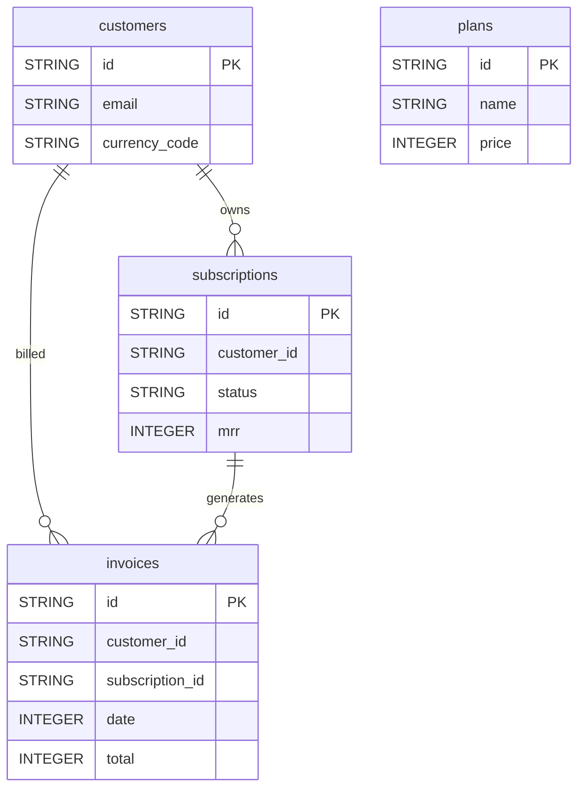

# Chargebee


Sync your Chargebee subscription billing data (customers, subscriptions, invoices, plans) into your warehouse for revenue and customer analysis.


***

## Prerequisites

* A **Chargebee** site with access to **Settings > Configure Chargebee > API Keys and Webhooks**.

***

## Authentication

The connector uses an **API key**. You provide two fields:

* **API Key**: generated in the Chargebee Admin Console under **Settings > Configure Chargebee > API Keys and Webhooks**.
* **Site Name**: your Chargebee site subdomain (e.g. `my-company` for `my-company.chargebee.com`).

***

## Setup Instructions



**Generate an API key**

In Chargebee, go to **Settings > Configure Chargebee > API Keys and Webhooks** and generate an API key.



**Enter your credentials**

Enter the **API Key** and your **Site Name**.



**Choose your reports**

Choose the reports to sync: customers, subscriptions, invoices and plans.



**Name your connector**

Give the connector a name, then click **Create**.



***

## Data Model

***

## Available Reports

### Customers

Full list of Chargebee customers with their billing and account attributes.

#### Dimensions

| Column | Type | Description |
|---|---|---|
| `id` | STRING | Unique identifier of the customer (primary key) |
| `first_name` | STRING | First name of the customer |
| `last_name` | STRING | Last name of the customer |
| `email` | STRING | Email address of the customer |
| `phone` | STRING | Phone number of the customer |
| `company` | STRING | Company name associated with the customer |
| `auto_collection` | STRING | Whether charges are collected automatically (on/off) |
| `net_term_days` | INTEGER | Net payment term in days |
| `currency_code` | STRING | ISO 4217 currency code for the customer |
| `taxability` | STRING | Tax status of the customer (taxable/exempt) |
| `created_at` | INTEGER | Unix timestamp of customer creation |
| `updated_at` | INTEGER | Unix timestamp of the last customer update |

#### Metrics

| Column | Type | Description |
|---|---|---|
| `promotional_credits` | INTEGER | Promotional credits balance in the lowest denomination |
| `unbilled_charges` | INTEGER | Total unbilled charges in the lowest denomination |
| `refundable_credits` | INTEGER | Total refundable credits in the lowest denomination |
| `excess_payments` | INTEGER | Total excess payments in the lowest denomination |

### Subscriptions

Full list of Chargebee subscriptions with status, billing cycle and revenue metrics.

#### Dimensions

| Column | Type | Description |
|---|---|---|
| `id` | STRING | Unique identifier of the subscription (primary key) |
| `customer_id` | STRING | Identifier of the customer owning this subscription |
| `currency_code` | STRING | ISO 4217 currency code for the subscription |
| `status` | STRING | Subscription status (future/in_trial/active/non_renewing/paused/cancelled/transferred) |
| `billing_period` | INTEGER | Length of the billing cycle |
| `billing_period_unit` | STRING | Unit of the billing period (day/week/month/year) |
| `current_term_start` | INTEGER | Unix timestamp of the start of the current billing term |
| `current_term_end` | INTEGER | Unix timestamp of the end of the current billing term |
| `next_billing_at` | INTEGER | Unix timestamp of the next scheduled billing date |
| `has_scheduled_changes` | BOOLEAN | Whether the subscription has pending scheduled changes |
| `created_at` | INTEGER | Unix timestamp of subscription creation |
| `updated_at` | INTEGER | Unix timestamp of the last subscription update |

#### Metrics

| Column | Type | Description |
|---|---|---|
| `mrr` | INTEGER | Monthly recurring revenue in the lowest denomination |
| `total_dues` | INTEGER | Total outstanding dues in the lowest denomination |

### Invoices

Daily Chargebee invoices with amounts, status and payment details.

#### Dimensions

| Column | Type | Description |
|---|---|---|
| `id` | STRING | Unique identifier of the invoice (primary key) |
| `customer_id` | STRING | Identifier of the customer this invoice belongs to |
| `subscription_id` | STRING | Identifier of the subscription this invoice is for (null for consolidated invoices) |
| `status` | STRING | Invoice status (paid/posted/payment_due/not_paid/voided/pending) |
| `date` | INTEGER | Unix timestamp of the invoice document date |
| `due_date` | INTEGER | Unix timestamp of the payment due date |
| `currency_code` | STRING | ISO 4217 currency code for this invoice |
| `recurring` | BOOLEAN | Whether the invoice is subscription-based |
| `dunning_status` | STRING | Payment retry state for overdue invoices |

#### Metrics

| Column | Type | Description |
|---|---|---|
| `total` | INTEGER | Total invoice amount in the lowest denomination (e.g. cents) |
| `sub_total` | INTEGER | Sum of line items before tax in the lowest denomination |
| `tax` | INTEGER | Total tax amount in the lowest denomination |
| `amount_paid` | INTEGER | Amount already collected in the lowest denomination |
| `amount_due` | INTEGER | Outstanding balance in the lowest denomination |
| `credits_applied` | INTEGER | Total credits applied to this invoice in the lowest denomination |

### Plans

List of Chargebee billing plans with pricing and period details.

#### Dimensions

| Column | Type | Description |
|---|---|---|
| `id` | STRING | Unique identifier of the plan (primary key) |
| `name` | STRING | Display name of the plan |
| `currency_code` | STRING | ISO 4217 currency code for the plan |
| `period` | INTEGER | Billing frequency (number of period_units between charges) |
| `period_unit` | STRING | Unit of the billing period (day/week/month/year) |
| `pricing_model` | STRING | Pricing model (flat_fee/per_unit/tiered/volume/stairstep) |
| `trial_period` | INTEGER | Duration of the free trial |
| `trial_period_unit` | STRING | Unit of the trial period (day/month) |
| `status` | STRING | Plan status (active/archived/deleted) |

#### Metrics

| Column | Type | Description |
|---|---|---|
| `price` | INTEGER | Plan price in the lowest denomination |

***

## Scheduling

| Setting | Default | Options |
|---|---|---|
| **Frequency** | Daily | Daily, Weekly |
| **Sync time** | 3:00 AM | — |
| **Lookback window** | 5 days | 1, 3, 5 days |
| **Historical load** | Up to 1 year | 3, 6, 12 months or custom dates |

***

## Notes

* Amounts are expressed in the **lowest currency unit** (e.g. cents): divide by 100 for a two-decimal currency.
* Dates are stored as **Unix timestamps** (INTEGER), as returned by Chargebee.
* Invoices are filtered by invoice date (`date`); Customers, Subscriptions and Plans are full lists.
