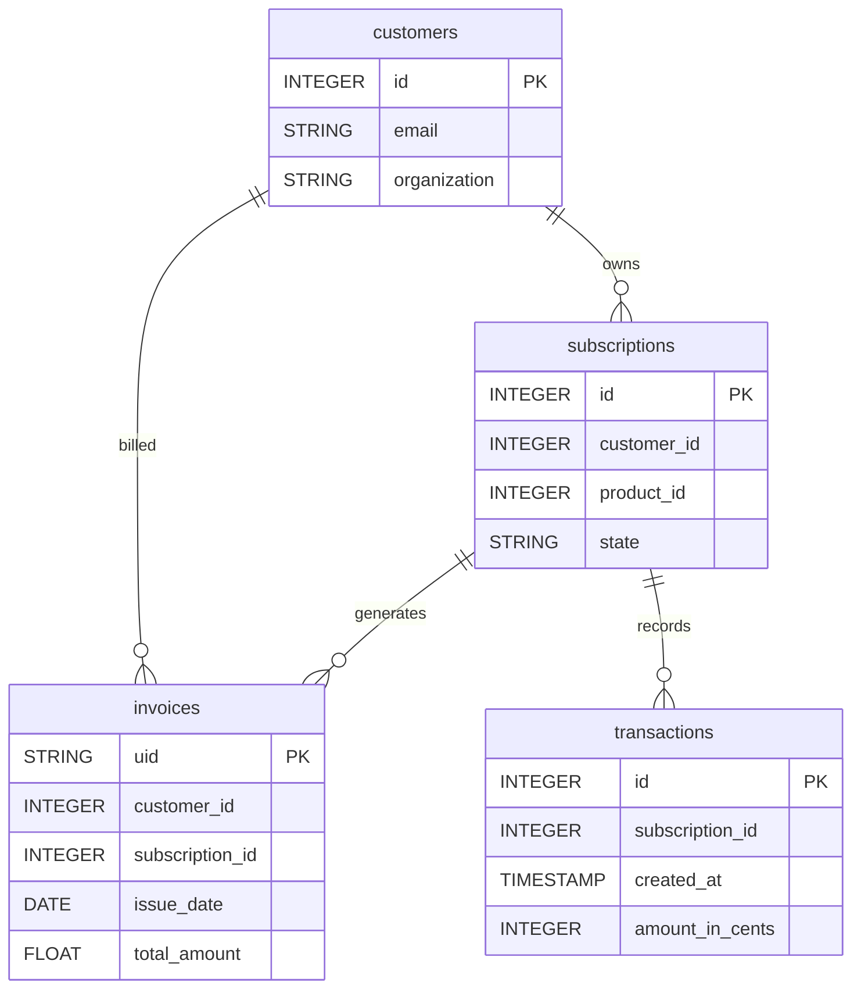

# Chargify


Sync your Chargify subscription billing data (customers, subscriptions, invoices, transactions) into your warehouse for revenue and customer analysis.


***

## Prerequisites

* A **Chargify** site with access to **Config > Integrations > API Keys** in the Admin Console.

***

## Authentication

The connector uses an **API key**. You provide two fields:

* **API Key**: generated in the Chargify Admin Console under **Config > Integrations > API Keys**.
* **Site Subdomain**: your Chargify site subdomain (e.g. `my-company` for `my-company.chargify.com`).

***

## Setup Instructions



**Generate an API key**

In the Chargify Admin Console, go to **Config > Integrations > API Keys** and generate an API key.



**Enter your credentials**

Enter the **API Key** and your **Site Subdomain**.



**Choose your reports**

Choose the reports to sync: customers, subscriptions, invoices and transactions.



**Name your connector**

Give the connector a name, then click **Create**.



***

## Data Model

***

## Available Reports

### Customers

Full list of Chargify customers with their billing and contact attributes.

| Column | Type | Description |
|---|---|---|
| `id` | INTEGER | Unique integer identifier of the customer (primary key) |
| `first_name` | STRING | First name of the customer |
| `last_name` | STRING | Last name of the customer |
| `email` | STRING | Email address of the customer |
| `organization` | STRING | Company or organization name of the customer |
| `reference` | STRING | External reference identifier linking Chargify customer to an internal system record |
| `address` | STRING | Street address line 1 |
| `city` | STRING | City of the customer |
| `state` | STRING | State or province of the customer |
| `zip` | STRING | Postal / ZIP code of the customer |
| `country` | STRING | ISO 3166-1 alpha-2 country code |
| `tax_exempt` | BOOLEAN | Whether the customer is tax exempt |
| `verified` | BOOLEAN | Whether the customer email address has been verified |
| `created_at` | TIMESTAMP | ISO 8601 timestamp of customer creation |
| `updated_at` | TIMESTAMP | ISO 8601 timestamp of the last customer update |

### Subscriptions

Full list of Chargify subscriptions with status, billing cycle and revenue metrics.

#### Dimensions

| Column | Type | Description |
|---|---|---|
| `id` | INTEGER | Unique integer identifier of the subscription (primary key) |
| `state` | STRING | Subscription state (active, canceled, expired, trialing, past_due, pending, suspended) |
| `customer_id` | INTEGER | Identifier of the customer owning this subscription |
| `product_id` | INTEGER | Identifier of the subscribed product |
| `payment_collection_method` | STRING | How payments are collected (automatic, remittance, prepaid) |
| `current_period_started_at` | TIMESTAMP | ISO 8601 timestamp of the start of the current billing period |
| `current_period_ends_at` | TIMESTAMP | ISO 8601 timestamp of the end of the current billing period |
| `next_assessment_at` | TIMESTAMP | ISO 8601 timestamp of the next scheduled billing assessment |
| `activated_at` | TIMESTAMP | ISO 8601 timestamp when the subscription was first activated |
| `created_at` | TIMESTAMP | ISO 8601 timestamp of subscription creation |
| `updated_at` | TIMESTAMP | ISO 8601 timestamp of the last subscription update |
| `canceled_at` | TIMESTAMP | ISO 8601 timestamp of subscription cancellation (null if not canceled) |

#### Metrics

| Column | Type | Description |
|---|---|---|
| `balance_in_cents` | INTEGER | Outstanding balance in cents |
| `total_revenue_in_cents` | INTEGER | Total lifetime revenue collected for this subscription in cents |
| `product_price_in_cents` | INTEGER | Current product price in cents |

### Invoices

Daily Chargify invoices with amounts, payment status and billing details.

#### Dimensions

| Column | Type | Description |
|---|---|---|
| `uid` | STRING | Unique string identifier of the invoice (e.g. inv_8hr3546h3bhq) (primary key) |
| `subscription_id` | INTEGER | Identifier of the subscription this invoice is for |
| `customer_id` | INTEGER | Identifier of the customer this invoice belongs to |
| `number` | STRING | Human-readable invoice number |
| `status` | STRING | Invoice payment status (draft, open, paid, voided, canceled) |
| `issue_date` | DATE | Date the invoice was issued (YYYY-MM-DD) |
| `due_date` | DATE | Payment due date (YYYY-MM-DD) |
| `currency` | STRING | ISO 4217 currency code for this invoice |
| `collection_method` | STRING | How the invoice is collected (automatic, remittance) |
| `created_at` | TIMESTAMP | ISO 8601 timestamp of invoice creation |
| `updated_at` | TIMESTAMP | ISO 8601 timestamp of the last invoice update |

#### Metrics

| Column | Type | Description |
|---|---|---|
| `total_amount` | FLOAT | Total invoice amount |
| `paid_amount` | FLOAT | Amount already collected |
| `amount_remaining` | FLOAT | Outstanding balance |
| `tax_amount` | FLOAT | Tax portion of the invoice |

### Transactions

Daily Chargify financial transactions (payments, refunds, credits) with amounts and status.

#### Dimensions

| Column | Type | Description |
|---|---|---|
| `id` | INTEGER | Unique integer identifier of the transaction (primary key) |
| `subscription_id` | INTEGER | Identifier of the subscription this transaction belongs to |
| `type` | STRING | Transaction type (Payment, Refund, Adjustment, etc.) |
| `kind` | STRING | Transaction kind (baseline, initial, trial, etc.) |
| `success` | BOOLEAN | Whether the transaction was successful |
| `memo` | STRING | Description or memo associated with the transaction |
| `product_id` | INTEGER | Identifier of the product associated with this transaction |
| `gateway_transaction_id` | STRING | External payment gateway transaction identifier |
| `created_at` | TIMESTAMP | ISO 8601 timestamp when the transaction was created |

#### Metrics

| Column | Type | Description |
|---|---|---|
| `amount_in_cents` | INTEGER | Transaction amount in cents (positive for charges, negative for credits) |
| `ending_balance_in_cents` | INTEGER | Subscription balance after this transaction in cents |

***

## Scheduling

| Setting | Default | Options |
|---|---|---|
| **Frequency** | Daily | Daily, Weekly |
| **Sync time** | 3:00 AM | — |
| **Lookback window** | 5 days | 1, 3, 5 days |
| **Historical load** | Up to 1 year | 3, 6, 12 months or custom dates |

***

## Notes

* Invoice amounts are decimal values (e.g. `29.90`); subscription and transaction amounts (`*_in_cents`) are in **cents**.
* Invoices are filtered by issue date and Transactions by creation date; Customers and Subscriptions are full lists.
