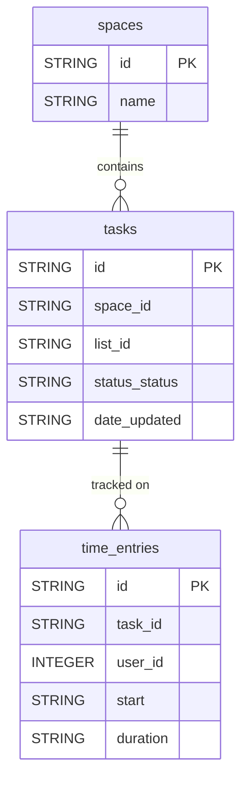

# ClickUp


Sync your ClickUp project management data (spaces, tasks, time tracking) into your warehouse for task tracking, productivity and time analysis.


***

## Prerequisites

* A **ClickUp** account with access to **Settings > Apps > API Token**.

***

## Authentication

The connector uses a **Personal API Token**, generated in ClickUp under **Settings > Apps > API Token**. The token starts with `pk_` and never expires.

***

## Setup Instructions



**Generate a Personal API Token**

In ClickUp, go to **Settings > Apps > API Token** and generate a Personal API Token.



**Enter your token**

Enter your **Personal API Token**.



**Choose your reports**

Choose the reports to sync: spaces, tasks and time entries.



**Name your connector**

Give the connector a name, then click **Create**.



***

## Data Model

***

## Available Reports

### Spaces

List of the non-archived spaces in your first ClickUp workspace.

| Column | Type | Description |
|---|---|---|
| `id` | STRING | Unique space identifier (primary key) |
| `name` | STRING | Space name |
| `color` | STRING | Hex color assigned to the space (null if not set) |
| `private` | BOOLEAN | Whether the space is private |
| `archived` | BOOLEAN | Whether the space is archived |
| `admin_can_manage` | BOOLEAN | Whether admins can manage this space |

### Tasks

Daily snapshot of tasks updated in the last 30 days across the workspace.

| Column | Type | Description |
|---|---|---|
| `id` | STRING | Unique task identifier (primary key) |
| `name` | STRING | Task name |
| `status_status` | STRING | Task status name (e.g. Open, In Progress, Done) |
| `status_type` | STRING | Status category type (open, in_progress, done, closed) |
| `status_color` | STRING | Hex color of the status |
| `orderindex` | STRING | Task order position within its list |
| `date_created` | STRING | Task creation timestamp in Unix milliseconds |
| `date_updated` | STRING | Task last update timestamp in Unix milliseconds |
| `date_closed` | STRING | Task close timestamp in Unix milliseconds (null if not closed) |
| `due_date` | STRING | Task due date in Unix milliseconds (null if not set) |
| `start_date` | STRING | Task start date in Unix milliseconds (null if not set) |
| `time_estimate` | STRING | Estimated time to complete the task in milliseconds (null if not set) |
| `priority_priority` | STRING | Priority level name (urgent, high, normal, low) — null if unset |
| `priority_color` | STRING | Hex color of the priority level — null if unset |
| `list_id` | STRING | ID of the list the task belongs to |
| `list_name` | STRING | Name of the list the task belongs to |
| `folder_id` | STRING | ID of the folder containing the list |
| `folder_name` | STRING | Name of the folder containing the list |
| `space_id` | STRING | ID of the space containing the task |
| `creator_id` | INTEGER | User ID of the task creator |
| `creator_username` | STRING | Username of the task creator |
| `url` | STRING | Direct URL to the task in ClickUp |

### Time Entries

Time tracking entries of the token owner, per day.

#### Dimensions

| Column | Type | Description |
|---|---|---|
| `id` | STRING | Unique time entry identifier (primary key) |
| `wid` | STRING | Workspace (team) ID the time entry belongs to |
| `user_id` | INTEGER | ID of the user who logged the time |
| `user_username` | STRING | Username of the user who logged the time |
| `user_email` | STRING | Email address of the user who logged the time |
| `task_id` | STRING | ID of the associated task (null if not linked to a task) |
| `task_name` | STRING | Name of the associated task (null if not linked to a task) |
| `start` | STRING | Start timestamp of the time entry in Unix milliseconds |
| `end` | STRING | End timestamp of the time entry in Unix milliseconds |
| `billable` | BOOLEAN | Whether the time entry is billable |
| `description` | STRING | Description or note for the time entry |
| `source` | STRING | Source of the time entry (clickup, chrome, etc.) |
| `at` | STRING | Timestamp when this time entry was last modified in Unix milliseconds |

#### Metrics

| Column | Type | Description |
|---|---|---|
| `duration` | STRING | Duration of the time entry in milliseconds |

***

## Scheduling

| Setting | Default | Options |
|---|---|---|
| **Frequency** | Daily | Daily, Weekly |
| **Sync time** | 3:00 AM | — |
| **Lookback window** | 5 days | 1, 3, 5 days |
| **Historical load** | Up to 1 year | 3, 6, 12 months or custom dates |

***

## Notes

* Dates and timestamps (`date_*`, `due_date`, `start_date`, `start`, `end`, `at`) are stored as **Unix timestamps in milliseconds**, in STRING columns.
* Durations (`time_estimate`, `duration`) are in **milliseconds**, in STRING columns.
* The Tasks report only covers tasks updated in the last 30 days.
* Only the first workspace accessible with the token is synced.
* Time Entries only contains the entries of the user who owns the API token.
