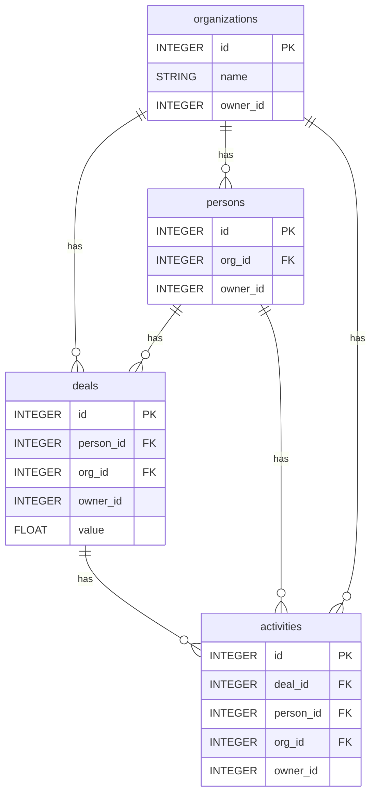

# Pipedrive


Sync your Pipedrive CRM data (deals, activities, persons, organizations) into your warehouse for sales pipeline and activity analysis.


***

## Prerequisites

* A Pipedrive account.
* A Pipedrive user whose permission set allows access to the API token.

***

## Authentication

The connector uses your Pipedrive **personal API token**. It reads data with the access of the user who owns the token.


The API token grants access to your Pipedrive account. Share it only with QUANTI:, and choose a user who can see every record you want to sync.


### Find your API token

1. Log in to Pipedrive.
2. Go to **Settings > Personal preferences > API**, or open `https://app.pipedrive.com/settings/api` directly.
3. Copy your **personal API token**.


If the **API** tab is missing, your permission set doesn't allow access to the API token. Ask a Pipedrive admin to enable it in your permission set.


***

## Setup Instructions



**Copy your API token**

In Pipedrive, go to **Settings > Personal preferences > API** and copy your personal API token.



**Enter your API token in QUANTI:**

Paste the token in the **API Token** field.



**Choose your reports**

Choose the reports to sync, then create the connector.



***

## Data Model

***

## Available Reports


All reports reload every record at each sync. **Persons** and **Organizations** keep only the latest version of each record. **Deals** and **Activities** keep one copy of every record per sync, so you can follow how your pipeline evolves over time. To get the current state, keep the latest row per `id` (most recent `_quanti_loaded_at`).


### Deals

All CRM deals with pipeline, stage, value and status.

#### Dimensions

| Column | Type | Description |
|---|---|---|
| `id` | INTEGER | Deal unique identifier |
| `title` | STRING | Deal title |
| `currency` | STRING | Currency code (e.g. USD, EUR) |
| `status` | STRING | Deal status: open, won, lost, or deleted |
| `stage_id` | INTEGER | Pipeline stage identifier |
| `pipeline_id` | INTEGER | Sales pipeline identifier |
| `expected_close_date` | DATE | Expected close date (YYYY-MM-DD) |
| `add_time` | TIMESTAMP | Deal creation timestamp |
| `update_time` | TIMESTAMP | Deal last modification timestamp |
| `close_time` | TIMESTAMP | Timestamp when the deal was closed (won or lost) |
| `won_time` | TIMESTAMP | Timestamp when the deal was marked as won |
| `lost_time` | TIMESTAMP | Timestamp when the deal was marked as lost |
| `lost_reason` | STRING | Reason the deal was lost |
| `owner_id` | INTEGER | Owner user ID |
| `person_id` | INTEGER | Associated contact person ID |
| `org_id` | INTEGER | Associated organization ID |

#### Metrics

| Column | Type | Description |
|---|---|---|
| `value` | FLOAT | Monetary deal amount |
| `probability` | FLOAT | Win likelihood percentage (0-100) |

### Activities

All activities (calls, meetings, tasks) logged in the CRM.

| Column | Type | Description |
|---|---|---|
| `id` | INTEGER | Activity unique identifier |
| `type` | STRING | Activity type (call, meeting, task, email, deadline, etc.) |
| `subject` | STRING | Activity subject / title |
| `done` | BOOLEAN | Whether the activity has been completed |
| `due_date` | DATE | Activity due date (YYYY-MM-DD) |
| `due_time` | STRING | Activity due time (HH:MM) |
| `duration` | STRING | Activity duration (HH:MM) |
| `deal_id` | INTEGER | ID of the deal linked to this activity |
| `person_id` | INTEGER | ID of the person linked to this activity |
| `org_id` | INTEGER | ID of the organization linked to this activity |
| `owner_id` | INTEGER | Owner user ID |
| `marked_as_done_time` | TIMESTAMP | Timestamp when the activity was marked as done |
| `add_time` | TIMESTAMP | Activity creation timestamp |
| `update_time` | TIMESTAMP | Activity last modification timestamp |

### Persons

All contacts (persons) with their attributes.

#### Dimensions

| Column | Type | Description |
|---|---|---|
| `id` | INTEGER | Person unique identifier |
| `name` | STRING | Full name of the person |
| `first_name` | STRING | First name |
| `last_name` | STRING | Last name |
| `org_id` | INTEGER | Organization ID the person belongs to |
| `owner_id` | INTEGER | Owner user ID |
| `add_time` | TIMESTAMP | Person creation timestamp |
| `update_time` | TIMESTAMP | Person last modification timestamp |

#### Metrics

| Column | Type | Description |
|---|---|---|
| `open_deals_count` | INTEGER | Number of open deals linked to this person |
| `won_deals_count` | INTEGER | Number of won deals linked to this person |
| `lost_deals_count` | INTEGER | Number of lost deals linked to this person |

### Organizations

All organizations (companies) with their attributes.

#### Dimensions

| Column | Type | Description |
|---|---|---|
| `id` | INTEGER | Organization unique identifier |
| `name` | STRING | Organization name |
| `owner_id` | INTEGER | Owner user ID |
| `address` | STRING | Organization address |
| `add_time` | TIMESTAMP | Organization creation timestamp |
| `update_time` | TIMESTAMP | Organization last modification timestamp |

#### Metrics

| Column | Type | Description |
|---|---|---|
| `people_count` | INTEGER | Number of persons linked to this organization |
| `open_deals_count` | INTEGER | Number of open deals linked to this organization |
| `won_deals_count` | INTEGER | Number of won deals linked to this organization |
| `lost_deals_count` | INTEGER | Number of lost deals linked to this organization |

***

## Scheduling

| Setting | Default | Options |
|---|---|---|
| **Frequency** | Daily | Daily, Weekly |
| **Sync time** | 3:00 AM | — |
| **Lookback window** | 5 days | 1, 3, 5 days |
| **Historical load** | — | 3, 6 or 12 months, or custom dates (up to 365 days) |

***

## Troubleshooting

**The API tab is missing in Pipedrive**: your permission set doesn't allow access to the API token. Ask a Pipedrive admin to enable it.

**Some records are missing**: the connector only sees the records visible to the user who owns the API token. Use the token of a user who can see all the deals, persons and organizations you need.
