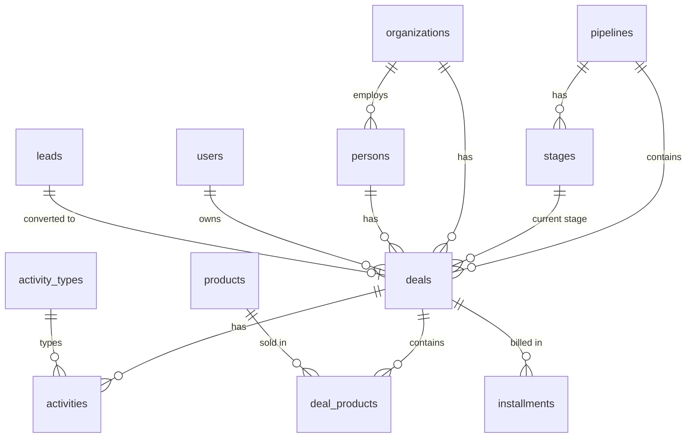

# Pipedrive


Sync your Pipedrive CRM into your warehouse: deals, leads, contacts, activities, products, pipeline statistics and custom fields (20 reports).


***

## Prerequisites

* A Pipedrive account.
* A Pipedrive user whose permission set allows access to the API token.

***

## Authentication

The connector uses a Pipedrive **personal API token**. The token decides what is synced: each token belongs to one user in one Pipedrive company, and QUANTI: reads that company's data as this user can access it.


The API token grants access to your Pipedrive account. Share it only with QUANTI:. A user who belongs to several Pipedrive companies has a different token for each company.


### Find your API token

1. Log in to Pipedrive.
2. Click your account name (top right), then **Company settings > Personal preferences > API**, or open `https://app.pipedrive.com/settings/api` directly.
3. Copy your **personal API token**.


If the **API** tab is missing, your permission set doesn't allow access to the API token. Ask a Pipedrive admin to enable **Access their own API token** in **Settings > Manage users > Permission sets**.


***

## Setup Instructions



**Copy your API token**

In Pipedrive, open **Company settings > Personal preferences > API** and copy your personal API token.



**Enter your API token in QUANTI:**

Paste the token in the **API Token** field.



**Choose your reports**

Choose the reports to sync, then create the connector.



***

## Data Model

***

## Sales pipeline

### Deals

Deals updated on each day (one row per version, deduplicate on id with the latest update_time).

Table: `deals` · Joins: `person_id` → persons, `org_id` → organizations, `owner_id` → users, `pipeline_id` → pipelines, `stage_id` → stages, `source_lead_id` → leads


This table can hold several rows per record. Keep the latest row per `id` (most recent `update_time`) to get the current state.


Columns

#### Dimensions

| Column | Type | Description |
|---|---|---|
| `id` (key) | INTEGER | The ID of the deal |
| `title` | STRING | The title of the deal |
| `owner_id` | INTEGER | The ID of the user who owns the deal |
| `person_id` | INTEGER | The ID of the person linked to the deal |
| `org_id` | INTEGER | The ID of the organization linked to the deal |
| `pipeline_id` | INTEGER | The ID of the pipeline associated with the deal |
| `stage_id` | INTEGER | The ID of the deal stage |
| `currency` | STRING | The currency associated with the deal |
| `add_time` | TIMESTAMP | The creation date and time of the deal |
| `update_time` (key) | TIMESTAMP | The last updated date and time of the deal |
| `stage_change_time` | TIMESTAMP | The last updated date and time of the deal stage |
| `is_deleted` | BOOLEAN | Whether the deal is deleted or not |
| `is_archived` | BOOLEAN | Whether the deal is archived or not |
| `status` | STRING | The status of the deal |
| `probability` | INTEGER | The success probability percentage of the deal |
| `lost_reason` | STRING | The reason for losing the deal |
| `visible_to` | INTEGER | The visibility of the deal |
| `close_time` | TIMESTAMP | The date and time of closing the deal |
| `won_time` | TIMESTAMP | The date and time of changing the deal status as won |
| `lost_time` | TIMESTAMP | The date and time of changing the deal status as lost |
| `expected_close_date` | DATE | The expected close date of the deal |
| `label_ids` | JSON | The IDs of labels assigned to the deal |
| `origin` | STRING | The way this Deal was created. `origin` field is set by Pipedrive when Deal is created and cannot be changed. |
| `origin_id` | STRING | The optional ID to further distinguish the origin of the deal - e.g. Which API integration created this Deal. |
| `channel` | INTEGER | The ID of your Marketing channel this Deal was created from. Recognized Marketing channels can be configured in your <a href="https://app.pipedrive.com/settings/fields" target="_blank" rel="noopener noreferrer">Company settings</a>. |
| `channel_id` | STRING | The optional ID to further distinguish the Marketing channel. |
| `source_lead_id` | STRING | The ID of the lead if the deal was converted from a lead. Only included when requested via include_fields parameter. |
| `custom_fields` | JSON | An object where each key represents a custom field. All custom fields are referenced as randomly generated 40-character hashes. To clear a custom field value, set it to `null`. |

#### Metrics

| Column | Type | Description |
|---|---|---|
| `value` | FLOAT | The value of the deal |
| `arr` | FLOAT | Only available in Growth and above plans The Annual Recurring Revenue of the deal Null if there are no products attached to the deal |
| `mrr` | FLOAT | Only available in Growth and above plans The Monthly Recurring Revenue of the deal Null if there are no products attached to the deal |
| `acv` | FLOAT | Only available in Growth and above plans The Annual Contract Value of the deal Null if there are no products attached to the deal |

### Archived deals

Archived deals updated on each day. Archived deals are no longer returned by the deals endpoint since 15/07/2025.

Table: `deals_archived` · Joins: same keys as deals. Archived deals are no longer returned with active deals since 15/07/2025: combine both tables (`UNION ALL`) for a full history


This table can hold several rows per record. Keep the latest row per `id` (most recent `update_time`) to get the current state.


Columns

#### Dimensions

| Column | Type | Description |
|---|---|---|
| `id` (key) | INTEGER | The ID of the deal |
| `title` | STRING | The title of the deal |
| `owner_id` | INTEGER | The ID of the user who owns the deal |
| `person_id` | INTEGER | The ID of the person linked to the deal |
| `org_id` | INTEGER | The ID of the organization linked to the deal |
| `pipeline_id` | INTEGER | The ID of the pipeline associated with the deal |
| `stage_id` | INTEGER | The ID of the deal stage |
| `currency` | STRING | The currency associated with the deal |
| `add_time` | TIMESTAMP | The creation date and time of the deal |
| `update_time` (key) | TIMESTAMP | The last updated date and time of the deal |
| `stage_change_time` | TIMESTAMP | The last updated date and time of the deal stage |
| `is_deleted` | BOOLEAN | Whether the deal is deleted or not |
| `is_archived` | BOOLEAN | Whether the deal is archived or not |
| `status` | STRING | The status of the deal |
| `probability` | INTEGER | The success probability percentage of the deal |
| `lost_reason` | STRING | The reason for losing the deal |
| `visible_to` | INTEGER | The visibility of the deal |
| `close_time` | TIMESTAMP | The date and time of closing the deal |
| `won_time` | TIMESTAMP | The date and time of changing the deal status as won |
| `lost_time` | TIMESTAMP | The date and time of changing the deal status as lost |
| `expected_close_date` | DATE | The expected close date of the deal |
| `label_ids` | JSON | The IDs of labels assigned to the deal |
| `origin` | STRING | The way this Deal was created. `origin` field is set by Pipedrive when Deal is created and cannot be changed. |
| `origin_id` | STRING | The optional ID to further distinguish the origin of the deal - e.g. Which API integration created this Deal. |
| `channel` | INTEGER | The ID of your Marketing channel this Deal was created from. Recognized Marketing channels can be configured in your <a href="https://app.pipedrive.com/settings/fields" target="_blank" rel="noopener noreferrer">Company settings</a>. |
| `channel_id` | STRING | The optional ID to further distinguish the Marketing channel. |
| `source_lead_id` | STRING | The ID of the lead if the deal was converted from a lead. Only included when requested via include_fields parameter. |
| `custom_fields` | JSON | An object where each key represents a custom field. All custom fields are referenced as randomly generated 40-character hashes. To clear a custom field value, set it to `null`. |

#### Metrics

| Column | Type | Description |
|---|---|---|
| `value` | FLOAT | The value of the deal |
| `arr` | FLOAT | Only available in Growth and above plans The Annual Recurring Revenue of the deal Null if there are no products attached to the deal |
| `mrr` | FLOAT | Only available in Growth and above plans The Monthly Recurring Revenue of the deal Null if there are no products attached to the deal |
| `acv` | FLOAT | Only available in Growth and above plans The Annual Contract Value of the deal Null if there are no products attached to the deal |

### Pipelines

All sales pipelines, fully reloaded on each run.

Table: `pipelines` · Joins: `id` ← deals.pipeline_id, stages.pipeline_id

Columns

| Column | Type | Description |
|---|---|---|
| `id` (key) | INTEGER | The ID of the pipeline |
| `name` | STRING | The name of the pipeline |
| `order_nr` | INTEGER | Defines the order of pipelines. The pipeline with the lowest `order_nr` is considered the default. |
| `is_deleted` | BOOLEAN | Whether this pipeline is marked as deleted or not |
| `is_deal_probability_enabled` | BOOLEAN | Whether deal probability is disabled or enabled for this pipeline |
| `add_time` | TIMESTAMP | The pipeline creation time |
| `update_time` | TIMESTAMP | The pipeline update time |

### Stages

All pipeline stages, fully reloaded on each run.

Table: `stages` · Joins: `id` ← deals.stage_id, `pipeline_id` → pipelines

Columns

| Column | Type | Description |
|---|---|---|
| `id` (key) | INTEGER | The ID of the stage |
| `order_nr` | INTEGER | Defines the order of the stage |
| `name` | STRING | The name of the stage |
| `is_deleted` | BOOLEAN | Whether the stage is marked as deleted or not |
| `deal_probability` | INTEGER | The success probability percentage of the deal. Used/shown when the deal weighted values are used. |
| `pipeline_id` | INTEGER | The ID of the pipeline to add the stage to |
| `is_deal_rot_enabled` | BOOLEAN | Whether deals in this stage can become rotten |
| `days_to_rotten` | INTEGER | The number of days the deals not updated in this stage would become rotten. Applies only if the `is_deal_rot_enabled` is set. |
| `add_time` | TIMESTAMP | The stage creation time |
| `update_time` | TIMESTAMP | The stage update time |

### Deal products

Products attached to each deal (line items), fully reloaded on each run.

Table: `deal_products` · Joins: `deal_id` → deals, `product_id` → products

Columns

#### Dimensions

| Column | Type | Description |
|---|---|---|
| `id` (key) | INTEGER | The ID of the deal-product (the ID of the product attached to the deal) |
| `deal_id` | INTEGER | The ID of the deal |
| `name` | STRING | The product name |
| `product_id` | INTEGER | The ID of the product |
| `product_variation_id` | INTEGER | The ID of the product variation |
| `order_nr` | INTEGER | The order number of the product within the deal |
| `add_time` | TIMESTAMP | The date and time when the product was added to the deal |
| `update_time` | TIMESTAMP | The date and time when the deal product was last updated |
| `comments` | STRING | The comments of the product |
| `currency` | STRING | The currency associated with the deal product |
| `discount_type` | STRING | The type of the discount's value |
| `tax_method` | STRING | The tax option to be applied to the products. When using `inclusive`, the tax percentage will already be included in the price. When using `exclusive`, the tax will not be included in the price. When using `none`, no tax will be added. Use the `tax` field for defining the tax percentage amount. |
| `is_enabled` | BOOLEAN | Whether this product is enabled for the deal |
| `billing_frequency` | STRING | Only available in Growth and above plans How often a customer is billed for access to a service or product To set `billing_frequency` different than `one-time`, the deal must not have installments associated A deal can have up to 20 products attached with `billing_frequency` different than… |
| `billing_frequency_cycles` | INTEGER | Only available in Growth and above plans The number of times the billing frequency repeats for a product in a deal When `billing_frequency` is set to `one-time`, this field must be `null` When `billing_frequency` is set to `weekly`, this field cannot be `null` For all the other values of… |
| `billing_start_date` | DATE | Only available in Growth and above plans The billing start date. Must be between 10 years in the past and 10 years in the future |

#### Metrics

| Column | Type | Description |
|---|---|---|
| `sum` | FLOAT | The sum of all the products attached to the deal |
| `tax` | FLOAT | The product tax |
| `discount` | FLOAT | The value of the discount. The `discount_type` field can be used to specify whether the value is an amount or a percentage |
| `quantity` | FLOAT | The quantity of the product |
| `item_price` | FLOAT | The price value of the product |

### Products

Products updated on each day (one row per version, deduplicate on id).

Table: `products` · Joins: `id` ← deal_products.product_id


This table can hold several rows per record. Keep the latest row per `id` (most recent `update_time`) to get the current state.


Columns

#### Dimensions

| Column | Type | Description |
|---|---|---|
| `id` (key) | INTEGER | The ID of the product |
| `name` | STRING | The name of the product |
| `code` | STRING | The product code |
| `unit` | STRING | The unit in which this product is sold |
| `is_deleted` | BOOLEAN | Whether this product will be marked as deleted or not |
| `is_linkable` | BOOLEAN | Whether this product can be added to a deal or not |
| `visible_to` | JSON | Visible to |
| `owner_id` | INTEGER | The ID of the Pipedrive user who owns the product |
| `add_time` | TIMESTAMP | The date and time when the product was added |
| `update_time` (key) | TIMESTAMP | The date and time when the product was last updated |
| `description` | STRING | The description of the product |
| `category` | STRING | The category of the product |
| `custom_fields` | JSON | An object where each key represents a custom field. All custom fields are referenced as randomly generated 40-character hashes. To clear a custom field value, set it to `null`. |
| `billing_frequency` | STRING | Only available in Growth and above plans How often a customer is billed for access to a service or product |
| `billing_frequency_cycles` | INTEGER | Only available in Growth and above plans The number of times the billing frequency repeats for a product in a deal When `billing_frequency` is set to `one-time`, this field must be `null` When `billing_frequency` is set to `weekly`, this field cannot be `null` For all the other values of… |
| `prices` | JSON | The prices of the product in different currencies |

#### Metrics

| Column | Type | Description |
|---|---|---|
| `tax` | FLOAT | The tax percentage |

### Deal installments

Installments of each deal, fully reloaded on each run. Requires the Pipedrive Growth plan or above.

Table: `installments` · Joins: `deal_id` → deals


This report depends on your Pipedrive plan. If your plan doesn't include it, the sync shows a warning and the other reports are still loaded.


Columns

#### Dimensions

| Column | Type | Description |
|---|---|---|
| `id` (key) | INTEGER | The ID of the installment |
| `billing_date` | STRING | The date on which the installment will be charged. |
| `description` | STRING | The name of installment. |
| `deal_id` | INTEGER | The ID of the deal the installment was added to. |

#### Metrics

| Column | Type | Description |
|---|---|---|
| `amount` | FLOAT | The installment amount. |

### Pipeline conversion statistics

Stage conversion statistics of each pipeline, one row per pipeline and day.

Table: `pipeline_conversion_stats` · Joins: `pipeline_id` → pipelines (cast to INTEGER), `stats_date`

Columns

#### Dimensions

| Column | Type | Description |
|---|---|---|
| `pipeline_id` (key) | STRING | The ID of the pipeline |
| `stats_date` (key) | DATE | The day the statistics cover (start_date = end_date) |
| `stage_conversions` | JSON | The stage conversions |

#### Metrics

| Column | Type | Description |
|---|---|---|
| `won_conversion` | INTEGER | The won conversion |
| `lost_conversion` | INTEGER | The lost conversion |

### Pipeline movement statistics

Deal movement statistics of each pipeline (new, won, lost, left open), one row per pipeline and day. Amounts per currency are not loaded.

Table: `pipeline_movement_stats` · Joins: `pipeline_id` → pipelines (cast to INTEGER), `stats_date`

Columns

#### Dimensions

| Column | Type | Description |
|---|---|---|
| `pipeline_id` (key) | STRING | The ID of the pipeline |
| `stats_date` (key) | DATE | The day the statistics cover (start_date = end_date) |
| `new_deals_deals_ids` | JSON | The IDs of the deals that have been moved |
| `deals_left_open_deals_ids` | JSON | The IDs of the deals that have been moved |
| `won_deals_deals_ids` | JSON | The IDs of the deals that have been moved |
| `lost_deals_deals_ids` | JSON | The IDs of the deals that have been moved |
| `average_age_in_days_across_all_stages` | INTEGER | The moved deals average age across all stages |
| `average_age_in_days_by_stages` | JSON | The moved deals average age by stages |

#### Metrics

| Column | Type | Description |
|---|---|---|
| `movements_between_stages_count` | INTEGER | The count of the deals that have been moved between stages |
| `new_deals_count` | INTEGER | The count of the deals |
| `deals_left_open_count` | INTEGER | The count of the deals |
| `won_deals_count` | INTEGER | The count of the deals |
| `lost_deals_count` | INTEGER | The count of the deals |

***

## Leads

### Leads

Leads updated on each day (one row per version, deduplicate on id).

Table: `leads` · Joins: `id` ← deals.source_lead_id, `person_id` → persons, `organization_id` → organizations, `label_ids` → lead_labels


This table can hold several rows per record. Keep the latest row per `id` (most recent `update_time`) to get the current state.


Columns

#### Dimensions

| Column | Type | Description |
|---|---|---|
| `id` (key) | STRING | The unique ID of the lead in the UUID format |
| `title` | STRING | The title of the lead |
| `owner_id` | INTEGER | The ID of the user who owns the lead |
| `creator_id` | INTEGER | The ID of the user who created the lead |
| `label_ids` | STRING | The IDs of the lead labels which are associated with the lead |
| `person_id` | INTEGER | The ID of a person which this lead is linked to |
| `organization_id` | INTEGER | The ID of an organization which this lead is linked to |
| `source_name` | STRING | Defines where the lead comes from. Will be `API` if the lead was created through the Public API and will be `Manually created` if the lead was created manually through the UI. |
| `origin` | STRING | The way this Lead was created. `origin` field is set by Pipedrive when Lead is created and cannot be changed. |
| `origin_id` | STRING | The optional ID to further distinguish the origin of the lead - e.g. Which API integration created this Lead. |
| `channel` | INTEGER | The ID of your Marketing channel this Lead was created from. Recognized Marketing channels can be configured in your <a href="https://app.pipedrive.com/settings/fields" target="_blank" rel="noopener noreferrer">Company settings</a>. |
| `channel_id` | STRING | The optional ID to further distinguish the Marketing channel. |
| `source_deal_id` | INTEGER | The ID of the deal if the lead was converted from a deal. |
| `is_archived` | BOOLEAN | A flag indicating whether the lead is archived or not |
| `archive_reason` | STRING | The reason for archiving the lead. Automatically cleared when the lead is unarchived. |
| `was_seen` | BOOLEAN | A flag indicating whether the lead was seen by someone in the Pipedrive UI |
| `value_currency` | STRING | Value currency |
| `expected_close_date` | DATE | The date of when the deal which will be created from the lead is expected to be closed. In ISO 8601 format: YYYY-MM-DD. |
| `next_activity_id` | INTEGER | The ID of the next activity associated with the lead |
| `add_time` | TIMESTAMP | The date and time of when the lead was created. In ISO 8601 format: YYYY-MM-DDTHH:MM:SSZ. |
| `update_time` (key) | TIMESTAMP | The date and time of when the lead was last updated. In ISO 8601 format: YYYY-MM-DDTHH:MM:SSZ. |
| `visible_to` | JSON | Visible to |
| `cc_email` | STRING | The BCC email of the lead |

#### Metrics

| Column | Type | Description |
|---|---|---|
| `value_amount` | FLOAT | Value amount |

### Archived leads

All archived leads, fully reloaded on each run.

Table: `leads_archived` · Joins: same keys as leads: combine both tables for full lead conversion rates

Columns

#### Dimensions

| Column | Type | Description |
|---|---|---|
| `id` (key) | STRING | The unique ID of the lead in the UUID format |
| `title` | STRING | The title of the lead |
| `owner_id` | INTEGER | The ID of the user who owns the lead |
| `creator_id` | INTEGER | The ID of the user who created the lead |
| `label_ids` | STRING | The IDs of the lead labels which are associated with the lead |
| `person_id` | INTEGER | The ID of a person which this lead is linked to |
| `organization_id` | INTEGER | The ID of an organization which this lead is linked to |
| `source_name` | STRING | Defines where the lead comes from. Will be `API` if the lead was created through the Public API and will be `Manually created` if the lead was created manually through the UI. |
| `origin` | STRING | The way this Lead was created. `origin` field is set by Pipedrive when Lead is created and cannot be changed. |
| `origin_id` | STRING | The optional ID to further distinguish the origin of the lead - e.g. Which API integration created this Lead. |
| `channel` | INTEGER | The ID of your Marketing channel this Lead was created from. Recognized Marketing channels can be configured in your <a href="https://app.pipedrive.com/settings/fields" target="_blank" rel="noopener noreferrer">Company settings</a>. |
| `channel_id` | STRING | The optional ID to further distinguish the Marketing channel. |
| `source_deal_id` | INTEGER | The ID of the deal if the lead was converted from a deal. |
| `is_archived` | BOOLEAN | A flag indicating whether the lead is archived or not |
| `archive_reason` | STRING | The reason for archiving the lead. Automatically cleared when the lead is unarchived. |
| `was_seen` | BOOLEAN | A flag indicating whether the lead was seen by someone in the Pipedrive UI |
| `value_currency` | STRING | Value currency |
| `expected_close_date` | DATE | The date of when the deal which will be created from the lead is expected to be closed. In ISO 8601 format: YYYY-MM-DD. |
| `next_activity_id` | INTEGER | The ID of the next activity associated with the lead |
| `add_time` | TIMESTAMP | The date and time of when the lead was created. In ISO 8601 format: YYYY-MM-DDTHH:MM:SSZ. |
| `update_time` | TIMESTAMP | The date and time of when the lead was last updated. In ISO 8601 format: YYYY-MM-DDTHH:MM:SSZ. |
| `visible_to` | JSON | Visible to |
| `cc_email` | STRING | The BCC email of the lead |

#### Metrics

| Column | Type | Description |
|---|---|---|
| `value_amount` | FLOAT | Value amount |

### Lead labels

All lead labels, fully reloaded on each run. Join on leads.label_ids.

Table: `lead_labels` · Joins: `id` ∈ leads.label_ids

Columns

| Column | Type | Description |
|---|---|---|
| `id` (key) | STRING | The unique ID of the lead label |
| `name` | STRING | The name of the lead label |
| `color` | STRING | The color of the label. Only a subset of colors can be used. |
| `add_time` | TIMESTAMP | The date and time of when the lead label was created. In ISO 8601 format: YYYY-MM-DDTHH:MM:SSZ. |
| `update_time` | TIMESTAMP | The date and time of when the lead label was last updated. In ISO 8601 format: YYYY-MM-DDTHH:MM:SSZ. |

***

## Contacts and activity

### Persons

Persons (contacts) updated on each day (one row per version, deduplicate on id).

Table: `persons` · Joins: `org_id` → organizations, `owner_id` → users


This table can hold several rows per record. Keep the latest row per `id` (most recent `update_time`) to get the current state.


Columns

| Column | Type | Description |
|---|---|---|
| `id` (key) | INTEGER | The ID of the person |
| `name` | STRING | The name of the person |
| `first_name` | STRING | The first name of the person |
| `last_name` | STRING | The last name of the person |
| `owner_id` | INTEGER | The ID of the user who owns the person |
| `org_id` | INTEGER | The ID of the organization linked to the person |
| `add_time` | TIMESTAMP | The creation date and time of the person |
| `update_time` (key) | TIMESTAMP | The last updated date and time of the person |
| `emails` | JSON | The emails of the person |
| `phones` | JSON | The phones of the person |
| `is_deleted` | BOOLEAN | Whether the person is deleted or not |
| `visible_to` | INTEGER | The visibility of the person |
| `label_ids` | JSON | The IDs of labels assigned to the person |
| `picture_id` | INTEGER | The ID of the picture associated with the person |
| `postal_address_value` | STRING | The full address of the person |
| `postal_address_country` | STRING | Country of the person |
| `postal_address_admin_area_level_1` | STRING | Admin area level 1 (e.g. state) of the person |
| `postal_address_admin_area_level_2` | STRING | Admin area level 2 (e.g. county) of the person |
| `postal_address_locality` | STRING | Locality (e.g. city) of the person |
| `postal_address_sublocality` | STRING | Sublocality (e.g. neighborhood) of the person |
| `postal_address_route` | STRING | Route (e.g. street) of the person |
| `postal_address_street_number` | STRING | Street number of the person |
| `postal_address_subpremise` | STRING | Subpremise (e.g. apartment/suite number) of the person |
| `postal_address_postal_code` | STRING | Postal code of the person |
| `notes` | STRING | Contact sync notes of the person, maximum 10 000 characters, included if contact sync is enabled for the company |
| `im` | JSON | The instant messaging accounts of the person, included if contact sync is enabled for the company |
| `birthday` | STRING | The birthday of the person, included if contact sync is enabled for the company |
| `job_title` | STRING | The job title of the person, included if contact sync is enabled for the company |
| `track_open` | STRING | The email open tracking consent of the person, included if the company has the Email tracking consent setting enabled |
| `track_click` | STRING | The email link click tracking consent of the person, included if the company has the Email tracking consent setting enabled |
| `custom_fields` | JSON | An object where each key represents a custom field. All custom fields are referenced as randomly generated 40-character hashes. To clear a custom field value, set it to `null`. |

### Organizations

Organizations updated on each day (one row per version, deduplicate on id).

Table: `organizations` · Joins: `owner_id` → users


This table can hold several rows per record. Keep the latest row per `id` (most recent `update_time`) to get the current state.


Columns

#### Dimensions

| Column | Type | Description |
|---|---|---|
| `id` (key) | INTEGER | The ID of the organization |
| `name` | STRING | The name of the organization |
| `owner_id` | INTEGER | The ID of the user who owns the organization |
| `add_time` | TIMESTAMP | The creation date and time of the organization |
| `update_time` (key) | TIMESTAMP | The last updated date and time of the organization |
| `is_deleted` | BOOLEAN | Whether the organization is deleted or not |
| `visible_to` | INTEGER | The visibility of the organization |
| `address_value` | STRING | The full address of the organization |
| `address_country` | STRING | Country of the organization |
| `address_admin_area_level_1` | STRING | Admin area level 1 (e.g. state) of the organization |
| `address_admin_area_level_2` | STRING | Admin area level 2 (e.g. county) of the organization |
| `address_locality` | STRING | Locality (e.g. city) of the organization |
| `address_sublocality` | STRING | Sublocality (e.g. neighborhood) of the organization |
| `address_route` | STRING | Route (e.g. street) of the organization |
| `address_street_number` | STRING | Street number of the organization |
| `address_subpremise` | STRING | Subpremise (e.g. apartment/suite number) of the organization |
| `address_postal_code` | STRING | Postal code of the organization |
| `label_ids` | JSON | The IDs of labels assigned to the organization |
| `website` | STRING | The website of the organization |
| `linkedin` | STRING | The LinkedIn profile URL of the organization |
| `industry` | INTEGER | The industry the organization belongs to |
| `annual_revenue` | INTEGER | The annual revenue of the organization |
| `custom_fields` | JSON | An object where each key represents a custom field. All custom fields are referenced as randomly generated 40-character hashes. To clear a custom field value, set it to `null`. |

#### Metrics

| Column | Type | Description |
|---|---|---|
| `employee_count` | INTEGER | The number of employees in the organization |

### Activities

Activities (calls, meetings, tasks…) updated on each day (one row per version, deduplicate on id).

Table: `activities` · Joins: `deal_id` → deals, `lead_id` → leads, `person_id` → persons, `org_id` → organizations, `owner_id` → users, `type` → activity_types.key_string


This table can hold several rows per record. Keep the latest row per `id` (most recent `update_time`) to get the current state.


Columns

| Column | Type | Description |
|---|---|---|
| `id` (key) | INTEGER | The ID of the activity |
| `subject` | STRING | The subject of the activity |
| `type` | STRING | The type of the activity |
| `owner_id` | INTEGER | The ID of the user who owns the activity |
| `creator_user_id` | INTEGER | The ID of the user who created the activity |
| `is_deleted` | BOOLEAN | Whether the activity is deleted or not |
| `add_time` | TIMESTAMP | The creation date and time of the activity |
| `update_time` (key) | TIMESTAMP | The last updated date and time of the activity |
| `deal_id` | INTEGER | The ID of the deal linked to the activity |
| `lead_id` | STRING | The ID of the lead linked to the activity |
| `person_id` | INTEGER | The ID of the person linked to the activity |
| `org_id` | INTEGER | The ID of the organization linked to the activity |
| `project_id` | INTEGER | The ID of the project linked to the activity |
| `due_date` | STRING | The due date of the activity |
| `due_time` | TIMESTAMP | The due time of the activity |
| `duration` | STRING | The duration of the activity |
| `busy` | BOOLEAN | Whether the activity marks the assignee as busy or not in their calendar |
| `done` | BOOLEAN | Whether the activity is marked as done or not |
| `marked_as_done_time` | TIMESTAMP | The date and time when the activity was marked as done |
| `location_value` | STRING | The full address of the activity |
| `location_country` | STRING | Country of the activity |
| `location_admin_area_level_1` | STRING | Admin area level 1 (e.g. state) of the activity |
| `location_admin_area_level_2` | STRING | Admin area level 2 (e.g. county) of the activity |
| `location_locality` | STRING | Locality (e.g. city) of the activity |
| `location_sublocality` | STRING | Sublocality (e.g. neighborhood) of the activity |
| `location_route` | STRING | Route (e.g. street) of the activity |
| `location_street_number` | STRING | Street number of the activity |
| `location_subpremise` | STRING | Subpremise (e.g. apartment/suite number) of the activity |
| `location_postal_code` | STRING | Postal code of the activity |
| `participants` | JSON | The participants of the activity |
| `attendees` | JSON | The attendees of the activity |
| `conference_meeting_client` | STRING | The client used for the conference meeting |
| `conference_meeting_url` | STRING | The URL of the conference meeting |
| `conference_meeting_id` | STRING | The ID of the conference meeting |
| `public_description` | STRING | The public description of the activity |
| `priority` | INTEGER | The priority of the activity. Mappable to a specific string using activityFields API. |
| `outcome` | INTEGER | The ID of the Outcome for the activity. The available Outcome values depend on the activity type and can be retrieved using the Activity Fields API. |
| `note` | STRING | The note of the activity |
| `custom_fields` | JSON | An object where each key represents a custom field. All custom fields are referenced as randomly generated 40-character hashes. To clear a custom field value, set it to `null`. |

### Activity types

All activity types, fully reloaded on each run.

Table: `activity_types` · Joins: `key_string` ← activities.type

Columns

| Column | Type | Description |
|---|---|---|
| `id` (key) | INTEGER | The ID of the activity type |
| `name` | STRING | The name of the activity type |
| `icon_key` | STRING | Icon graphic to use for representing this activity type |
| `color` | STRING | A designated color for the activity type in 6-character HEX format (e.g. `FFFFFF` for white, `000000` for black) |
| `order_nr` | INTEGER | An order number for the activity type. Order numbers should be used to order the types in the activity type selections. |
| `key_string` | STRING | A string that is generated by the API based on the given name of the activity type upon creation |
| `active_flag` | BOOLEAN | The active flag of the activity type |
| `is_custom_flag` | BOOLEAN | Whether the activity type is a custom one or not |
| `add_time` | TIMESTAMP | The creation time of the activity type |
| `update_time` | TIMESTAMP | The update time of the activity type |

### Users

All users of the Pipedrive company, fully reloaded on each run.

Table: `users` · Joins: `id` ← `owner_id` of deals, leads, activities, persons, organizations, products

Columns

| Column | Type | Description |
|---|---|---|
| `id` (key) | INTEGER | The user ID |
| `name` | STRING | The user name |
| `default_currency` | STRING | The user default currency |
| `locale` | STRING | The user locale |
| `lang` | INTEGER | The user language ID |
| `email` | STRING | The user email |
| `phone` | STRING | The user phone |
| `activated` | BOOLEAN | Boolean that indicates whether the user is activated |
| `last_login` | STRING | The last login date and time of the user. Format: YYYY-MM-DD HH:MM:SS |
| `created` | STRING | The creation date and time of the user. Format: YYYY-MM-DD HH:MM:SS |
| `modified` | STRING | The last modification date and time of the user. Format: YYYY-MM-DD HH:MM:SS |
| `has_created_company` | BOOLEAN | Boolean that indicates whether the user has created a company |
| `access` | JSON | Access |
| `active_flag` | BOOLEAN | Boolean that indicates whether the user is activated |
| `timezone_name` | STRING | The user timezone name |
| `timezone_offset` | STRING | The user timezone offset |
| `role_id` | INTEGER | The ID of the user role |
| `icon_url` | STRING | The user icon URL |
| `is_you` | BOOLEAN | Boolean that indicates if the requested user is the same which is logged in (in this case, always true) |
| `is_deleted` | BOOLEAN | Boolean that indicates whether the user is deleted from the company |

***

## Projects

### Projects

All projects, fully reloaded on each run. May require a higher Pipedrive plan.

Table: `projects` · Joins: `deal_ids` → deals (JSON array)


This report depends on your Pipedrive plan. If your plan doesn't include it, the sync shows a warning and the other reports are still loaded.


Columns

| Column | Type | Description |
|---|---|---|
| `id` (key) | INTEGER | The ID of the project |
| `title` | STRING | The title of the project |
| `description` | STRING | The description of the project |
| `status` | STRING | The status of the project |
| `board_id` | INTEGER | The ID of the board this project is associated with |
| `phase_id` | INTEGER | The ID of the phase this project is associated with |
| `owner_id` | INTEGER | The ID of the user who owns the project |
| `start_date` | DATE | The start date of the project. Format: YYYY-MM-DD |
| `end_date` | DATE | The end date of the project. Format: YYYY-MM-DD |
| `deal_ids` | JSON | An array of IDs of the deals this project is associated with |
| `person_ids` | JSON | An array of IDs of the persons this project is associated with |
| `org_ids` | JSON | An array of IDs of the organizations this project is associated with |
| `label_ids` | JSON | An array of IDs of the labels this project has |
| `health_status` | INTEGER | The health status of the project |
| `add_time` | TIMESTAMP | The creation date and time of the project in ISO 8601 format |
| `update_time` | TIMESTAMP | The last updated date and time of the project in ISO 8601 format |
| `status_change_time` | TIMESTAMP | The date and time of the last status change of the project in ISO 8601 format |
| `archive_time` | TIMESTAMP | The date and time the project was archived in ISO 8601 format. If not archived, this field is null. |
| `custom_fields` | JSON | An object where each key represents a custom field. All custom fields are referenced as randomly generated 40-character hashes. To clear a custom field value, set it to `null`. |

### Archived projects

All archived projects, fully reloaded on each run (the projects endpoint returns non-archived projects only). May require a higher Pipedrive plan.

Table: `projects_archived` · Joins: same keys as projects


This report depends on your Pipedrive plan. If your plan doesn't include it, the sync shows a warning and the other reports are still loaded.


Columns

| Column | Type | Description |
|---|---|---|
| `id` (key) | INTEGER | The ID of the project |
| `title` | STRING | The title of the project |
| `description` | STRING | The description of the project |
| `status` | STRING | The status of the project |
| `board_id` | INTEGER | The ID of the board this project is associated with |
| `phase_id` | INTEGER | The ID of the phase this project is associated with |
| `owner_id` | INTEGER | The ID of the user who owns the project |
| `start_date` | DATE | The start date of the project. Format: YYYY-MM-DD |
| `end_date` | DATE | The end date of the project. Format: YYYY-MM-DD |
| `deal_ids` | JSON | An array of IDs of the deals this project is associated with |
| `person_ids` | JSON | An array of IDs of the persons this project is associated with |
| `org_ids` | JSON | An array of IDs of the organizations this project is associated with |
| `label_ids` | JSON | An array of IDs of the labels this project has |
| `health_status` | INTEGER | The health status of the project |
| `add_time` | TIMESTAMP | The creation date and time of the project in ISO 8601 format |
| `update_time` | TIMESTAMP | The last updated date and time of the project in ISO 8601 format |
| `status_change_time` | TIMESTAMP | The date and time of the last status change of the project in ISO 8601 format |
| `archive_time` | TIMESTAMP | The date and time the project was archived in ISO 8601 format. If not archived, this field is null. |
| `custom_fields` | JSON | An object where each key represents a custom field. All custom fields are referenced as randomly generated 40-character hashes. To clear a custom field value, set it to `null`. |

***

## Custom fields

### Custom fields

Definitions of the custom fields of every entity (deals, persons, organizations, products, activities, leads), fully reloaded on each run.

Table: `custom_fields` · Joins: `entity` + `field_code` = key inside the `custom_fields` JSON column of each entity table

Columns

| Column | Type | Description |
|---|---|---|
| `entity` (key) | STRING | Entity the custom field belongs to (deal, person, organization, product, activity, lead) |
| `field_name` | STRING | The display name/label of the field |
| `field_code` (key) | STRING | The unique identifier for the field (40-character hash for custom fields) |
| `description` | STRING | The description of the field |
| `field_type` | STRING | The type of the field |
| `options` | JSON | Array of available options for enum/set fields, null for other field types |
| `subfields` | JSON | Array of subfields for complex field types (address, monetary), null for simple field types |
| `is_custom_field` | BOOLEAN | Whether this is a user-created custom field |
| `is_optional_response_field` | BOOLEAN | Whether this field is not returned by default in entity responses |
| `ui_visibility_add_visible_flag` | BOOLEAN | Whether the field is shown in the add modal |
| `ui_visibility_details_visible_flag` | BOOLEAN | Whether the field is shown in the details view |
| `ui_visibility_projects_detail_visible_flag` | BOOLEAN | Whether the field is shown in project details view |
| `ui_visibility_show_in_pipelines_show_in_all` | BOOLEAN | Whether the field is shown in all pipelines |
| `ui_visibility_show_in_pipelines_pipeline_ids` | JSON | Specific pipeline IDs where the field is shown (if show_in_all is false) |
| `important_fields_enabled` | BOOLEAN | Whether the field is marked as important |
| `important_fields_stage_ids` | JSON | Array of stage IDs where the field is important |
| `required_fields_enabled` | BOOLEAN | Whether the field is required |
| `required_fields_stage_ids` | JSON | Array of stage IDs where the field is required |
| `required_fields_statuses` | JSON | Pipeline-specific status requirements, mapping pipeline ID to array of statuses |
| `ui_visibility_show_in_add_deal_dialog_show` | BOOLEAN | Whether the field is shown in the add deal dialog |
| `ui_visibility_show_in_add_deal_dialog_order` | INTEGER | Display order in the add deal dialog (null if not shown) |
| `ui_visibility_org_detail_visible_flag` | BOOLEAN | Whether the field is shown in the organization details view |
| `ui_visibility_person_detail_visible_flag` | BOOLEAN | Whether the field is shown in the person details view |
| `ui_visibility_deal_detail_visible_flag` | BOOLEAN | Whether the field is shown in the deal details view |
| `ui_visibility_show_in_add_person_dialog_show` | BOOLEAN | Whether the field is shown in the add person dialog |
| `ui_visibility_show_in_add_person_dialog_order` | INTEGER | Display order in the add person dialog (null if not shown) |
| `ui_visibility_show_in_activity_types_show_in_all` | BOOLEAN | Whether the field is available for all activity types, including ones created later |
| `ui_visibility_show_in_activity_types_activity_type_ids` | JSON | IDs of the activity types the field is available for. Only present when `show_in_all` is `false`. |
| `required_on_creation_required_in_all` | BOOLEAN | Whether the field is required for all activity types |
| `required_on_creation_activity_type_ids` | JSON | IDs of the activity types the field is required for |
| `required_on_completion_required_in_all` | BOOLEAN | Whether the field is required for all activity types |
| `required_on_completion_activity_type_ids` | JSON | IDs of the activity types the field is required for |
| `id` | INTEGER | The ID of the field. Value is `null` in case of subfields. |
| `key` | STRING | The key of the field. For custom fields this is generated upon creation. |
| `name` | STRING | The name of the field |
| `order_nr` | INTEGER | The order number of the field |
| `add_time` | TIMESTAMP | The creation time of the field |
| `update_time` | TIMESTAMP | The update time of the field |
| `last_updated_by_user_id` | INTEGER | The ID of the user who created or most recently updated the field, only applicable for custom fields |
| `created_by_user_id` | INTEGER | The ID of the user who created the field |
| `active_flag` | BOOLEAN | The active flag of the field |
| `edit_flag` | BOOLEAN | The edit flag of the field |
| `index_visible_flag` | BOOLEAN | Not used |
| `details_visible_flag` | BOOLEAN | Not used |
| `add_visible_flag` | BOOLEAN | Not used |
| `important_flag` | BOOLEAN | Not used |
| `bulk_edit_allowed` | BOOLEAN | Whether or not the field of an item can be edited in bulk |
| `searchable_flag` | BOOLEAN | Whether or not items can be searched by this field |
| `filtering_allowed` | BOOLEAN | Whether or not items can be filtered by this field |
| `sortable_flag` | BOOLEAN | Whether or not items can be sorted by this field |
| `mandatory_flag` | BOOLEAN | Whether or not the field is mandatory |
| `options_deleted` | JSON | The deleted options of the field. Only present when there is at least 1 deleted option. |
| `is_subfield` | BOOLEAN | Whether or not the field is a subfield of another field. Only present if field is subfield. |

***

## Scheduling

| Setting | Default | Options |
|---|---|---|
| **Frequency** | Daily | Daily, Weekly |
| **Sync time** | 3:00 AM | — |
| **Lookback window** | 5 days | 1, 3, 5 days |
| **Historical load** | — | 3, 6 or 12 months, or custom dates (up to 1,095 days) |


**No intra-day sync.** Pipedrive doesn't document when the API data of a day is available, so QUANTI: offers daily and weekly syncs only.



***

## Not loaded

These Pipedrive lists are not loaded, on purpose:

* **Notes**: free text without metrics, may contain personal data. Track sales engagement with **Activities**.
* **Currencies, lead sources, note fields**: the information is already in other tables (`deals.currency`, `leads.source_name`).
* **Meetings**: Pipedrive has no endpoint to read them.
* **Organization relationships, roles**: one API call per record, rarely used in analysis.
* **Permission sets, billing, webhooks**: account configuration, not sales data.
* **Call logs, mailbox, goals**: Pipedrive returns only the data of the token's owner, not the whole company.
* **Deal history (flow, changelog)**: one API call per deal, which would use up your Pipedrive API quota.

***

## Troubleshooting

**The API tab is missing in Pipedrive**: your permission set doesn't allow access to the API token. Ask a Pipedrive admin to enable it.

**Some records are missing**: the token decides what is synced. Check that the token's user can access the records you expect in Pipedrive.

**A report shows a plan warning**: your Pipedrive plan doesn't include this report (installments need the Growth plan or above). The other reports are loaded normally.

**429 errors or slow syncs**: Pipedrive limits API usage per company and per day, shared with your other integrations. QUANTI: waits and retries automatically.
