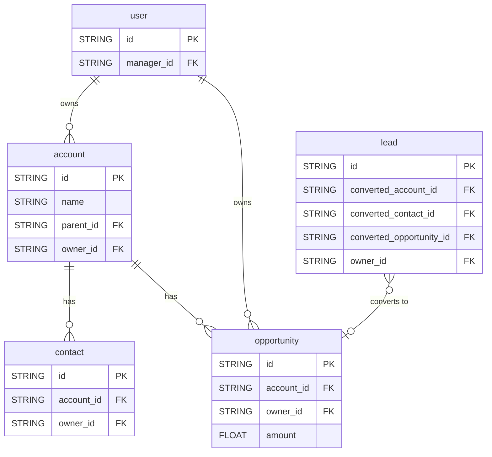

# Salesforce


Sync your Salesforce CRM data (accounts, contacts, leads, opportunities, users) into your warehouse for sales pipeline and revenue analysis.


***

## Prerequisites

* A Salesforce org with **API access**: Enterprise, Unlimited, Performance or Developer edition, or Professional with the API add-on.
* A Salesforce **administrator**, for about 10 minutes.

***

## Authentication

The connector uses the OAuth 2.0 **Client Credentials** flow, which Salesforce provides for server-to-server integrations. You create an app in your own Salesforce org, choose the user the connector runs as, and give QUANTI: three values: your **My Domain URL**, the app's **Consumer Key** and its **Consumer Secret**.

The connector only reads data, with the permissions of that user. You can revoke its access at any time by disabling the app.


Anyone holding the Consumer Key and Secret can read your org as that user. Pick a dedicated read-only user, never an administrator.


***

## Setup Instructions



**Choose the integration user**

In **Setup > Users**, pick or create the user the connector will run as. We recommend a dedicated user with the **Minimum Access - API Only Integrations** profile and a permission set with **Read** on Accounts, Contacts, Leads, Opportunities and Users.



**Create the app**

In **Setup**, search **External Client App Manager**, then click **New External Client App**.

* **Label**: `QUANTI Integration`, plus your contact email. **Distribution State**: **Local**.
* Check **Enable OAuth**. **Callback URL**: `https://login.salesforce.com` (required by Salesforce, never used).
* **OAuth Scopes**: **Manage user data via APIs (api)** only.
* **Flow Enablement**: check **Enable Client Credentials Flow** only. Click **Create**.

Salesforce guides: [create an External Client App](https://developer.salesforce.com/docs/platform/mobile-sdk/guide/eca-create.html), [OAuth settings](https://help.salesforce.com/s/articleView?id=sf.configure_external_client_app_oauth_settings.htm&language=en_US).



**Set the Run As user**

Open the app, **Policies** tab, **Edit**. Under **OAuth Policies**, check that **Enable Client Credentials Flow** is selected and enter the integration user's username in **Run As (Username)**. Click **Save**. Policy changes can take a few minutes to apply.

Salesforce guide: [client credentials policies](https://help.salesforce.com/s/articleView?id=xcloud.policies_configure_client_credentials_flow_for_external_client_apps.htm&language=en_US&type=5).



**Copy the keys**

**Settings** tab > **OAuth Settings** > **Consumer Key and Secret**. Enter the code Salesforce emails you, then copy the **Consumer Key** and the **Consumer Secret**.

Salesforce guide: [OAuth 2.0 client credentials flow](https://help.salesforce.com/s/articleView?id=xcloud.remoteaccess_oauth_client_credentials_flow.htm&language=en_US&type=5).



**Connect in QUANTI:**

Enter your **My Domain URL** (in **Setup**, search **My Domain**; it ends with `my.salesforce.com`), the **Consumer Key** and the **Consumer Secret**. Then choose the reports to sync.

* Production: `https://acme.my.salesforce.com`
* Sandbox: `https://acme--uat.sandbox.my.salesforce.com`


`login.salesforce.com`, `test.salesforce.com` and `lightning.force.com` addresses don't work with this flow: use your My Domain URL.



**Sandboxes**: refreshing a sandbox doesn't copy apps created in it. After a refresh, create the app again in the sandbox and update the connector with the new keys.





**Optional: restrict access to QUANTI:'s IP.** If your security policy requires it, set the integration user's profile **Login IP Ranges** to `51.158.117.103`, the address all QUANTI: syncs come from.


***

## Data Model

***

## Available Reports


All reports reload every record at each sync. **Account**, **Contact** and **User** keep only the latest version of each record. **Lead** and **Opportunity** keep one copy of every record per sync, so you can follow how your pipeline evolves over time. To get the current state, keep the latest row per `id`.


### Account

Companies and organizations: industry, size, revenue and owner.

#### Dimensions

| Column | Type | Description |
|---|---|---|
| `id` | STRING | Account ID (primary key) |
| `name` | STRING | Account name |
| `type` | STRING | Account type (customer, partner…) |
| `industry` | STRING | Industry |
| `account_source` | STRING | Source of the account |
| `rating` | STRING | Rating (hot, warm, cold) |
| `number_of_employees` | INTEGER | Number of employees |
| `website` | STRING | Website |
| `billing_city` | STRING | Billing city |
| `billing_country` | STRING | Billing country |
| `parent_id` | STRING | ID of the parent account |
| `owner_id` | STRING | ID of the user who owns the record |
| `created_date` | TIMESTAMP | Creation date and time |
| `last_modified_date` | TIMESTAMP | Last modification date and time by a user |
| `system_modstamp` | TIMESTAMP | Last modification date and time, by a user or an automated process |

#### Metrics

| Column | Type | Description |
|---|---|---|
| `annual_revenue` | FLOAT | Estimated annual revenue |

### Contact

People linked to accounts: identity, contact details and lead source.

| Column | Type | Description |
|---|---|---|
| `id` | STRING | Contact ID (primary key) |
| `account_id` | STRING | ID of the related account |
| `first_name` | STRING | First name |
| `last_name` | STRING | Last name |
| `name` | STRING | Full name |
| `email` | STRING | Email address |
| `phone` | STRING | Phone number |
| `title` | STRING | Job title |
| `lead_source` | STRING | Lead source |
| `mailing_city` | STRING | Mailing city |
| `mailing_country` | STRING | Mailing country |
| `owner_id` | STRING | ID of the user who owns the record |
| `created_date` | TIMESTAMP | Creation date and time |
| `last_modified_date` | TIMESTAMP | Last modification date and time by a user |
| `system_modstamp` | TIMESTAMP | Last modification date and time, by a user or an automated process |

### Lead

Prospects not yet converted: status, source and conversion links.

| Column | Type | Description |
|---|---|---|
| `id` | STRING | Lead ID (primary key) |
| `first_name` | STRING | First name |
| `last_name` | STRING | Last name |
| `name` | STRING | Full name |
| `company` | STRING | Company name |
| `email` | STRING | Email address |
| `status` | STRING | Lead status |
| `lead_source` | STRING | Lead source |
| `industry` | STRING | Industry |
| `rating` | STRING | Rating (hot, warm, cold) |
| `city` | STRING | City |
| `country` | STRING | Country |
| `is_converted` | BOOLEAN | Whether the lead has been converted |
| `converted_date` | DATE | Conversion date |
| `converted_account_id` | STRING | ID of the account created at conversion |
| `converted_contact_id` | STRING | ID of the contact created at conversion |
| `converted_opportunity_id` | STRING | ID of the opportunity created at conversion |
| `owner_id` | STRING | ID of the user who owns the record |
| `created_date` | TIMESTAMP | Creation date and time |
| `last_modified_date` | TIMESTAMP | Last modification date and time by a user |
| `system_modstamp` | TIMESTAMP | Last modification date and time, by a user or an automated process |

### Opportunity

Sales pipeline: stage, amount, probability and close date.

#### Dimensions

| Column | Type | Description |
|---|---|---|
| `id` | STRING | Opportunity ID (primary key) |
| `account_id` | STRING | ID of the related account |
| `name` | STRING | Opportunity name |
| `stage_name` | STRING | Sales stage |
| `probability` | FLOAT | Win probability (percent) |
| `close_date` | DATE | Expected or actual close date |
| `type` | STRING | Opportunity type |
| `lead_source` | STRING | Lead source |
| `forecast_category` | STRING | Forecast category |
| `is_closed` | BOOLEAN | Whether the opportunity is closed |
| `is_won` | BOOLEAN | Whether the opportunity is won |
| `campaign_id` | STRING | ID of the primary campaign |
| `owner_id` | STRING | ID of the user who owns the record |
| `created_date` | TIMESTAMP | Creation date and time |
| `last_modified_date` | TIMESTAMP | Last modification date and time by a user |
| `system_modstamp` | TIMESTAMP | Last modification date and time, by a user or an automated process |

#### Metrics

| Column | Type | Description |
|---|---|---|
| `amount` | FLOAT | Estimated total amount |

### User

Salesforce users: sales reps and owners of CRM records.

| Column | Type | Description |
|---|---|---|
| `id` | STRING | User ID (primary key) |
| `name` | STRING | Full name |
| `first_name` | STRING | First name |
| `last_name` | STRING | Last name |
| `email` | STRING | Email address |
| `username` | STRING | Login username |
| `is_active` | BOOLEAN | Whether the user is active |
| `title` | STRING | Job title |
| `department` | STRING | Department |
| `user_type` | STRING | User license category |
| `user_role_id` | STRING | ID of the user role |
| `profile_id` | STRING | ID of the profile |
| `manager_id` | STRING | ID of the manager |
| `created_date` | TIMESTAMP | Creation date and time |
| `last_modified_date` | TIMESTAMP | Last modification date and time by a user |
| `system_modstamp` | TIMESTAMP | Last modification date and time, by a user or an automated process |

***

## Scheduling

| Setting | Default | Options |
|---|---|---|
| **Frequency** | Daily | Daily, Weekly |
| **Sync time** | 3:00 AM | — |
| **Lookback window** | 3 days | 1, 3, 7, 30 days |
| **Historical load** | — | 12 or 36 months, or custom dates (up to 10 years) |

***

## Troubleshooting

**"client credentials token request failed"**: check that **Enable Client Credentials Flow** is checked in both the app's **Settings** and **Policies** tabs, that a **Run As** user is set, and that the Consumer Key and Secret are correct. A new app can take a few minutes to become active.

**"my_domain must be your org's My Domain"**: replace `login.salesforce.com` with your My Domain URL, shown in **Setup > My Domain**.

**"API access check failed"**: your Salesforce edition or the Run As user doesn't have API access. Check your edition and give the user the **API Enabled** permission.

**A column is always empty**: the Run As user can't read that field, or your org doesn't have it. The connector leaves such fields empty instead of failing the report. Grant read access to the field in the user's permission sets if you need it.

**"INVALID_SESSION_ID"**: in **Setup > Session Settings**, uncheck **Lock sessions to the IP address from which they originated**.

**Your org restricts login IP ranges**: open the app, **Policies** tab, and under **App Authorization** set **IP Relaxation** to **Relax IP restrictions**, or allow `51.158.117.103`.
