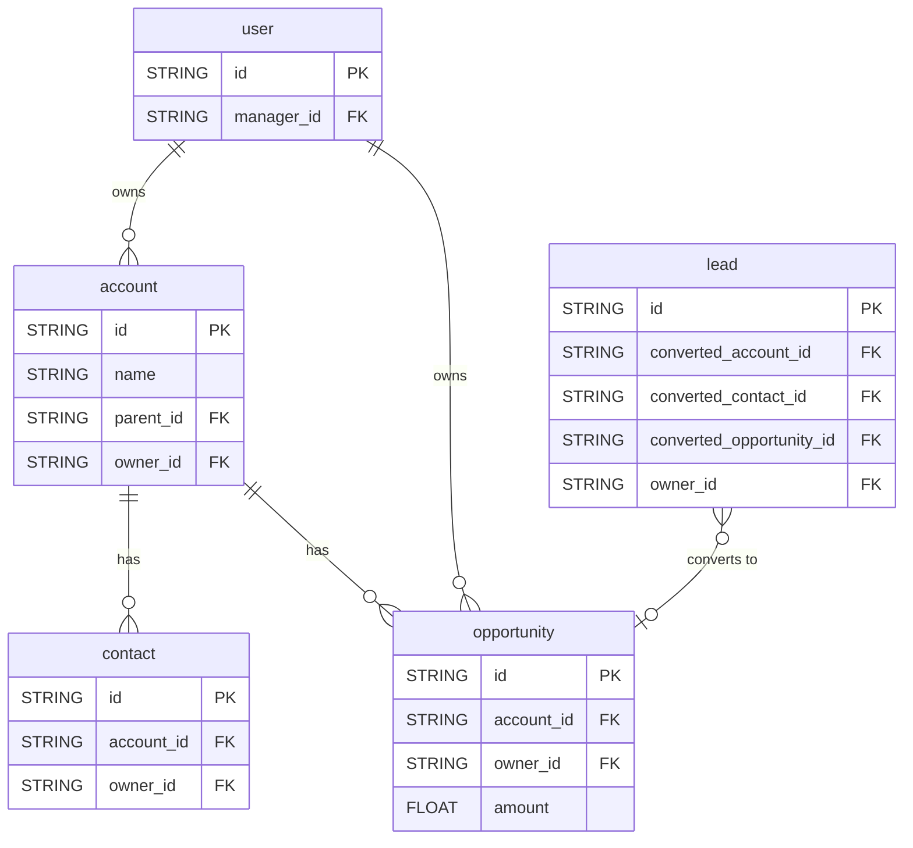

# Salesforce


Sync your Salesforce CRM data (accounts, contacts, leads, opportunities, users) into your warehouse for sales pipeline and revenue analysis.


***

## Prerequisites

* A Salesforce org with **API access**. API access is included in Enterprise, Unlimited, Performance and Developer editions. Professional Edition requires the API add-on. Group and Essentials editions don't have API access.
* A Salesforce administrator, to create an External Client App in your org.
* A dedicated **integration user** that the connector will run as. We recommend a user with read-only access to the objects you want to sync.

***

## Authentication

The connector uses the **OAuth 2.0 Client Credentials flow**, which Salesforce designs for server-to-server integrations that run as a single integration identity.

You create an External Client App in your own Salesforce org and give QUANTI: three values: your **My Domain URL**, the app's **Consumer Key** and its **Consumer Secret**. The connector then reads data with the permissions of the integration user you chose. No Salesforce user login or refresh token is involved.


Anyone holding the Consumer Key and Consumer Secret can access your org as the integration user. Pick a user with read-only permissions, never an administrator.


***

## Setup Instructions



**Prepare an integration user**

In Salesforce **Setup**, go to **Users** and choose the user the connector will run as. We recommend a dedicated user with the **Minimum Access - API Only Integrations** profile (Salesforce Integration license, when your edition includes it) and permission sets granting read access to Accounts, Contacts, Leads, Opportunities and Users.



**Create an External Client App**

1. In **Setup**, type **External Client App Manager** in the Quick Find box and open it.
2. Click **New External Client App**.
3. Enter a **Label** (for example `QUANTI Integration`). The **API Name** fills in automatically. Enter your **Contact Email**.
4. Set **Distribution State** to **Local**. The app is then usable in this org only.



**Enable OAuth and the Client Credentials flow**

Still on the creation form, in the **API (Enable OAuth Settings)** section:

1. Select **Enable OAuth**.
2. In **Callback URL**, enter `https://login.salesforce.com`. Salesforce requires a valid callback URL, but the Client Credentials flow never uses it.
3. In **OAuth Scopes**, select **Manage user data via APIs (api)**. No other scope is needed.
4. In **Flow Enablement**, select **Enable Client Credentials Flow** only.
5. Click **Create**.



**Set the integration user in the app policies**

1. Open the app and go to the **Policies** tab, then click **Edit**.
2. In **OAuth Policies**, under **OAuth Flows and External Client App Enhancements**, check that **Enable Client Credentials Flow** is selected.
3. In **Run As (Username)**, enter the username of the integration user prepared in step 1. Every token issued to QUANTI: acts as this user.
4. If your org restricts login IP ranges, go to **App Authorization** and set **IP Relaxation** to **Relax IP restrictions**.
5. Click **Save**.



**Copy the Consumer Key and Secret**

1. Open the app and go to the **Settings** tab.
2. Expand **OAuth Settings** and click **Consumer Key and Secret**. Salesforce sends you a verification code by email.
3. Copy the **Consumer Key** and the **Consumer Secret**.



**Find your My Domain URL**

In **Setup**, type **My Domain** in the Quick Find box. Copy the **My Domain URL**: it starts with `https://` and ends with `my.salesforce.com`, with no path after it.

* Production: `https://MyDomainName.my.salesforce.com`
* Sandbox: `https://MyDomainName--SandboxName.sandbox.my.salesforce.com`



**Enter your credentials in QUANTI:**

Enter your **My Domain URL** (including `https://`), the **Consumer Key** and the **Consumer Secret**.


Use your My Domain URL. `login.salesforce.com` and `test.salesforce.com` are not supported by the Client Credentials flow.




**Choose your reports**

Choose the reports to sync, then create the connector.



***

## Data Model

***

## Available Reports


All reports reload every record at each sync. **Account**, **Contact** and **User** keep only the latest version of each record. **Lead** and **Opportunity** keep one copy of every record per sync, so you can follow how your pipeline evolves over time. To get the current state, keep the latest row per `id`.


### Account

Companies and organizations: industry, size, revenue and owner.

#### Dimensions

| Column | Type | Description |
|---|---|---|
| `id` | STRING | Account ID (primary key) |
| `name` | STRING | Account name |
| `type` | STRING | Account type (customer, partner…) |
| `industry` | STRING | Industry |
| `account_source` | STRING | Source of the account |
| `rating` | STRING | Rating (hot, warm, cold) |
| `number_of_employees` | INTEGER | Number of employees |
| `website` | STRING | Website |
| `billing_city` | STRING | Billing city |
| `billing_country` | STRING | Billing country |
| `parent_id` | STRING | ID of the parent account |
| `owner_id` | STRING | ID of the user who owns the record |
| `created_date` | TIMESTAMP | Creation date and time |
| `last_modified_date` | TIMESTAMP | Last modification date and time by a user |
| `system_modstamp` | TIMESTAMP | Last modification date and time, by a user or an automated process |

#### Metrics

| Column | Type | Description |
|---|---|---|
| `annual_revenue` | FLOAT | Estimated annual revenue |

### Contact

People linked to accounts: identity, contact details and lead source.

| Column | Type | Description |
|---|---|---|
| `id` | STRING | Contact ID (primary key) |
| `account_id` | STRING | ID of the related account |
| `first_name` | STRING | First name |
| `last_name` | STRING | Last name |
| `name` | STRING | Full name |
| `email` | STRING | Email address |
| `phone` | STRING | Phone number |
| `title` | STRING | Job title |
| `lead_source` | STRING | Lead source |
| `mailing_city` | STRING | Mailing city |
| `mailing_country` | STRING | Mailing country |
| `owner_id` | STRING | ID of the user who owns the record |
| `created_date` | TIMESTAMP | Creation date and time |
| `last_modified_date` | TIMESTAMP | Last modification date and time by a user |
| `system_modstamp` | TIMESTAMP | Last modification date and time, by a user or an automated process |

### Lead

Prospects not yet converted: status, source and conversion links.

| Column | Type | Description |
|---|---|---|
| `id` | STRING | Lead ID (primary key) |
| `first_name` | STRING | First name |
| `last_name` | STRING | Last name |
| `name` | STRING | Full name |
| `company` | STRING | Company name |
| `email` | STRING | Email address |
| `status` | STRING | Lead status |
| `lead_source` | STRING | Lead source |
| `industry` | STRING | Industry |
| `rating` | STRING | Rating (hot, warm, cold) |
| `city` | STRING | City |
| `country` | STRING | Country |
| `is_converted` | BOOLEAN | Whether the lead has been converted |
| `converted_date` | DATE | Conversion date |
| `converted_account_id` | STRING | ID of the account created at conversion |
| `converted_contact_id` | STRING | ID of the contact created at conversion |
| `converted_opportunity_id` | STRING | ID of the opportunity created at conversion |
| `owner_id` | STRING | ID of the user who owns the record |
| `created_date` | TIMESTAMP | Creation date and time |
| `last_modified_date` | TIMESTAMP | Last modification date and time by a user |
| `system_modstamp` | TIMESTAMP | Last modification date and time, by a user or an automated process |

### Opportunity

Sales pipeline: stage, amount, probability and close date.

#### Dimensions

| Column | Type | Description |
|---|---|---|
| `id` | STRING | Opportunity ID (primary key) |
| `account_id` | STRING | ID of the related account |
| `name` | STRING | Opportunity name |
| `stage_name` | STRING | Sales stage |
| `probability` | FLOAT | Win probability (percent) |
| `close_date` | DATE | Expected or actual close date |
| `type` | STRING | Opportunity type |
| `lead_source` | STRING | Lead source |
| `forecast_category` | STRING | Forecast category |
| `is_closed` | BOOLEAN | Whether the opportunity is closed |
| `is_won` | BOOLEAN | Whether the opportunity is won |
| `campaign_id` | STRING | ID of the primary campaign |
| `owner_id` | STRING | ID of the user who owns the record |
| `created_date` | TIMESTAMP | Creation date and time |
| `last_modified_date` | TIMESTAMP | Last modification date and time by a user |
| `system_modstamp` | TIMESTAMP | Last modification date and time, by a user or an automated process |

#### Metrics

| Column | Type | Description |
|---|---|---|
| `amount` | FLOAT | Estimated total amount |

### User

Salesforce users: sales reps and owners of CRM records.

| Column | Type | Description |
|---|---|---|
| `id` | STRING | User ID (primary key) |
| `name` | STRING | Full name |
| `first_name` | STRING | First name |
| `last_name` | STRING | Last name |
| `email` | STRING | Email address |
| `username` | STRING | Login username |
| `is_active` | BOOLEAN | Whether the user is active |
| `title` | STRING | Job title |
| `department` | STRING | Department |
| `user_type` | STRING | User license category |
| `user_role_id` | STRING | ID of the user role |
| `profile_id` | STRING | ID of the profile |
| `manager_id` | STRING | ID of the manager |
| `created_date` | TIMESTAMP | Creation date and time |
| `last_modified_date` | TIMESTAMP | Last modification date and time by a user |
| `system_modstamp` | TIMESTAMP | Last modification date and time, by a user or an automated process |

***

## Scheduling

| Setting | Default | Options |
|---|---|---|
| **Frequency** | Daily | Daily, Weekly |
| **Sync time** | 3:00 AM | — |
| **Lookback window** | 3 days | 1, 3, 7, 30 days |
| **Historical load** | — | 12 or 36 months, or custom dates (up to 10 years) |

***

## Troubleshooting

**"client credentials token request failed"**: check that **Enable Client Credentials Flow** is checked in both the app's **Settings** and **Policies** tabs, that a **Run As** user is set, and that the Consumer Key and Secret are correct.

**"my_domain must be your org's My Domain"**: replace `login.salesforce.com` with your My Domain URL, shown in **Setup > My Domain**.

**"API access check failed"**: your Salesforce edition or the Run As user doesn't have API access. Check your edition and give the user the **API Enabled** permission.

**A column is always empty**: the Run As user can't read that field. Grant read access to the field in the user's permission sets.

**"INVALID_SESSION_ID"**: in **Setup > Session Settings**, uncheck **Lock sessions to the IP address from which they originated**.
