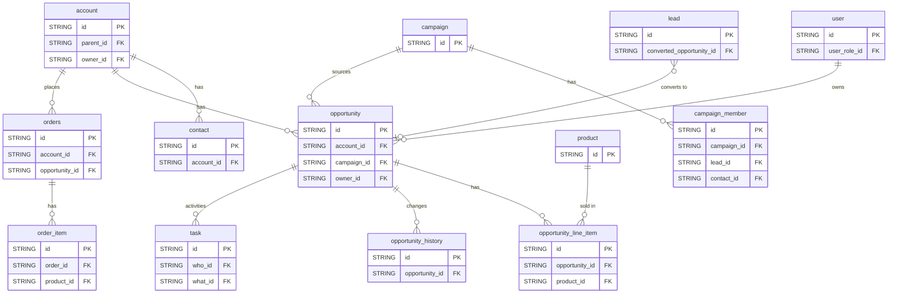

# Salesforce


Sync your Salesforce CRM data (accounts, contacts, leads, opportunities, campaigns, activities, products, orders and their history) into your warehouse for sales pipeline, attribution and revenue analysis.


***

## Prerequisites

* A Salesforce org with **API access**. API access is included in Enterprise, Unlimited, Performance and Developer editions. Professional Edition requires the API add-on. Group and Essentials editions don't have API access.
* A Salesforce administrator, to create an External Client App in your org.
* A dedicated **integration user** that the connector will run as. We recommend a user with read-only access to the objects you want to sync.

***

## Authentication

The connector uses the **OAuth 2.0 Client Credentials flow**, which Salesforce designs for server-to-server integrations that run as a single integration identity.

You create an External Client App in your own Salesforce org and give QUANTI: three values: your **My Domain URL**, the app's **Consumer Key** and its **Consumer Secret**. The connector then reads data with the permissions of the integration user you chose. No Salesforce user login or refresh token is involved.


Anyone holding the Consumer Key and Consumer Secret can access your org as the integration user. Pick a user with read-only permissions, never an administrator.


***

## Setup Instructions



**Prepare an integration user**

In Salesforce **Setup**, go to **Users** and choose the user the connector will run as. We recommend a dedicated user with the **Minimum Access - API Only Integrations** profile (Salesforce Integration license, when your edition includes it) and permission sets granting read access to the objects you want to sync (Accounts, Contacts, Leads, Opportunities, Campaigns, Tasks, Events, Products, Orders…).



**Create an External Client App**

1. In **Setup**, type **External Client App Manager** in the Quick Find box and open it.
2. Click **New External Client App**.
3. Enter a **Label** (for example `QUANTI Integration`). The **API Name** fills in automatically. Enter your **Contact Email**.
4. Set **Distribution State** to **Local**. The app is then usable in this org only.

Salesforce guide: [create an External Client App](https://developer.salesforce.com/docs/platform/mobile-sdk/guide/eca-create.html).



**Enable OAuth and the Client Credentials flow**

Still on the creation form, in the **API (Enable OAuth Settings)** section:

1. Select **Enable OAuth**.
2. In **Callback URL**, enter `https://login.salesforce.com`. Salesforce requires a valid callback URL, but the Client Credentials flow never uses it.
3. In **OAuth Scopes**, select **Manage user data via APIs (api)**. No other scope is needed.
4. In **Flow Enablement**, select **Enable Client Credentials Flow** only.
5. Click **Create**.

Salesforce guide: [OAuth settings](https://help.salesforce.com/s/articleView?id=sf.configure_external_client_app_oauth_settings.htm&language=en_US).



**Set the integration user in the app policies**

1. Open the app and go to the **Policies** tab, then click **Edit**.
2. In **OAuth Policies**, under **OAuth Flows and External Client App Enhancements**, check that **Enable Client Credentials Flow** is selected.
3. In **Run As (Username)**, enter the username of the integration user prepared in step 1. Every token issued to QUANTI: acts as this user.
4. If your org restricts login IP ranges, go to **App Authorization** and set **IP Relaxation** to **Relax IP restrictions**.
5. Click **Save**. Policy changes can take a few minutes to apply.

Salesforce guide: [client credentials policies](https://help.salesforce.com/s/articleView?id=xcloud.policies_configure_client_credentials_flow_for_external_client_apps.htm&language=en_US&type=5).



**Copy the Consumer Key and Secret**

1. Open the app and go to the **Settings** tab.
2. Expand **OAuth Settings** and click **Consumer Key and Secret**. Salesforce sends you a verification code by email.
3. Copy the **Consumer Key** and the **Consumer Secret**.

Salesforce guide: [OAuth 2.0 client credentials flow](https://help.salesforce.com/s/articleView?id=xcloud.remoteaccess_oauth_client_credentials_flow.htm&language=en_US&type=5).



**Find your My Domain URL**

In **Setup**, type **My Domain** in the Quick Find box. Copy the **My Domain URL**: it starts with `https://` and ends with `my.salesforce.com`, with no path after it.

* Production: `https://MyDomainName.my.salesforce.com`
* Sandbox: `https://MyDomainName--SandboxName.sandbox.my.salesforce.com`


**Sandboxes**: refreshing a sandbox doesn't copy apps created in it. After a refresh, create the app again in the sandbox and update the connector with the new keys.




**Enter your credentials in QUANTI:**

Enter your **My Domain URL** (including `https://`), the **Consumer Key** and the **Consumer Secret**.


Use your My Domain URL. `login.salesforce.com`, `test.salesforce.com` and `lightning.force.com` addresses are not supported by the Client Credentials flow.




**Choose your reports**

Choose the reports to sync, then create the connector.




**Optional: restrict access to QUANTI:'s IP.** If your security policy requires it, set the integration user's profile **Login IP Ranges** to `51.158.117.103`, the address all QUANTI: syncs come from.


***

## Data Model

The main tables and how they join. Reference tables (stages, statuses, record types, roles, periods) join on their `id` or value.

`task.what_id` and `event.what_id` point to an opportunity (ID starting with `006`) or an account (`001`). `who_id` points to a lead (`00Q`) or a contact (`003`).

***

## Available Reports


Most reports reload every record at each sync and keep only the current state of each record. **Tasks** and **Events** keep one row per version of a record: keep the latest row per `id`. **Opportunity history**, **Opportunity field history** and **Lead history** keep one row per change.



Some reports depend on a Salesforce feature: **Products** (opportunity products, products), **Orders** (orders, order products), **field history tracking** (opportunity field history, lead history), **Customizable Campaign Influence** (campaign influence) and **Collaborative Forecasts with quotas** (quotas). When the feature isn't enabled in your org, the report stays empty and the sync doesn't fail.


### CRM records

#### Accounts

Companies and organizations: industry, size, revenue and owner. Table `account`.

**Dimensions**

| Column | Type | Description |
|---|---|---|
| `id` | STRING | Account ID |
| `name` | STRING | Account name |
| `type` | STRING | Account type (customer, partner…) |
| `industry` | STRING | Industry |
| `account_source` | STRING | Source of the account |
| `rating` | STRING | Rating (hot, warm, cold) |
| `number_of_employees` | INTEGER | Number of employees |
| `website` | STRING | Website |
| `billing_city` | STRING | Billing city |
| `billing_country` | STRING | Billing country |
| `parent_id` | STRING | ID of the parent account |
| `owner_id` | STRING | ID of the user who owns the record |
| `created_date` | TIMESTAMP | Creation date and time |
| `last_modified_date` | TIMESTAMP | Last modification date and time by a user |
| `system_modstamp` | TIMESTAMP | Last modification date and time, by a user or an automated process |

**Metrics**

| Column | Type | Description |
|---|---|---|
| `annual_revenue` | FLOAT | Estimated annual revenue |

#### Contacts

People linked to accounts: identity, contact details and lead source. Table `contact`.

| Column | Type | Description |
|---|---|---|
| `id` | STRING | Contact ID |
| `account_id` | STRING | ID of the related account |
| `first_name` | STRING | First name |
| `last_name` | STRING | Last name |
| `name` | STRING | Full name |
| `email` | STRING | Email address |
| `phone` | STRING | Phone number |
| `title` | STRING | Job title |
| `lead_source` | STRING | Lead source |
| `mailing_city` | STRING | Mailing city |
| `mailing_country` | STRING | Mailing country |
| `owner_id` | STRING | ID of the user who owns the record |
| `created_date` | TIMESTAMP | Creation date and time |
| `last_modified_date` | TIMESTAMP | Last modification date and time by a user |
| `system_modstamp` | TIMESTAMP | Last modification date and time, by a user or an automated process |

#### Leads

Prospects not yet converted: status, source and conversion links. Table `lead`.

| Column | Type | Description |
|---|---|---|
| `id` | STRING | Lead ID |
| `first_name` | STRING | First name |
| `last_name` | STRING | Last name |
| `name` | STRING | Full name |
| `company` | STRING | Company name |
| `email` | STRING | Email address |
| `status` | STRING | Lead status |
| `lead_source` | STRING | Lead source |
| `industry` | STRING | Industry |
| `rating` | STRING | Rating (hot, warm, cold) |
| `city` | STRING | City |
| `country` | STRING | Country |
| `is_converted` | BOOLEAN | Whether the lead has been converted |
| `converted_date` | DATE | Conversion date |
| `converted_account_id` | STRING | ID of the account created at conversion |
| `converted_contact_id` | STRING | ID of the contact created at conversion |
| `converted_opportunity_id` | STRING | ID of the opportunity created at conversion |
| `owner_id` | STRING | ID of the user who owns the record |
| `created_date` | TIMESTAMP | Creation date and time |
| `last_modified_date` | TIMESTAMP | Last modification date and time by a user |
| `system_modstamp` | TIMESTAMP | Last modification date and time, by a user or an automated process |

#### Opportunities

Sales pipeline: stage, amount, probability and close date. Table `opportunity`.

**Dimensions**

| Column | Type | Description |
|---|---|---|
| `id` | STRING | Opportunity ID |
| `account_id` | STRING | ID of the related account |
| `name` | STRING | Opportunity name |
| `stage_name` | STRING | Sales stage |
| `probability` | FLOAT | Win probability (percent) |
| `close_date` | DATE | Expected or actual close date |
| `type` | STRING | Opportunity type |
| `lead_source` | STRING | Lead source |
| `forecast_category` | STRING | Forecast category |
| `is_closed` | BOOLEAN | Whether the opportunity is closed |
| `is_won` | BOOLEAN | Whether the opportunity is won |
| `campaign_id` | STRING | ID of the primary campaign |
| `owner_id` | STRING | ID of the user who owns the record |
| `created_date` | TIMESTAMP | Creation date and time |
| `last_modified_date` | TIMESTAMP | Last modification date and time by a user |
| `system_modstamp` | TIMESTAMP | Last modification date and time, by a user or an automated process |

**Metrics**

| Column | Type | Description |
|---|---|---|
| `amount` | FLOAT | Estimated total amount |

#### Users

Salesforce users: sales reps and owners of CRM records. Table `user`.

| Column | Type | Description |
|---|---|---|
| `id` | STRING | User ID |
| `name` | STRING | Full name |
| `first_name` | STRING | First name |
| `last_name` | STRING | Last name |
| `email` | STRING | Email address |
| `username` | STRING | Login username |
| `is_active` | BOOLEAN | Whether the user is active |
| `title` | STRING | Job title |
| `department` | STRING | Department |
| `user_type` | STRING | User license category |
| `user_role_id` | STRING | ID of the user role |
| `profile_id` | STRING | ID of the profile |
| `manager_id` | STRING | ID of the manager |
| `created_date` | TIMESTAMP | Creation date and time |
| `last_modified_date` | TIMESTAMP | Last modification date and time by a user |
| `system_modstamp` | TIMESTAMP | Last modification date and time, by a user or an automated process |

### Marketing and attribution

#### Campaigns

Marketing campaigns: type, status, dates, budget, cost and results. Table `campaign`.

**Dimensions**

| Column | Type | Description |
|---|---|---|
| `id` | STRING | Campaign ID (primary key) |
| `name` | STRING | Campaign name |
| `parent_id` | STRING | ID of the parent campaign |
| `type` | STRING | Campaign type |
| `status` | STRING | Campaign status |
| `start_date` | DATE | Start date |
| `end_date` | DATE | End date |
| `is_active` | BOOLEAN | Whether the campaign is active |
| `expected_response` | FLOAT | Expected response rate (percent) |
| `owner_id` | STRING | ID of the user who owns the record |
| `created_date` | TIMESTAMP | Creation date and time |
| `last_modified_date` | TIMESTAMP | Last modification date and time by a user |
| `system_modstamp` | TIMESTAMP | Last modification date and time, by a user or an automated process |

**Metrics**

| Column | Type | Description |
|---|---|---|
| `budgeted_cost` | FLOAT | Budgeted cost |
| `actual_cost` | FLOAT | Actual cost |
| `expected_revenue` | FLOAT | Expected revenue |
| `number_sent` | FLOAT | Number of people targeted |
| `number_of_leads` | INTEGER | Number of leads |
| `number_of_converted_leads` | INTEGER | Number of converted leads |
| `number_of_contacts` | INTEGER | Number of contacts |
| `number_of_responses` | INTEGER | Number of responses |
| `number_of_opportunities` | INTEGER | Number of opportunities |
| `number_of_won_opportunities` | INTEGER | Number of won opportunities |
| `amount_all_opportunities` | FLOAT | Amount of all opportunities |
| `amount_won_opportunities` | FLOAT | Amount of won opportunities |

#### Campaign members

Leads and contacts linked to a campaign, with their response status. Table `campaign_member`.

| Column | Type | Description |
|---|---|---|
| `id` | STRING | Campaign member ID (primary key) |
| `campaign_id` | STRING | ID of the campaign |
| `lead_id` | STRING | ID of the lead, if the member is a lead |
| `contact_id` | STRING | ID of the contact, if the member is a contact |
| `lead_or_contact_id` | STRING | ID of the lead or contact |
| `status` | STRING | Member status |
| `has_responded` | BOOLEAN | Whether the member responded |
| `first_responded_date` | DATE | Date of the first response |
| `created_date` | TIMESTAMP | Creation date and time |
| `last_modified_date` | TIMESTAMP | Last modification date and time by a user |
| `system_modstamp` | TIMESTAMP | Last modification date and time, by a user or an automated process |

#### Campaign influence

Campaigns credited on each opportunity, with their share of revenue (requires Customizable Campaign Influence). Table `campaign_influence`.

**Dimensions**

| Column | Type | Description |
|---|---|---|
| `id` | STRING | Campaign influence ID (primary key) |
| `campaign_id` | STRING | ID of the campaign |
| `opportunity_id` | STRING | ID of the opportunity |
| `contact_id` | STRING | ID of the contact |
| `model_id` | STRING | ID of the attribution model |
| `influence` | FLOAT | Influence percentage |
| `created_date` | TIMESTAMP | Creation date and time |
| `last_modified_date` | TIMESTAMP | Last modification date and time by a user |
| `system_modstamp` | TIMESTAMP | Last modification date and time, by a user or an automated process |

**Metrics**

| Column | Type | Description |
|---|---|---|
| `revenue_share` | FLOAT | Share of the opportunity amount credited to the campaign |

### Sales activity

#### Tasks

Calls, emails and to-dos logged by sales reps, one row per version (keep the latest row per id). Table `task`.

**Dimensions**

| Column | Type | Description |
|---|---|---|
| `id` | STRING | Task ID |
| `who_id` | STRING | ID of the related lead or contact |
| `what_id` | STRING | ID of the related record (opportunity, account…) |
| `account_id` | STRING | ID of the related account |
| `owner_id` | STRING | ID of the user who owns the record |
| `subject` | STRING | Subject |
| `status` | STRING | Status |
| `priority` | STRING | Priority |
| `task_subtype` | STRING | Subtype (call, email, task…) |
| `type` | STRING | Type |
| `activity_date` | DATE | Due date |
| `is_closed` | BOOLEAN | Whether the task is closed |
| `call_type` | STRING | Call type (inbound, outbound…) |
| `call_disposition` | STRING | Call result |
| `is_archived` | BOOLEAN | Whether Salesforce archived the task |
| `completed_date_time` | TIMESTAMP | Completion date and time |
| `created_date` | TIMESTAMP | Creation date and time |
| `last_modified_date` | TIMESTAMP | Last modification date and time by a user |
| `system_modstamp` | TIMESTAMP | Last modification date and time, by a user or an automated process |

**Metrics**

| Column | Type | Description |
|---|---|---|
| `call_duration_in_seconds` | INTEGER | Call duration in seconds |

#### Events

Meetings and calendar events logged by sales reps, one row per version (keep the latest row per id). Table `event`.

**Dimensions**

| Column | Type | Description |
|---|---|---|
| `id` | STRING | Event ID |
| `who_id` | STRING | ID of the related lead or contact |
| `what_id` | STRING | ID of the related record (opportunity, account…) |
| `account_id` | STRING | ID of the related account |
| `owner_id` | STRING | ID of the user who owns the record |
| `subject` | STRING | Subject |
| `type` | STRING | Type |
| `event_subtype` | STRING | Subtype |
| `activity_date` | DATE | Event date |
| `start_date_time` | TIMESTAMP | Start date and time |
| `end_date_time` | TIMESTAMP | End date and time |
| `is_all_day_event` | BOOLEAN | Whether the event lasts all day |
| `is_archived` | BOOLEAN | Whether Salesforce archived the event |
| `created_date` | TIMESTAMP | Creation date and time |
| `last_modified_date` | TIMESTAMP | Last modification date and time by a user |
| `system_modstamp` | TIMESTAMP | Last modification date and time, by a user or an automated process |

**Metrics**

| Column | Type | Description |
|---|---|---|
| `duration_in_minutes` | INTEGER | Duration in minutes |

### Products and revenue

#### Opportunity products

Products sold on each opportunity: quantity, prices and total (requires Products). Table `opportunity_line_item`.

**Dimensions**

| Column | Type | Description |
|---|---|---|
| `id` | STRING | Opportunity product ID (primary key) |
| `opportunity_id` | STRING | ID of the opportunity |
| `product_id` | STRING | ID of the product |
| `pricebook_entry_id` | STRING | ID of the price book entry |
| `product_code` | STRING | Product code |
| `name` | STRING | Line name |
| `unit_price` | FLOAT | Sales price per unit |
| `list_price` | FLOAT | List price per unit |
| `discount` | FLOAT | Discount (percent) |
| `service_date` | DATE | Service date |
| `created_date` | TIMESTAMP | Creation date and time |
| `last_modified_date` | TIMESTAMP | Last modification date and time by a user |
| `system_modstamp` | TIMESTAMP | Last modification date and time, by a user or an automated process |

**Metrics**

| Column | Type | Description |
|---|---|---|
| `quantity` | FLOAT | Quantity |
| `total_price` | FLOAT | Total price |

#### Products

Product catalog: name, code, family and status (requires Products). Table `product`.

| Column | Type | Description |
|---|---|---|
| `id` | STRING | Product ID (primary key) |
| `name` | STRING | Product name |
| `product_code` | STRING | Product code |
| `family` | STRING | Product family |
| `description` | STRING | Description |
| `is_active` | BOOLEAN | Whether the product is active |
| `quantity_unit_of_measure` | STRING | Unit of measure |
| `created_date` | TIMESTAMP | Creation date and time |
| `last_modified_date` | TIMESTAMP | Last modification date and time by a user |
| `system_modstamp` | TIMESTAMP | Last modification date and time, by a user or an automated process |

#### Orders

Orders booked after signature: account, status, dates and amount (requires Orders). Table `orders`.

**Dimensions**

| Column | Type | Description |
|---|---|---|
| `id` | STRING | Order ID (primary key) |
| `order_number` | STRING | Order number |
| `account_id` | STRING | ID of the account |
| `opportunity_id` | STRING | ID of the opportunity |
| `contract_id` | STRING | ID of the contract |
| `status` | STRING | Order status |
| `type` | STRING | Order type |
| `effective_date` | DATE | Start date |
| `end_date` | DATE | End date |
| `activated_date` | TIMESTAMP | Activation date and time |
| `owner_id` | STRING | ID of the user who owns the record |
| `created_date` | TIMESTAMP | Creation date and time |
| `last_modified_date` | TIMESTAMP | Last modification date and time by a user |
| `system_modstamp` | TIMESTAMP | Last modification date and time, by a user or an automated process |

**Metrics**

| Column | Type | Description |
|---|---|---|
| `total_amount` | FLOAT | Total amount |

#### Order products

Products of each order: quantity, prices and total (requires Orders). Table `order_item`.

**Dimensions**

| Column | Type | Description |
|---|---|---|
| `id` | STRING | Order product ID (primary key) |
| `order_id` | STRING | ID of the order |
| `product_id` | STRING | ID of the product |
| `pricebook_entry_id` | STRING | ID of the price book entry |
| `unit_price` | FLOAT | Price per unit |
| `list_price` | FLOAT | List price per unit |
| `service_date` | DATE | Start date |
| `end_date` | DATE | End date |
| `created_date` | TIMESTAMP | Creation date and time |
| `last_modified_date` | TIMESTAMP | Last modification date and time by a user |
| `system_modstamp` | TIMESTAMP | Last modification date and time, by a user or an automated process |

**Metrics**

| Column | Type | Description |
|---|---|---|
| `quantity` | FLOAT | Quantity |
| `total_price` | FLOAT | Total price |

#### Opportunity contact roles

Contacts involved in each opportunity and their role. Table `opportunity_contact_role`.

| Column | Type | Description |
|---|---|---|
| `id` | STRING | Contact role ID (primary key) |
| `opportunity_id` | STRING | ID of the opportunity |
| `contact_id` | STRING | ID of the contact |
| `role` | STRING | Role of the contact |
| `is_primary` | BOOLEAN | Whether this is the primary contact |
| `created_date` | TIMESTAMP | Creation date and time |
| `last_modified_date` | TIMESTAMP | Last modification date and time by a user |
| `system_modstamp` | TIMESTAMP | Last modification date and time, by a user or an automated process |

### Pipeline history

#### Opportunity history

Every change of stage, amount, close date or probability of an opportunity. Table `opportunity_history`.

**Dimensions**

| Column | Type | Description |
|---|---|---|
| `id` | STRING | History row ID (primary key) |
| `opportunity_id` | STRING | ID of the opportunity |
| `stage_name` | STRING | Stage after the change |
| `close_date` | DATE | Close date after the change |
| `probability` | FLOAT | Probability after the change (percent) |
| `forecast_category` | STRING | Forecast category after the change |
| `created_by_id` | STRING | ID of the user who made the change |
| `created_date` | TIMESTAMP | Creation date and time |
| `system_modstamp` | TIMESTAMP | Last modification date and time, by a user or an automated process |

**Metrics**

| Column | Type | Description |
|---|---|---|
| `amount` | FLOAT | Amount after the change |
| `expected_revenue` | FLOAT | Expected revenue after the change |

#### Opportunity field history

Changes of the opportunity fields tracked in the org (requires field history tracking). Table `opportunity_field_history`.

| Column | Type | Description |
|---|---|---|
| `id` | STRING | History row ID (primary key) |
| `opportunity_id` | STRING | ID of the opportunity |
| `field` | STRING | API name of the changed field |
| `data_type` | STRING | Data type of the field |
| `old_value` | STRING | Value before the change |
| `new_value` | STRING | Value after the change |
| `created_by_id` | STRING | ID of the user who made the change |
| `created_date` | TIMESTAMP | Creation date and time |

#### Lead history

Changes of the lead fields tracked in the org, such as status (requires field history tracking). Table `lead_history`.

| Column | Type | Description |
|---|---|---|
| `id` | STRING | History row ID (primary key) |
| `lead_id` | STRING | ID of the lead |
| `field` | STRING | API name of the changed field |
| `data_type` | STRING | Data type of the field |
| `old_value` | STRING | Value before the change |
| `new_value` | STRING | Value after the change |
| `created_by_id` | STRING | ID of the user who made the change |
| `created_date` | TIMESTAMP | Creation date and time |

### Reference tables

#### Opportunity stages

Sales stages of the org: order, probability and whether they mean closed or won. Table `opportunity_stage`.

| Column | Type | Description |
|---|---|---|
| `id` | STRING | Stage ID (primary key) |
| `api_name` | STRING | Stage value, as stored in opportunity.stage_name |
| `master_label` | STRING | Stage label |
| `sort_order` | INTEGER | Position in the sales process |
| `is_active` | BOOLEAN | Whether the stage is active |
| `is_closed` | BOOLEAN | Whether the stage closes the opportunity |
| `is_won` | BOOLEAN | Whether the stage means won |
| `default_probability` | FLOAT | Default probability (percent) |
| `forecast_category_name` | STRING | Forecast category |
| `created_date` | TIMESTAMP | Creation date and time |
| `last_modified_date` | TIMESTAMP | Last modification date and time by a user |
| `system_modstamp` | TIMESTAMP | Last modification date and time, by a user or an automated process |

#### Lead statuses

Lead statuses of the org: order and whether they mean converted. Table `lead_status`.

| Column | Type | Description |
|---|---|---|
| `id` | STRING | Lead status ID (primary key) |
| `api_name` | STRING | Status value, as stored in lead.status |
| `master_label` | STRING | Status label |
| `sort_order` | INTEGER | Position in the lead process |
| `is_default` | BOOLEAN | Whether this is the default status |
| `is_converted` | BOOLEAN | Whether the status means converted |
| `created_date` | TIMESTAMP | Creation date and time |
| `last_modified_date` | TIMESTAMP | Last modification date and time by a user |
| `system_modstamp` | TIMESTAMP | Last modification date and time, by a user or an automated process |

#### Record types

Record types of the org, used to separate pipelines and processes. Table `record_type`.

| Column | Type | Description |
|---|---|---|
| `id` | STRING | Record type ID (primary key) |
| `name` | STRING | Record type name |
| `developer_name` | STRING | API name |
| `sobject_type` | STRING | Object the record type applies to |
| `description` | STRING | Description |
| `is_active` | BOOLEAN | Whether the record type is active |
| `created_date` | TIMESTAMP | Creation date and time |
| `last_modified_date` | TIMESTAMP | Last modification date and time by a user |
| `system_modstamp` | TIMESTAMP | Last modification date and time, by a user or an automated process |

#### User roles

Role hierarchy of the org, to group users by team or region. Table `user_role`.

| Column | Type | Description |
|---|---|---|
| `id` | STRING | Role ID (primary key) |
| `name` | STRING | Role name |
| `developer_name` | STRING | API name |
| `parent_role_id` | STRING | ID of the parent role |
| `rollup_description` | STRING | Label used in reports |
| `last_modified_date` | TIMESTAMP | Last modification date and time by a user |
| `system_modstamp` | TIMESTAMP | Last modification date and time, by a user or an automated process |

#### Fiscal periods

Fiscal years, quarters and months of the org. Table `period`.

| Column | Type | Description |
|---|---|---|
| `id` | STRING | Period ID (primary key) |
| `fiscal_year_settings_id` | STRING | ID of the fiscal year |
| `type` | STRING | Period type (year, quarter, month…) |
| `start_date` | DATE | Start date |
| `end_date` | DATE | End date |
| `number` | INTEGER | Period number within its parent |
| `period_label` | STRING | Period label |
| `quarter_label` | STRING | Quarter label |
| `is_forecast_period` | BOOLEAN | Whether the period is used for forecasts |
| `system_modstamp` | TIMESTAMP | Last modification date and time, by a user or an automated process |

#### Quotas

Sales quotas per user and period (requires Collaborative Forecasts with quotas). Table `forecasting_quota`.

**Dimensions**

| Column | Type | Description |
|---|---|---|
| `id` | STRING | Quota ID (primary key) |
| `quota_owner_id` | STRING | ID of the user the quota applies to |
| `period_id` | STRING | ID of the period |
| `start_date` | DATE | Start date of the quota period |
| `forecasting_type_id` | STRING | ID of the forecast type |
| `product_family` | STRING | Product family |
| `is_amount` | BOOLEAN | Whether the quota is an amount |
| `is_quantity` | BOOLEAN | Whether the quota is a quantity |
| `created_date` | TIMESTAMP | Creation date and time |
| `last_modified_date` | TIMESTAMP | Last modification date and time by a user |
| `system_modstamp` | TIMESTAMP | Last modification date and time, by a user or an automated process |

**Metrics**

| Column | Type | Description |
|---|---|---|
| `quota_amount` | FLOAT | Quota amount |
| `quota_quantity` | FLOAT | Quota quantity |

***

## Scheduling

| Setting | Default | Options |
|---|---|---|
| **Frequency** | Daily | Daily, Weekly |
| **Sync time** | 3:00 AM | — |
| **Lookback window** | 3 days | 1, 3, 7, 30 days |
| **Historical load** | — | 12 or 36 months, or custom dates (up to 3 years) |

Salesforce data is live, but each sync re-reads whole objects from your org's shared daily API allocation, so syncs run daily or weekly and not intra-day.

Salesforce keeps field history (opportunity field history, lead history) for 18 months through the API by default. The connector keeps every change it has already loaded.

***

## Troubleshooting

**"client credentials token request failed"**: check that **Enable Client Credentials Flow** is checked in both the app's **Settings** and **Policies** tabs, that a **Run As** user is set, and that the Consumer Key and Secret are correct. A new app can take a few minutes to become active.

**"my_domain must be your org's My Domain"**: replace `login.salesforce.com` with your My Domain URL, shown in **Setup > My Domain**.

**"API access check failed"**: your Salesforce edition or the Run As user doesn't have API access. Check your edition and give the user the **API Enabled** permission.

**A column is always empty**: the Run As user can't read that field, or your org doesn't have it. The connector leaves such fields empty instead of failing the report. Grant read access to the field in the user's permission sets if you need it.

**A report stays empty**: the Salesforce feature behind it isn't enabled in your org, or the Run As user can't read that object. Grant the object's read access in the user's permission sets.

**"INVALID_SESSION_ID"**: in **Setup > Session Settings**, uncheck **Lock sessions to the IP address from which they originated**.

**Your org restricts login IP ranges**: open the app, **Policies** tab, and under **App Authorization** set **IP Relaxation** to **Relax IP restrictions**, or allow `51.158.117.103`.
