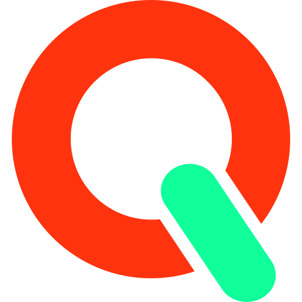

# Get started

<figure><figcaption></figcaption></figure>

QUANTI: takes your marketing data all the way to business outcomes. Use the products you need: they all work inside the same QUANTI: project.

<table data-view="cards"><thead><tr><th width="48"></th><th></th><th></th><th data-hidden data-card-target data-type="content-ref"></th></tr></thead><tbody><tr><td></td><td><strong>Track</strong></td><td>Collect events from your sites and apps, server-side and straight into your warehouse.</td><td><a href="../track/README.md">Track</a></td></tr><tr><td></td><td><strong>Connect</strong></td><td>Every marketing source in your warehouse, daily.</td><td><a href="../connect/README.md">Connect</a></td></tr><tr><td></td><td><strong>Store</strong></td><td>A managed warehouse, or your own BigQuery, Snowflake or ClickHouse.</td><td><a href="../store/README.md">Store</a></td></tr><tr><td></td><td><strong>Activate</strong></td><td>Push audiences and conversions back to your ad and analytics platforms.</td><td><a href="../activate/README.md">Activate</a></td></tr><tr><td></td><td><strong>Ask AI</strong></td><td>Ask questions about your data in plain language, in QUANTI: or in your own AI assistant.</td><td><a href="../ask-ai/README.md">Ask AI</a></td></tr></tbody></table>

## New to QUANTI:?

Start with the [Key Concepts](../concepts/README.md): what a project, a data source and a connected account are, and how your data refreshes.
