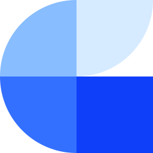

# Track

<figure><figcaption></figcaption></figure>

Track collects the events of your websites and apps. Run your own server-side tagging, and send events straight into your data warehouse with tracking tags.

<table data-view="cards"><thead><tr><th width="48"></th><th></th><th></th><th data-hidden data-card-target data-type="content-ref"></th></tr></thead><tbody><tr><td><i class="fa-server"></i></td><td><strong>Server-side tagging</strong></td><td>A tagging server of your own, on your own domain.</td><td><a href="../server-side-tagging/README.md">Server-side tagging</a></td></tr><tr><td><i class="fa-code"></i></td><td><strong>Tracking tags</strong></td><td>Track web and app events straight into your data warehouse.</td><td><a href="../tag-tracker/README.md">Tracking tags</a></td></tr><tr><td><i class="fa-link"></i></td><td><strong>Tracking Templates</strong></td><td>Add a click identifier to your ad URLs to tie each visit to the ad that drove it.</td><td><a href="../concepts/tracking-templates.md">Tracking Templates</a></td></tr></tbody></table>
